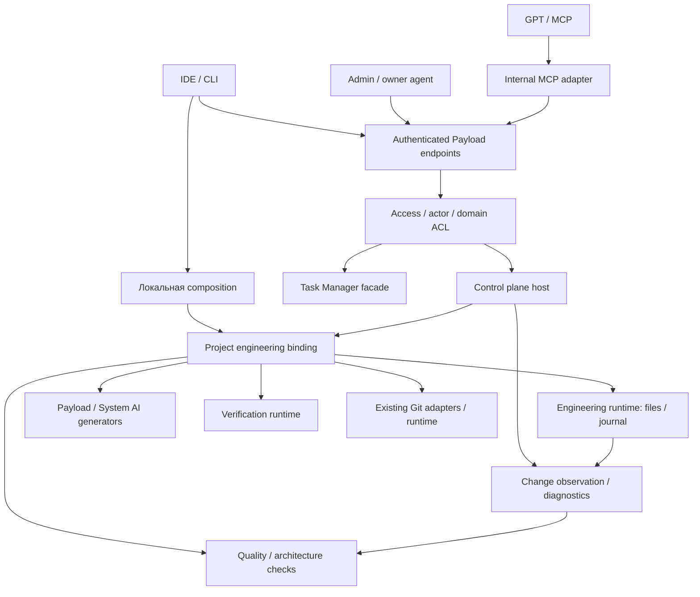

# ADR-0019: Общие инженерные операции для IDE, Admin и GPT

## Статус и область

`accepted-as-target`, 24 октября 2026 года. TASK-60 / ENG-02 программы
«Инженерные инструменты: задачи, файлы и архитектура». Документ выбирает
владельцев и границы. С 26 октября 2026 реализовано основание
`packages/engineering-runtime` (ENG-07), create FS adapter/project binding
(ENG-08) и exact-version edit для двух authored profiles (ENG-09). Новые
клиентские tools/scopes ещё не активированы. Границы этапов — §12–14 протокола
ниже.
Точные schemas, переходы и протокол восстановления определяются в ENG-03–06
до реализации ENG-07–30. `canonical_doc_decision: existing_doc_insufficient`.

Целевой протокол ENG-06 зафиксирован 25 октября 2026 года в
[engineering-operations.md](../engineering-operations.md): versioned DTO,
workspace/Git lock order, journal/recovery, generators, checks и bounded events.
Полный целевой протокол не означает готовность всех runtime adapters.

Частично **supersedes** [ADR-0015](ADR-0015-protected-system-ai-layer-and-installation-overlay.md):
запрет изменения repository System AI и произвольного native shell из Admin
сохраняется для installation overlay и обычных профилей, но не для отдельно
допущенного инженера владельца в разрешённой ему области.
Его действующий native runtime описан в
[интеграции Codex](../codex-integration.md#инженерный-режим-владельца-целевой-контракт).
Приоритет политик, licensing/security ceilings и immutable installation releases
сохраняются. Дополняет [ADR-0017](ADR-0017-internal-mcp-and-server-management.md)
в части будущих инженерных tools; [ADR-0016](ADR-0016-development-git-delivery-handler.md)
остаётся владельцем Git-процесса. Сам ADR не выдаёт новых полномочий.

## Основание

В проекте уже существуют Task Manager с ACL, транзакциями и replay,
авторизация инструментов, Git и verification runtimes, repository read bridge,
native owner-host и генераторы Payload/System AI. Общего типизированного
исполнителя изменения файлов на момент инвентаризации не было; CLI задач покрывает лишь часть API,
карты структуры авторские, архитектурного watcher/cache ещё нет.

Основание выбора — инвентаризация TASK-59 / ENG-01. Текущее размещение владельцев
проверяется по [структуре проекта](../project-structure.md), возможности Task
Manager — по его [спецификации исполнения](../../specifications/task-management-execution.md),
identity — по [доступам платформы](../platform-access.md).
История успешного запуска не означает готовности следующих этапов программы.

## Схема и владельцы

Один набор предметных операций обслуживает три входа. Клиент выбирает операцию,
а полномочия, проверки версии, изменения и результат проверяет её владелец.
Схема целевая; стрелка не означает предоставление полномочий.

MCP может вызывать существующий server facade внутри доверенного процесса;
HTTP hop не обязателен. Он сохраняет ту же проверку actor, scope и domain ACL.
Локальный binding получает полномочия оператора ОС, а не поддельную Payload-сессию.

| Владелец                                              | Ответственность и целевое размещение                                                                                                                                                                                                                                                                                                                                             |
| ----------------------------------------------------- | -------------------------------------------------------------------------------------------------------------------------------------------------------------------------------------------------------------------------------------------------------------------------------------------------------------------------------------------------------------------------------- |
| **ENG-07/09** `packages/engineering-runtime`          | Node runtime: plan/preview/apply, версии входов, workspace lease, durable journal, отмена, recovery и события; ENG-08 добавляет immutable content/create adapter, ENG-09 — exact-version edit через Linux atomic exchange с private backup. Публичные contracts отделены от server exports. Получает project descriptor, policy, generator и check ports; не импортирует browser/Next runtime, Payload, `.ai`, host `src`, MCP или модель. |
| **Начальный binding ENG-08** `.ai/tools/engineering`  | Native metadata, шаблоны и folder policies для `source.util`/`ai.template`; trusted callback читает rule/template/policy sources для core manifest. Расширенный каталог, регистрации генераторов/checks и CLI остаются целевыми. Binding предназначен для общих CLI и control plane adapters, без отдельного launcher.                                                           |
| `packages/payload-task-manager`                       | Единственный владелец проектов, листов, задач, их lifecycle/связей, membership ACL, транзакций, replay и истории. Новые операции добавляются в его contracts/server, не в файловый runtime.                                                                                                                                                                                      |
| `.ai/tools/task-workspace`                            | CLI задач, credentials adapter, уже существующий server-first intake и локальный fallback. Не превращается во второй сервер задач или общий файловый исполнитель.                                                                                                                                                                                                                |
| `packages/payload-access-management`                  | Личные credentials, scopes, device/login/refresh/revocation. Предметные ACL остаются у Task Manager и engineering admission; новых token vault или доверия к имени роли нет.                                                                                                                                                                                                     |
| `services/ai-control-plane/src/engineering`           | **Планируемый** host: workspace binding, admission, подключение общего исполнителя, состояние операций и ограниченное наблюдение за checkout. Существующий owner run lifecycle остаётся в `owner-engineering`.                                                                                                                                                                   |
| `.ai/tools/quality`                                   | Детерминированные проверки инструкций, структуры и будущего графа зависимостей; вход — ограниченный набор источников, выход — диагностика и hashes. Сканер не владеет UI, watcher, авторизацией или исправлением файлов.                                                                                                                                                         |
| `packages/git-runtime`, `.ai/tools/git-delivery`      | Существующие Git executor, locks и адаптеры действий. Инженерная операция не добавляет raw Git/shell endpoint и не меняет модельный маршрут доставки.                                                                                                                                                                                                                            |
| `packages/verification-runtime`                       | Запуск разрешённых checks, receipts и проверка их применимости. Выбор достаточных checks — policy вызывающего владельца; новый runtime не копирует runner.                                                                                                                                                                                                                       |
| `packages/payload-ai-plugin`, `services/internal-mcp` | Authenticated endpoints, Admin UI, MCP dispatch и перевод DTO. Не содержат вторую реализацию файловых, task или generator правил. MCP transport DTO остаются у `packages/ai-contracts`; предметные contracts импортируются у владельцев.                                                                                                                                         |

Пути планируемых adapters в таблице — места будущей реализации; фактические
ENG-07/08 owners выделены отдельно.
В core одна операция/адаптер/валидатор имеет собственную ответственность;
зависимости передаются через публичные contracts. Пакет не становится общим
хранилищем бизнес-логики задач, конфигурации ИИ и мониторинга.

## Входы и полномочия

- **IDE/CLI:** локальные файловые операции вызывают тот же core через project
  binding без обязательного сервера, БД или LLM. Installed Task Manager
  используется через его API и существующий login. Удалённый checkout доступен
  только через authenticated host; путь на клиенте не выбирает серверный root.
  Локальный режим выбирается явно; отказ удалённой авторизации не переключает
  операцию на локальные OS-права.
- **Admin:** текущая сессия и серверная owner-проверка допускают инженерное
  действие; host повторно проверяет binding, scope и policy перед записью.
  Браузер не получает OS flags, credentials или прямой доступ к процессу.
  Текущий HMAC grant/run admission расширяется для новых операций, не заменяется
  полем `authorized: true` в запросе.
- **GPT/MCP:** server-resolved личный actor и новые точечные engineering scopes,
  действующие grants и allowlist tools. Общий tunnel key или repository-read
  principal не становится владельцем. Персональная привязка, transport login
  и отзыв определены в [целевом ENG-05](../platform-access.md#единые-инженерные-полномочия-eng-05)
  от 25 октября 2026 года и проверяются реальным клиентом в ENG-22/29.
  Нынешние read-only подключения сохраняют прежние права.

Права на файл, запуск генератора, task mutation и Git delivery проверяются
раздельно. Уже выданное разрешение действует в своей области; подтверждение
каждой рутинной записи не требуется. Расширение области, commit/push/deploy и
изменение полномочий не выводятся из разрешения редактировать исходники.
Grant не восстанавливается из replay receipt; выдача сохранённого результата
также проверяет актуальный доступ. Матрица scopes принадлежит ENG-05;
точные operation DTO и протокол admission/recovery — ENG-06.

### Совместимость с native owner-host

Действующий owner-host сохраняет полные права своего пользователя ОС. По мере
внедрения workflow использует typed tools для поддержанных файловых действий;
работа с машиной и неподдержанные команды остаются явно native-операциями.
Запреты project API не изолируют shell того же пользователя.

Прямые изменения IDE/shell/генератора обнаруживаются по событиям и контрольной
сверке hashes. Они инвалидируют зависимые планы/receipts и отмечаются как внешние;
им нельзя приписывать actor, успешный apply или rollback общего исполнителя.
Watcher обнаруживает изменения постфактум. Полное принуждение всех OS-записей
к одному API потребовало бы отдельного режима изоляции и не входит в эту поставку.
Между проверкой версии и заменой файла возможна несогласованная native-запись:
общий lease предотвращает потерянные правки только между его участниками.
Для остальных writers предоставляются обнаружение конфликтов и диагностика
с явным покрытием, без гарантии предотвращения каждой гонки.

## Файлы, генераторы и три вида конфигурации

1. **Repository artifacts:** исходники, docs, `.ai`, `.codex`, авторские части
   карт. Тип артефакта определяет допустимое место, владельца, шаблон, обязательные
   metadata и связанные регистрации. Папка также имеет назначение; произвольное
   расширение файла не заменяет тип. Контракты и fallback неизвестного типа — ENG-03.
2. **Generated artifacts:** Payload types/importMap/migrations и derived-секции
   карт создаются зарегистрированным генератором из источников. Реестр хранит
   recipe/version, inputs/outputs и ограничения. Используются штатные Payload
   commands и существующий System AI publisher; новая шаблонизирующая система
   для их результатов не создаётся. `migrate:create` не разрешает DB apply.
3. **Installation AI configuration:** drafts, validation, compiler, immutable
   releases и activation остаются у `payload-ai-plugin`/`change-engine`. Это не
   файловая копия `.ai`. Repository System AI source публикуется существующим
   create-only publisher; изменение исходника не перезаписывает старый release
   и не активирует его автоматически.

Генератор вызывается по зарегистрированному ID с проверенными параметрами,
не через переданную моделью shell-строку. Если native generator не имеет
безопасного dry-run, preview создаётся в изолированной рабочей области с
зафиксированными входами. Выходной diff проверяется и применяется общим
исполнителем; запись вне объявленной области завершает операцию ошибкой.
Recipe, способ изоляции и ограничения каждого генератора проверяются в ENG-13.

Для `.ai/STRUCTURE.md`, `.codex/STRUCTURE.md` и каталогов ENG-15 определит
авторские и derived-секции, их маркеры и источники. Авторские пояснения не
перезаписываются. Упорядочивание и генерация детерминированы; повтор на тех же
входах не даёт diff. Устаревшая карта даёт диагностику, а обновление проходит
через тот же разрешённый план изменений.

## Согласованность, выполнение и восстановление

Общий lifecycle: **admission → plan/preview → apply → checks → receipt**.
Предпросмотр фиксирует входы и ожидаемые эффекты; действие может сразу исполняться
в пределах ранее выданного задания. Дополнительный LLM/review turn не является
обязательным этапом обычной детерминированной операции.

- Workspace binding задаёт canonical root, identity рабочей копии, policy и
  доверенный private state location. CLI и host используют один state/lease
  namespace для одного checkout; параллельные процессы не выбирают свои locks.
  Запрошенный путь не может сменить root или journal directory.
- Core сериализует свои записи workspace lease-ом; версии файлов и namespace
  проверяются повторно перед apply. No-follow FS guards и проверка принадлежности
  защищают границу инструмента. Первый write backend — Linux; существующие
  `/proc`/GNU `mv` примитивы переиспользуются только после проверки применимости.
  На неподдержанной ОС write недоступен, а слабая замена не включается молча.
- Run lease owner-host, Git lock и operation lease имеют разные обязанности.
  Нельзя держать operation lease весь модельный turn и затем ждать дочерний tool,
  который запрашивает его снова. Для mediated изменений checkout порядок —
  workspace lease, затем существующий Git lock при необходимости; владение и
  делегирование вложенному действию проверяются, а не изображаются флагом.
  Живой объект Git `existingLease` не является переносимым межпроцессным grant.
  Подключение Git adapters и recovery lock-order — обязательный контракт ENG-06/20.
  Текущие locks пока не дают общей взаимной блокировки всех этих входов.
- Нет общей транзакции filesystem + генератор + Task Manager. Journal хранит
  стадии, command hash, request identity, версии и фактические эффекты. После
  неизвестного исхода сначала читается состояние; новый ключ не создаётся ради
  повторной записи. Task DB-транзакция не удерживается во время FS/процесса.
- Recovery учитывает частичное выполнение. Компенсация допустима лишь если
  изменяемая версия всё ещё совпадает; чужая последующая правка не затирается.
  Ошибка привязки результата к задаче не отменяет уже состоявшуюся запись файла:
  результат сохраняется для reconcile и не объявляется полным успехом.
- Отмена, timeout и завершение процесса имеют явный результат и реальный handle.
  Долгая операция возвращает ID/события; клиент ожидает завершение или выполняет
  ограниченную сверку после переподключения. Частый пустой polling не требуется.

Journal и резервные данные находятся в private runtime storage, не в Git и не
в публичном DTO. Ответ ограничен summary, paths/hashes, стадиями и ссылками на
доступный результат; секреты и полное содержимое файлов не публикуются по умолчанию.

## Task Manager и локальная работа

Task Manager сохраняет authoritative задачи. Общий engineering journal содержит
ссылку на задачу и evidence, но не вторую карточку/lifecycle. Создание задачи
через Admin/API/MCP не создаёт локальный `TASK.md`.

Если платформа, БД или Task Manager ещё не установлены либо подтверждённо
недоступны, используется существующий локальный fallback. Ошибка прав, validation,
конфликт или неизвестный исход POST не служат основанием создать дубликат.
При восстановлении связи существующий intake/reconcile связывает одну задачу;
remote state становится основным, автоматического зеркала каждой задачи нет.

Переходы задач, закрытие/архив, parent/dependencies/order, перемещение между
листами, критерии результата и область полномочий определяются в ENG-04 и
реализуются в ENG-16–20. Существующие IDs, записи, receipts/replay и ACL должны
сохраниться при миграции. CLI и MCP используют эти операции, а не пишут в БД.
Доставка Git связывает verified observations через существующего владельца;
переданный агентом hash сам по себе не подтверждает результат.

## Архитектурное наблюдение и стоимость проверок

Host наблюдает события core и внешние изменения checkout. Ограниченная очередь
объединяет затронутые пути; quality-owner проверяет структуру, registrations,
generated drift и направления импортов/циклы. Целевая связка переиспользует
имеющиеся source readers/import resolver, а не создаёт второй сканер в Admin.
Локальная команда может выполнить те же checks без постоянно работающего host.

Диагностика хранит workspace/version, rule/recipe version, coverage и состояние
очереди. Watcher не является источником истины: startup, переполнение очереди,
пропуск событий или переподключение требуют ограниченной сверки. До неё результат
`stale/incomplete`, а не `passed`. Cache привязан к inputs, policy и runtime;
он не кэширует разрешение доступа. Admin читает историю через authenticated API.
Автоматическое исправление импортов/карт — отдельная разрешённая операция.

Verification runtime проверяет предоставленный план checks и пригодность receipts.
Он пока не выводит минимальный набор автоматически; platform recipes содержат
`full` inputs и `never` reuse для части checks. ENG-06/20/29 должны определить
достаточный выбор и freshness для каждого потребителя, сохранив проверки внешнего
состояния. Commit/push использует действительные результаты неизменённых входов,
если policy допускает reuse; stale/failed/недостаточное покрытие требует проверки.
Обычная файловая операция, сбор evidence или обновление derived-карты не запускает
полный suite или модельный review автоматически.

## Границы поставки и последующие решения

- **ENG-03–06:** типы/папки и owners, task lifecycle, identity/grants, затем schemas,
  idempotency, lease/recovery, generator и verification protocols. Эти контракты
  должны закрыть вопросы выше до начала общего executor.
- **ENG-07–15:** core, файловые операции, штатные generators и derived maps.
  **ENG-16–20:** расширение Task Manager и bindings без второй модели задач.
- **ENG-21–23:** CLI/IDE, персонально авторизованный MCP и Admin через общих
  владельцев. Новые write capabilities включаются только после их проверки.
- **ENG-24–27:** очередь, cache, architecture checks и наблюдение в Admin.
  **ENG-28–30:** сквозная приёмка, конкуренция, recovery, расходы и включение.

Первая поставка рассчитана на один явно привязанный Linux checkout на host,
с несколькими согласованными клиентами. Общий journal не является распределённой
блокировкой нескольких машин/NFS. Удалённый произвольный shell/SQL endpoint,
универсальный plugin generator framework, принудительная изоляция native shell,
отдельный task store и новый учёт расходов внешних IDE/CLI не входят в программу.

Критерий архитектурной приёмки: одна предметная операция и результат при разных
входах, серверные полномочия, проверяемые версии, отсутствие потерянных правок
между участниками общего lease и дубликатов после retry, ограниченная стоимость
проверок и честная диагностика
неполного состояния. Runtime-подтверждение этих свойств относится к последующим
задачам; этот ADR фиксирует решение, а не свидетельство его реализации.
