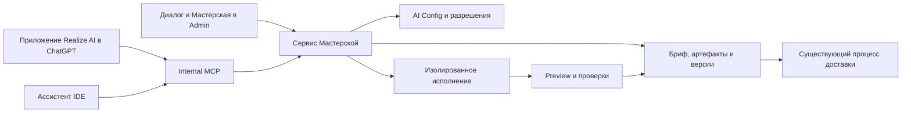

# Мастерская дизайна Realize — продукт и агентский процесс

Версия **0.11**, 2026-10-19. Статус: **W1a и первый UI установлены; Template SDK/Realize и переключение Admin внедрены; файловое ядро, durable jobs и capture preview реализованы в исходниках; выпуск пакетов из Мастерской остаётся целевым**.
Требования к общей Мастерской, трём каналам и предустановке заданы пользователем.
Backend W1a и первый интерфейс установлены в основную локальную админку
`http://localhost:3000/system/workshop`. Production bundle проверен на отдельной
копии БД перед установкой; миграция сохранила прежние данные.
Целевой runtime, AI-диалог и запись через ChatGPT ещё не доступны.

## 1. Результат

Мастерская создаёт и развивает референсы, интерактивные макеты, компоненты,
интерфейсы модулей и темы Admin/frontend внутри существующего проекта Realize.
Пользователь описывает задачу в админке, ChatGPT или IDE, видит результат,
оставляет замечания и продолжает ту же работу в другом канале.

Единица работы — **дизайн-проект с версиями результата**, а не отдельная реплика
модели. В нём сохраняются бриф, источники, дизайн-решения, компоненты, состояния,
изменения, предпросмотр, проверки и обратная связь. Диалоги ссылаются на него;
смена чата не создаёт копию проекта автоматически.

Разделение в продукте:

- **Мастерская** — создание, эксперименты, сравнение и развитие результата.
- **Темы и шаблоны** — каталог совместимых выпусков, настройка и применение.
- **Task Manager** — постановка, назначения и контроль работ; он связывает
  дизайн-проект с задачей, но не заменяет хранилище версий и исполнитель.
- **Агентский слой** — профили, инструкции, доступные действия и процессы.

Документ уточняет DEV-01–03, DEV-05–08, DEV-12–16, DEV-18–23 и THEME-01–14
из [функционального каталога](../product-functional-catalog.md).
Разработка бизнес-логики модуля продолжает обычный backend/Code Lane процесс;
макет модуля сам по себе не создаёт production API, таблицы или интеграции.

## 2. Что есть в репозитории

Проверено 2026-09-25 по коду и [контексту проекта](../project-context.md).

| Возможность                 | Фактическое состояние                                                                                                                                                       | Как использовать                                                                                                                          |
| --------------------------- | --------------------------------------------------------------------------------------------------------------------------------------------------------------------------- | ----------------------------------------------------------------------------------------------------------------------------------------- |
| Мастерская в навигации      | `workshop` ведёт на `/system/workshop` и виден по умолчанию; `SystemAdminPayloadEntry` добавляет вход в Payload                                                             | Пользовательские настройки видимости сохраняются; скрытый пункт доступен через «Ещё»                                                      |
| Первый интерфейс            | Каталог, создание, бриф/материалы/текстовые файлы, review/apply и история в `packages/payload-ai-plugin/src/admin/design-workshop/`                                         | Работает через W1a API; host подключает общий shell и auth; preview/AI-диалог ещё отсутствуют                                             |
| Хранилище макетов W1a       | `packages/payload-ai-plugin/src/design-workshop/`: личные проекты, versioned snapshots, prepare/apply, CAS и durable receipts; migration применена локально                 | Общий backend для следующих Admin/MCP адаптеров; исходники макета хранятся в БД и не исполняются                                          |
| Файловое ядро и capture W1b | `services/ai-execution-worker/src/design-workshop/`: exact revision, manifest, receipt/recovery, очередь с lease и React/Chromium capture; подключены к общему worker и API | Новая migration ещё не установлена в основной БД; UI-кнопки, MCP tools и интерактивный preview отсутствуют                                |
| Task Manager                | Общий интерактивный референс в `src/components/admin/task-manager/reference/`; публичный и защищённый маршруты                                                              | Первый сценарий доработки; не выдавать fixtures за реальные задачи                                                                        |
| Темы интерфейса             | UI-kit хранит default tokens/runtime, concrete shell/navigation palette — `packages/template-realize/`; Payload имеет отдельный host adapter                                | Realize Admin `0.1.0` и Payload ↔ Realize внедрены; fixed reference сохранён; frontend renderer и Workshop package producer ещё не готовы |
| Инструкции референсов       | Есть [reference-to-frontend workflow](../../.ai/workflows/frontend/next-react/guardrail/WORKFLOW.md#reference-to-frontend)                                                  | Сохранить как процесс исследования и реализации UI                                                                                        |
| Конфигурация AI             | Восемь типов артефактов, редактор workflow, validation, immutable AIConfigRelease, activation/rollback                                                                      | Расширять существующую модель и UI                                                                                                        |
| Исполнение workflow         | `agent_turn`, `request_input`, `capability`, `check`, `branch`, `finish`; bounded graph без циклов; capability готовит DataOperation dry-run                                | Нужны новые зарегистрированные действия Мастерской, их исполнение и передача вложений                                                     |
| Admin chat                  | Текущий agent turn анализирует контекст; отдельный Code Lane запускает Codex в worktree из HEAD                                                                             | Обычный чат пока не является исполнителем дизайн-правок                                                                                   |
| Internal MCP / ChatGPT      | S1 и Repo/Git/Pages read; локальное облачное соединение проверено пользователем и tunnel-метриками                                                                          | GPT может читать инструкции; patch/write/preview tools ещё не зарегистрированы                                                            |
| Code Lane / delivery        | Изолированное исполнение, проверки, review, preview; отдельное продвижение в GitHub branch/draft PR                                                                         | Переиспользовать владельцев, сохраняя отдельную авторизацию доставки                                                                      |

Актуальные исходные контракты: [AI-layer](realize-ai-commerce/v1.0/01-architecture/10-ai-codex-layer-integration.md),
[MCP](internal-mcp.md), [Task Manager](task-management.md),
[системная оболочка](../architecture/system-admin-shell.md).

## 3. Сравнение подходов

Изучены официальные тексты на 2026-09-25. Продукты не запускались для этого
исследования; это сравнение документированных подходов, не оценка качества
генерации и не визуальный benchmark. Тарифы и полнота возможностей не сравниваются.

| Источник                                                                     | Наблюдение                                                                                                    | Проектное решение для Realize                                                                     |
| ---------------------------------------------------------------------------- | ------------------------------------------------------------------------------------------------------------- | ------------------------------------------------------------------------------------------------- |
| [Lovable: Plan mode](https://docs.lovable.dev/features/plan-mode)            | Обсуждение, согласуемый план и выполнение представлены разными режимами; планы имеют историю                  | Отделить исследование, черновую реализацию и применение; объём планирования зависит от задачи     |
| [Lovable: ChatGPT app](https://docs.lovable.dev/tips-tricks/chatgpt-app)     | Документация текущей начальной интеграции описывает создание проекта из ChatGPT и дальнейшие правки в Lovable | Поддержать повторные правки одной версии через MCP; не ограничивать ChatGPT стартовым запросом    |
| [v0: Design mode](https://v0.app/docs/design-mode)                           | Выбор элемента в preview, точные визуальные изменения и текстовое поручение приводят к новой версии кода      | Связать замечание с элементом и ревизией; показывать diff и состояние сохранения                  |
| [v0: Design Systems 2.0](https://v0.app/docs/design-systems-2)               | Повторное использование опирается на реальные пакеты, примеры потребителей, tokens и проверяемый starter      | Давать агенту контракт установленной дизайн-системы и примеры, проверять переносимость результата |
| [Bolt: Project settings](https://support.bolt.new/settings/project-settings) | Контекст проекта сохраняется отдельно от короткой истории чата; восстановление backup может создавать fork    | Хранить дизайн-контекст как данные проекта; восстанавливать старый результат новой версией        |

Вывод для архитектуры: качество обеспечивается постоянным контекстом,
дизайн-системой, работающим preview и проверяемыми итерациями. Один длинный
system prompt не заменяет эти механизмы. Это наше проектное решение по итогам
сравнения, а не утверждение о внутренней архитектуре конкурентов.

### 3.1. Критерии конкурентного качества

Повторная сверка официальных документов 25 сентября 2026 года:
[Lovable Build mode](https://docs.lovable.dev/features/agent-mode) описывает
агентное изменение и проверку приложения;
[preview toolbar](https://docs.lovable.dev/features/preview-toolbar) — выбор
элементов, текстовые правки, рисунки и комментарии. Эти возможности входят
в baseline сравнения. [v0 Design Systems 2.0](https://v0.app/docs/design-systems-2)
опирается на реальные компоненты и tokens команды.

Требование «лучше конкурентов» проверяется на одинаковых задачах; оно не
означает уже достигнутого превосходства. Для Realize обязательны:

| Сценарий оценки                                  | Критерий приёмки                                                                                                                                                         |
| ------------------------------------------------ | ------------------------------------------------------------------------------------------------------------------------------------------------------------------------ |
| Task Manager: правка из GPT, продолжение в Admin | Одна revision, сохранённый brief и замечания; без ручного переноса файлов и повторного объяснения задачи                                                                 |
| Специализированная работа                        | Профили исследования, UX, визуального дизайна, реализации и проверки имеют доступные tools и понятные результаты этапов; можно менять pipeline через существующий Config |
| Качество макета                                  | Иерархия, typography, плотность, состояния, responsive и accessibility проверены по общей rubric, включая 390/768/1440 и клавиатуру                                      |
| Точная итерация                                  | Замечание привязано к версии и элементу; незатронутые решения сохраняются; preview соответствует новой версии, ошибка не маскируется старым результатом                  |
| Стоимость и управление                           | Видны исполнитель, статус и известный расход; детерминированное применение подготовленных GPT файлов не запускает дополнительного Codex агента                           |
| CMS и переносимость                              | Тема использует установленные tokens/components, проверяется для выбранных Admin/frontend adapters и применяется обратимо                                                |
| Надёжность                                       | Повтор запроса, потеря соединения, конкурентная правка и рестарт не повреждают предыдущий результат; чужие проекты и секреты недоступны                                  |

Сравнительный прогон фиксирует дату/версию конкурента, одинаковый brief,
число исправляющих итераций, время до проверенного preview, известный расход
и оценку дизайна по одной rubric. Документация конкурента подтверждает только
описанную возможность; она не является нашим browser benchmark. Специализация
ролей не требует пяти отдельных платных model calls на каждую правку.

## 4. Объекты и режимы

| Результат             | Что получает пользователь                                                                    | Граница готовности                                                                                                                    |
| --------------------- | -------------------------------------------------------------------------------------------- | ------------------------------------------------------------------------------------------------------------------------------------- |
| Референс              | Проверенные источники, композиция, визуальное направление, пояснения                         | Исследование или изображение не называется работающим интерфейсом                                                                     |
| Интерактивный макет   | Реальные React-компоненты и сценарии на fixtures                                             | Явно указаны демонстрационные данные и ограничения сохранения                                                                         |
| Компонент             | API/props, варианты, состояния, tokens, примеры использования                                | Проверен в реальных потребителях и изолированном примере                                                                              |
| Интерфейс модуля      | Связанные экраны, переходы, DTO-потребности и права пользователя                             | Backend отдельно отмечен как существующий, подготовленный или отсутствующий                                                           |
| Тема Admin / frontend | Версионный пакет оформления и адаптеры выбранных поверхностей                                | Подтверждены совместимость, состояния и способ применения/возврата                                                                    |
| Шаблонный пакет       | Самодостаточная композиция, настройки, палитры, собственные UI-примитивы и публичные exports | Проверены единый контракт, пакет на двух hosts и общий install/activation lifecycle; текущий snapshot сам по себе пакетом не является |

Режимы действий в диалоге:

1. **Исследовать** — понять задачу, собрать образцы, сравнить направления.
2. **Создать / доработать** — менять разрешённый черновик с предпросмотром.
3. **Проверить** — оценить конкретную версию, воспроизвести сценарии, дать замечания.
4. **Подготовить к применению** — представить точный пакет изменений и проверки.

Тип результата, режим действия и модель-исполнитель — разные настройки.
Для простой правки в принятом стиле не нужны новый конкурентный анализ и
несколько новых направлений. Если пользователь дал точный референс, сначала
сравнивается он; вариативная генерация не подменяет соответствие.

## 5. Один процесс, три канала

Это целевая схема. Transport adapters вызывают один application service;
они не пишут в файловую систему или БД в обход него. MCP получает узкие DTO,
а не raw Payload documents. Установка и actor определяются сервером.

**Admin.** В диалоге можно начать дизайн-проект, приложить материалы и открыть
его в Мастерской. Карточка показывает текущую версию, стадию, preview, замечания
и следующий доступный шаг. В полноэкранном разделе: библиотека проектов,
чат/материалы, preview, инспектор компонентов/tokens, версии и проверки.
На узком экране области переключаются вкладками. Маршрут `/system/workshop`
реализован в system shell; полный набор областей остаётся целевым.

Первый UI-срез над W1a: `/system/workshop` — личный каталог, а
`/system/workshop/[projectId]` — бриф, материалы, текстовые файлы и история.
Сервер проверяет admin до открытия страницы; API отдельно проверяет permission
и владельца каждого проекта. Публичная ссылка не даёт доступ к чужому проекту.
Входы находятся в Payload «Рабочая область» и в системной навигации. Сохранённые
пользователем настройки видимости разделов не сбрасываются.

Редактирование создаёт несохранённый draft в памяти вкладки. Сохранение проходит
через подготовку кандидата, просмотр изменённых значений и явное применение
показанного кандидата. Повтор после сетевой ошибки использует тот же ключ
операции; конфликт версий сохраняет ввод и требует явного обновления базы.
Переход на другую страницу предупреждает о несохранённых изменениях.
Явная отмена черновика требует подтверждения и возвращает открытую сохранённую
версию без записи в БД. Возврат в каталог использует общую контекстную строку shell.
Историческая версия открывается только для чтения; взятие её за основу создаёт
draft относительно текущей версии и сохраняется обычным prepare/apply.
Текст файлов отображается как текст, без исполнения HTML/JS/SVG в Admin.
UI не называет сохранённый snapshot работающим preview, не показывает
неподключённый чат как действующий и не инициирует model calls.

**ChatGPT.** Приложение находит или создаёт тот же дизайн-проект, читает его
контекст и готовит правки. MCP возвращает подтверждённые receipts, ссылки на
preview, версии и результаты проверок. Следующая реплика меняет выбранную
версию, а не генерирует новый несвязанный проект. Минимальный интерфейс — tools
и защищённая ссылка; встроенная карточка/preview внутри ChatGPT — отдельное
улучшение после проверки возможностей клиентского SDK и доставки ресурсов.

**IDE.** Ассистент использует те же инструкции и workspace binding. Локальные
несохранённые изменения не входят автоматически в Git HEAD. Импорт рабочей
копии требует явного manifest с hashes, исключения секретов и подтверждения
базы; прямые локальные правки нельзя объявлять сохранённой версией Мастерской
до регистрации и проверки. При отсутствии этого runtime IDE выполняет обычную
локальную задачу и передаёт честный отчёт о файлах/проверках.

Перенос контекста происходит через brief/revision/decision records, а не через
скрытое копирование всего чата. Два клиента, меняющие одну базу, получают
revision conflict; интерфейс предлагает обновить базу или создать вариант.
Отмена preview-правки и восстановление сохранённой версии имеют разные действия.

## 6. Исполнитель и расход лимитов

| Исполнение               | Кто создаёт содержимое                               | Что делает Realize                                                                                                  |
| ------------------------ | ---------------------------------------------------- | ------------------------------------------------------------------------------------------------------------------- |
| `client_authored`        | GPT в текущем ChatGPT-диалоге или ассистент IDE      | Принимает bounded patch/структурированные операции, проверяет scope, сохраняет, строит preview и выполняет проверки |
| `server_agent`           | Явно выбранный доступный provider из Admin           | Запускает задачу с выбранным профилем, моделью и бюджетом; сохраняет реальный job и результат                       |
| Детерминированная правка | Пользователь меняет поддержанный token/prop через UI | Выполняет типизированную операцию без обязательного нового модельного вызова                                        |

Первый сценарий ChatGPT проектируется как `client_authored`. MCP не запускает
Codex автоматически для применения полученного patch. Запуск Code Lane/Codex
или другой серверной модели — отдельный явно выбранный способ исполнения.

Подписка ChatGPT и OpenAI API имеют отдельный billing; серверные API-вызовы
не покрываются подпиской автоматически. [OpenAI: billing](https://help.openai.com/en/articles/9039756-managing-billing-for-chatgpt-and-the-api-platform).
Нельзя обещать точный остаток ChatGPT/Codex allowance, если интеграция его
не сообщает. В Admin показываются исполнитель, источник оплаты, доступные
лимиты и измеренный расход; неизвестные значения остаются неизвестными.
Preview, storage, browser checks и генерация изображений также имеют свои
ресурсы. Credentials разных клиентов сохраняются через Admin/vault.

## 7. Предлагаемая модель и владельцы

Таблица описывает полную целевую модель. Проекты, snapshots брифа/материалов,
revisions и prepared changes реализованы в ограниченной поставке W1a (§12).
Остальные сущности и поля не следует считать существующим runtime.

| Сущность         | Существенный контракт                                                                                                                                          |
| ---------------- | -------------------------------------------------------------------------------------------------------------------------------------------------------------- |
| `DesignProject`  | Установка, owner/access, target, тип результата, текущий brief, ссылки на диалоги и при наличии настоящую задачу                                               |
| `DesignBrief`    | Revision, цель/аудитория, экраны, сценарии/состояния, стиль, ограничения, критерии и предположения                                                             |
| `DesignSource`   | Тип, источник, дата, наблюдение, статус визуального просмотра, права использования assets; содержимое недоверенное                                             |
| `DesignRevision` | Immutable ID/hash, parent revision, база исходников, artifact manifest, patch receipt, автор и канал                                                           |
| `DesignFeedback` | Revision, экран/состояние/элемент, замечание, критерий и статус решения; привязка к устаревшему элементу видна                                                 |
| `DesignRun`      | Ссылка на существующий execution/workflow run, выбранный executor, pinned configuration, status/progress и evidence; не второй scheduler                       |
| `DesignPackage`  | Принятая revision, тип/версия пакета, immutable digest, targets, зависимости, общий package manifest, evidence и лицензии assets; для шаблонов контракт из §11 |

Бинарные материалы и screenshots хранятся как артефакты с digest и ACL;
в DTO возвращаются метаданные и ограниченные ссылки. Нужны quotas, retention,
экспорт и очистка с учётом ссылок на принятые версии. Локальная `.ai-workspace`
остаётся рабочим каталогом IDE и не становится multi-user storage продукта.

`taskID` не является обязательной зависимостью дизайн-проекта. Связь с постоянным
Task Manager проходит через его owner и реальные IDs; fixture ID нельзя
выдавать за настоящую задачу. Foundation задач не подтверждает полный execution
контур Мастерской.

| Слой                             | Ответственность                                                                                                                                   |
| -------------------------------- | ------------------------------------------------------------------------------------------------------------------------------------------------- |
| `packages/ai-contracts`          | DTO, versioned commands, errors и manifests                                                                                                       |
| `packages/change-engine`         | Общая policy, capability validation, prepare/apply semantics; без Transport/React                                                                 |
| `packages/payload-ai-plugin`     | Installation persistence, API facade, actor/access, связи с Config/AIRun и chat UI                                                                |
| `services/internal-mcp`          | Схемы tools и адаптация к тому же facade                                                                                                          |
| Существующий execution worker    | Workspace lease, выполнение разрешённых jobs/checks, preview lifecycle и receipts                                                                 |
| `packages/ui-kit`                | Reusable primitives, tokens, runtime активного UI adapter и объявленный default fallback; concrete shell принадлежит template package             |
| Template SDK и конкретные пакеты | `packages/template-contracts` — общий manifest/presentation контракт; `packages/template-realize` — первая внедрённая Admin реализация            |
| Общий менеджер расширений        | Целевой владелец install/update/replace/activation: один lifecycle из [ТЗ расширений](extension-management.md); не отдельный installer Мастерской |
| `.ai` / `.codex`                 | Канонические инструкции процесса / тонкий адаптер IDE                                                                                             |

Это распределение предполагает расширение существующих владельцев. Создание
отдельного универсального workflow engine, Git delivery или secrets store
для Мастерской не требуется. Новые domain-файлы выбираются при реализации
по принятому стандарту структуры; этот документ не предписывает монолитный service.

## 8. Настраиваемый процесс в Admin

Базовый маршрут: **бриф → исследование → направление → компоненты/tokens →
интерактивная версия → проверки → замечания → принятая версия**.
Неприменимые этапы пропускаются с причиной. Новая правка возвращает процесс
к затронутому этапу и создаёт новую версию; принятые evidence не переносятся
на изменившийся результат автоматически.

Используется существующий редактор «Настройки → Агентский слой → Рабочие
процессы», AIConfigRelease и runtime сегментов. В Мастерской нужен понятный
выбор шаблона, параметров и progress, с переходом к этому редактору для сложной
настройки. Не создавать второй независимый каталог ролей/skills/workflows.

Предлагаемые presets:

- `workshop.reference` — бриф, источники, направление и интерактивный референс.
- `workshop.component` — контракт, reuse, состояния, примеры и review.
- `workshop.theme` — foundations, tokens, adapters, галерея потребителей и review.
- `workshop.template` — starter/fork, весь layout, UI adapter, настройки, палитры, package checks и подготовка выпуска; целевой preset, ещё не установленный workflow.
- `workshop.refine` — замечание к версии, локальная правка и затронутые проверки.

Администратор выбирает включённые этапы, роли/профиль исполнителя, источники,
доступные tool bindings, модель, бюджет/таймаут, целевые поверхности,
обязательные проверки и точки человеческого решения. Сохранение черновика,
выпуск и активация остаются разными существующими действиями.

Отображение на текущие типы шагов:

| Шаг             | Использование                                                   | Недостающая реализация                                                                         |
| --------------- | --------------------------------------------------------------- | ---------------------------------------------------------------------------------------------- |
| `agent_turn`    | Анализ brief, направления, подготовка содержимого               | Typed artifact inputs/outputs и executor selection для дизайн-задачи                           |
| `request_input` | Существенное уточнение или выбор направления                    | Привязка ответа/вложений к brief revision; не механизм выдачи серверных прав                   |
| `capability`    | Подготовка draft change, preview/check job, package preparation | Зарегистрированные domain capabilities; текущий DataOperation dispatcher не умеет эти операции |
| `check`         | Проверить receipt и evidence точной revision                    | Реестры проверок дизайна и owner для их исполнения                                             |
| `branch`        | Выбрать объявленный путь по typed результату                    | Никаких произвольных JS/команд из prompt                                                       |
| `finish`        | Закончить bounded этап с typed outcome                          | Честное различение подготовлено, проверено, принято                                            |

Текущий граф запрещает циклы. Итерация по замечаниям — новый запуск/сегмент
над выбранной revision, а не обход ограничения через бесконечный retry.
Асинхронный preview/check выдаёт job ID и durable checkpoint; отключение чата
не теряет работу. Timeout, `failed`, `cancel_requested`, `cancelled` и recovery
требуют явных переходов владельца runtime. Cancel не означает, что процесс
действительно завершён, пока это не подтверждено. Неизвестный результат apply
сначала восстанавливается по idempotency receipt.

Каждый run фиксирует release/profile/workflow hashes, версии инструкций,
design-system contract, brief/base revision, grants/policy snapshot и executor.
Текущие права перепроверяются при каждом действии: исторический snapshot
не позволяет продолжать запись после отзыва доступа.

## 9. Агентский слой и поставка по умолчанию

Канонический процесс находится в `.ai`. Подготовлены отдельная роль
[Workshop Director](../../.ai/roles/design/workshop-director/INDEX.md),
[маршрут Мастерской](../../.ai/workflows/frontend/design-workshop/WORKFLOW.md),
[бриф](../../.ai/templates/design/TEMPLATE-DESIGN-WORKSHOP-BRIEF.md) и
[проверка результата](../../.ai/checks/development/frontend/CHECK-DESIGN-WORKSHOP-REVIEW.md).
Они используют действующий frontend workflow и существующие роли разработки.

| Ответственность в процессе                                     | Реализация в агентском слое                                                                        |
| -------------------------------------------------------------- | -------------------------------------------------------------------------------------------------- |
| Бриф, направление, последовательность и целостность результата | Workshop Director                                                                                  |
| Поиск и оценка образцов                                        | Режим исследования Director; отдельный агент не обязателен                                         |
| Tokens, компоненты и реальный UI                               | Developer Frontend с reference workflow                                                            |
| DTO, сохранение, права и интеграции                            | Developer Backend по мере необходимости                                                            |
| Review версии и evidence                                       | Режим проверки по общему rubric; независимый reviewer только когда он действительно назначен/нужен |

Роли — обязанности, а не автоматический запуск пяти моделей и не ACL.
Один исполнитель может пройти несколько этапов. Самопроверка маркируется как
самопроверка; независимый review нельзя имитировать сменой имени в prompt.

Три способа доставки инструкций:

- **IDE:** `.codex/skills/design-workshop` направляет к каноническим `.ai`.
- **ChatGPT сейчас:** S1 `ai_context_resolve` / `ai_instructions_get` доставляют
  выбранные инструкции по hashes. ChatGPT не читает AGENTS автоматически;
  правило bootstrap должно быть в подключённом приложении/профиле и вызываться
  агентом. S1 сообщает truncation и неоднозначные связи, их нельзя игнорировать.
  `.ai/templates` не входит в текущую S1 policy: workflow содержит необходимые
  поля брифа/передачи, отдельная локальная форма остаётся необязательной.
- **Admin, целевая поставка:** build/versioned preset преобразует разрешённые
  инструкции в typed skill/role/prompt/workflow artifacts существующего Config.
  Manifest фиксирует source hashes; compiler проверяет system ceiling. Нужны
  реализация publisher и parity tests, сейчас автосинхронизации файлов в БД нет.

Пакет платформы содержит базовые инструкции, manifests и совместимые шаблоны
Мастерской. **Предустановленность не означает автоматически выданные права**:
новая установка получает catalog entry/readiness; owner подключает клиента и
разрешает области работы через Admin. Установка приложения в личный аккаунт
ChatGPT всё равно требует подключения пользователем; платформа не делает это
за владельца аккаунта.

Обновление presets идемпотентно и версионно: изменённый клиентом профиль не
перезаписывается. Новый baseline предлагается как новая версия с diff;
локальные настройки остаются overlay. Upgrade проверяет совместимость,
missing capabilities и миграции; downgrade инструкций не откатывает данные.
Неподдержанный preset не активируется с фиктивными bindings. До готовности
write runtime доступен только явно обозначенный режим анализа.

## 10. Инструменты и управляемая запись

Следующие семейства **предлагаются**, в текущем MCP их нет. Стабильные имена
и строгие schemas уточняются в контрактной поставке до регистрации tools.

| Семейство                                                                   | Назначение                                            | Доступ / эффект                                   |
| --------------------------------------------------------------------------- | ----------------------------------------------------- | ------------------------------------------------- |
| `workshop_project_list/get`, `workshop_context_get`                         | Проект, brief, выбранная revision, доступные операции | Scoped read                                       |
| `workshop_project_create`, `workshop_brief_update`, `workshop_feedback_add` | Сохранение проекта, brief и замечаний                 | Design metadata write, optimistic revision        |
| `workshop_artifact_read`, `workshop_revision_get`                           | Артефакты и версии того же workspace binding          | Scoped read, limits/ACL                           |
| `changes_prepare/get/apply`                                                 | Точный patch/структурированная операция в черновике   | S4 draft write, server-derived scope, idempotency |
| `workshop_preview_start/get`, `workshop_checks_start/get`                   | Реальные jobs для конкретной revision                 | Execute grant, registered worker/check IDs        |
| `workshop_package_prepare/get`                                              | Совместимый пакет и diff для review                   | Package preparation; ещё не установка/публикация  |

Существующие repository reads при работе в draft должны использовать тот же
server-owned `workspaceBindingID`, что patch/check/preview. Чтение из основной
копии при записи в другую копию недопустимо. MCP tool annotations отражают
реальный эффект; возвращать writes как `readOnly` нельзя.

Основной контракт изоляции и восстановления остаётся в
[internal MCP §4.6 и §16.5](internal-mcp.md). Для первой версии:

- Сервер создаёт/привязывает изолированную рабочую копию и immutable base;
  client не передаёт произвольный абсолютный repo path. По умолчанию — чтение.
- Prepare сохраняет hashes, точный diff, затронутые пути, policy и checks.
  Apply проверяет текущую базу, actor/grants, lease и idempotency receipt.
- Multi-file запись имеет durable journal/recovery; hash-check плюс rename
  в общем checkout не объявляется атомарной транзакцией или compare-and-swap.
- Каталоги secrets, generated outputs, системные инструкции, package lifecycle
  scripts и зависимости имеют отдельные ограничения. Даже разрешённый TSX
  исполняется в sandbox без production env, сетевых/DB credentials и admin cookies.
- Изменения инфраструктуры, permissions, `.ai`/`.codex` и AGENTS не следуют из
  разрешения создавать дизайн. Code execution также требует отдельной policy.
- Promotion, commit/push, установка темы, merge и deploy выполняются через
  существующих владельцев и свои разрешения. Принятие макета не равно release.

Preview работает на отдельном origin с ограниченным доступом и сроком жизни;
использует fixtures, sandboxed runtime, ограниченные network/CPU/time/storage.
URL не заменяет ACL. Screenshot/evidence связываются с content hash, viewport,
темой и сценарием. Подгруженный URL/HTML/asset проходит отдельный контролируемый
fetch с защитой от private-network redirects, лимитами и проверкой типа.

Identity пользователя ChatGPT нельзя вывести из текста запроса. Текущая
личная tunnel-интеграция использует выданного principal; многопользовательская
поставка требует проверяемого actor mapping/OAuth и isolation каждой установки.
Подтверждение от модели `approved: true` не заменяет авторизацию доверенного UI.
Обычные правки уже разрешённого draft не требуют повторного согласия на каждый
файл; изменение scope или применение к рабочей установке — отдельное действие.

## 11. Темы, компоненты и качество

### 11.1. Единый контракт самодостаточного шаблона

[ADR-0018](../architecture/decisions/ADR-0018-self-contained-template-packages.md)
фиксирует принятую целевую границу: один template contract family, один manifest
protocol и один lifecycle для Admin/frontend. Пакет поддерживает одну либо обе
поверхности; назначение каждой независимо. Различимые target/screen contracts
не заставляют frontend принимать Admin navigation или actor. Конкретный шаблон
содержит свою структуру, настройки, палитры, assets и реализации UI-примитивов;
его внутреннее дерево свободно. Стандартизируются публичные exports и поведение,
а не папки каждого поставщика.

Штатный Payload Admin остаётся встроенным вариантом host и обновляется вместе
с CMS; Мастерская не создаёт его копию или fork. Выбор Payload ↔ Realize не требует
второго собственного template package. Мастерская создаёт и выпускает Realize
и дополнительные пакетные шаблоны по этому контракту. Доступность штатного UI
для конкретного клиента и основной Admin вход принадлежат host policy,
описанной в [System Admin](../architecture/system-admin-shell.md#штатный-и-пакетный-интерфейсы-admin).

**Шаблонный пакет** поставляет код React renderer и UI adapter.
**Preset** содержит валидируемые данные для уже установленного совместимого
пакета: палитру, mode и настройки. Импорт preset не устанавливает новый renderer.
Light/dark — режим оформления, а не две реализации шаблона. Палитра включает
typography, spacing/density, colors, radii, elevation, focus/motion и состояния.
Admin и frontend не получают общий глобальный stylesheet только ради бренда.

Серверный manifest читается до выполнения кода и описывает одну неизменяемую
версию. Workshop, installer и host используют его общую schema из Template SDK;
AI DTO ссылаются на этот контракт, не создают второй формат. Таблица ниже
описывает целевое семейство контрактов. Реализованный protocol 1.0 проверяет
identity, compatibility, targets/screens, entrypoints, settings/defaults,
palettes/modes и UI adapter; publisher/license, assets, module overrides и
release/check recipes будут добавляться при развитии протокола.

| Группа            | Обязательные сведения                                                                                     |
| ----------------- | --------------------------------------------------------------------------------------------------------- |
| Идентичность      | ID/version, publisher, package identity, protocol version, лицензия                                       |
| Совместимость     | Platform/Next/React и SDK/UI contract versions, dependencies, targets                                     |
| Представление     | Exports/entrypoints, поддержанные screens/capabilities, presentation contract versions                    |
| Настройки         | Settings schema/version, defaults, UI metadata, правила совместимого обновления                           |
| Оформление        | Palette presets, modes, semantic token schema, fonts/assets с provenance и namespace                      |
| UI adapter        | Обязательные primitive slots, их версии и явно объявленное наследование fallback                          |
| Module overrides  | При наличии — точные module-view IDs и версии presentation contracts                                      |
| Проверки и выпуск | Внешний release/installation receipt: artifact digest, source revision, evidence, recipes и release notes |

Artifact digest относится к конкретному архиву и хранится во внешнем receipt,
а не внутри manifest этого же архива. Installer сверяет receipt и содержимое
пакета перед активацией.

Manifest не является shell-скриптом или произвольным import из БД. Соответствие
schema не делает код доверенным и не создаёт sandbox; источники и полномочия
проверяет существующая host policy.

### 11.2. Примитивы, модули и реактивное поведение

Пакет вправе предоставить собственные Button/Input/Dialog/Tabs и другие
требуемые slots. Их публичные props/ref/events и accessibility соблюдают SDK;
private components свободны. Модули разрешают активный UI adapter через общую
границу host/provider и не импортируют concrete template. Наличие Button внутри
пакета не меняет статически импортированный UiButton: потребители переводятся
адресно. Неполный обязательный adapter блокирует активацию; fallback допустим
только при объявленной совместимости, частично смешанный UI не скрывается.

Полная композиция Admin включает workspace/auth/status, navigation/header/main/
footer и responsive lifecycle. Backend, routes, session/ACL, DTO и commands
остаются у host/module owners. Module-view override получает versioned
presentation data/actions, не заменяет коллекции, access или историю задач.
Backend hooks/миграции принадлежат plugin-расширению с отдельным контрактом.

React/Next App Router и SSR сохраняются. Сервер передаёт serializable IDs,
versions, settings revision/mode и безопасные DTO; client host строит callbacks.
Полученные данные, состояние и настройки обновляют интерактивные компоненты
реактивно. Адаптивность viewport проверяется отдельно. Module controllers живут
выше заменяемого renderer: draft, frozen input/revision, pending UUID и known/
unknown outcome сохраняются. Retry использует прежнюю команду; unmount/abort
fetch не отменяет серверную операцию. До реализации этой границы switch при
dirty/pending блокируется. Effective palette/mode и tokens доходят до portals;
SSR и hydration используют один разрешённый выбор.

### 11.3. Создание, выпуск и применение

Мастерская — producer пакета, общий менеджер расширений — единственный installer.
Целевой сценарий: starter либо fork точной версии → DesignProject/revision →
layout/settings/palette/primitives → preview/checks → принятая revision →
immutable DesignPackage → общий каталог → install → preview/settings → apply.
Правка установленного шаблона создаёт следующую revision/версию, а не меняет
опубликованный артефакт. Source revision, task, commit/PR при наличии, digest,
build и activation receipt связываются явно; Workshop revision не равна Git SHA.

Новый React-код проходит управляемый build/delivery через существующего owner:
exact package/lockfile/registration, contract/type/build checks и runtime smoke.
Production HTTP request не выполняет npm install. Переключение совместимых
пакетов, уже включённых в текущий build, может не требовать новой сборки.
«Установлен» требует подтверждения package/build от runtime; «активен» обозначает
независимое назначение поверхности. Settings меняются с revision/CAS, preview
не меняет рабочую установку, сохраняются receipt и прежнее назначение.
Uninstall активного пакета требует рабочей замены. Возврат назначения и откат
build различаются; совместимость settings и доступность предыдущего пакета
проверяются. Recovery surface остаётся доступным при ошибке нового renderer.

Текущий W1a хранит только разрешённые virtual files `src/public`, не package.json
или служебный config. Будущий packager строит metadata из проверенной структуры;
существующий snapshot не является готовым npm-пакетом. Preview должен поддержать
pinned SDK/UI dependencies: нынешняя поддержка React/ReactDOM и относительных
imports этого не доказывает. Тип проекта `template`, package export, installer,
activation и Workshop-to-release bridge ещё требуют реализации. Первый этап
SDK, Realize package и host не объявляется готовностью этой цепочки.

### 11.4. Визуальная проверка

Visual inspector меняет только поддержанные tokens/props с обратным отображением
на исходники. Произвольный DOM selection не обещает надёжную AST-правку любого
компонента: неподдержанный элемент передаёт scoped замечание агенту. Реальная
запись всегда создаёт revision; временный DOM override не называется сохранением.

Готовность оценивается по [общему review rubric](../../.ai/checks/development/frontend/CHECK-DESIGN-WORKSHOP-REVIEW.md):
сценарий пользователя, композиция и иерархия, связная typography/spacing,
корректные данные и состояния, переиспользование, responsive, доступность,
browser evidence и совместимость. Указываются конкретные дефекты и evidence,
а не произвольная общая оценка «профессионально на 9/10».

Для темы Admin базовая галерея включает shell/sidebar, таблицу с фильтрами,
форму, modal/popover/portal, статусы/ошибки, empty/loading и длинный русский
текст; light/dark и 1440/768/390. Для frontend добавляются согласованные
публичные страницы; каталог/карточка/корзина обязательны только для магазина.
Accessibility проверяет keyboard/focus/labels/contrast/reduced motion по
затронутым компонентам; полная сертификация не выводится из одного автотеста.

Источник изображения может быть предоставлен, найден или сгенерирован при
наличии соответствующего инструмента. Сохраняются origin, условия использования,
alt и назначение. Сгенерированная картинка интерфейса служит направлением,
но не заменяет редактируемый React-макет и проверку работающих контролов.

### 11.5. Первый стандартный шаблон RealizeAI Control Panel

[Состав первого релиза и переход](RealizeAI Control Panel-first-release.md) уточняет
границы TASK-23 / ONE-04: развитие `realize` как плановой версии `0.2.0`,
сохранение настоящего baseline `0.1.0`, глобальный Admin и отдельный frontend,
auth/status, управление оформлением и gates интеграции. Это целевой план;
текущий установленный срез описан выше и не объявляется готовым RealizeAI Control Panel.

## 12. Порядок реализации и приёмка

### Контракт первой backend-поставки W1a

W1 делится на хранилище версий (W1a) и изолированное файловое исполнение
(W1b). W1a сохраняет логические текстовые файлы макета в PostgreSQL вместе
с брифом и материалами `link`/`note`. Snapshot имеет `schemaVersion: "1.0"`.
Снимок не исполняется; ссылки не загружаются.
`workspace.mode = stored_draft` и server-generated binding ID
явно отличают это состояние от будущего checkout. Нет S4 filesystem receipt,
preview URL, фонового агента или автоматического вызова Codex.

Владелец storage/API — `packages/payload-ai-plugin` (`design-workshop`),
строгих команд/DTO — `packages/ai-contracts`, чистой подготовки снимка/diff —
`packages/change-engine`. Источник истины — четыре приватные коллекции
проектов, immutable revisions, prepared changes и mutation receipts.
Встроенный CRUD коллекций закрыт; API требует настоящего Payload actor,
отдельного `canManageDesignWorkshop` (по умолчанию false) и владения проектом.
В текущей установке permission предоставляется Admin; проекты разных Admin
изолированы. Общий доступ и MCP grants добавляются отдельными адаптерами.

Базовый API `/api/realize-ai/workshop/projects`: создание/список, чтение
проекта, история и чтение revision, `changes/prepare`, чтение change и
`changes/:changeId/apply`. POST требует `Idempotency-Key`; actor, канал
`admin`, IDs, hashes и binding задаются сервером. Prepare принимает точную
base revision, операции put/delete и при необходимости новый бриф/материалы.
Сохраняются кандидат и обозримый diff; prepare не меняет current revision.
Apply одной PostgreSQL-транзакцией проверяет базу и владельца, создаёт
immutable revision, передвигает указатель и сохраняет receipt. Повтор того
же ключа/запроса возвращает исходный receipt даже после новых изменений;
другой запрос с тем же ключом или устаревшая база дают 409. Отказ записи
receipt откатывает всю транзакцию. Это атомарность DB-снимка, не файлов.

Точные DTO и поля команд находятся в
[DesignWorkshop.types.ts](../../packages/ai-contracts/src/DesignWorkshop.types.ts)
и [designWorkshop.schemas.ts](../../packages/ai-contracts/src/designWorkshop.schemas.ts).
Для сравнения правки возвращаются полный candidate и hash-diff; содержимое
«до» читается по immutable base revision. Бриф и материалы изменяются тем же
prepare/apply, отдельной mutable копии брифа нет. HTTP использует общий
`{ ok, correlationID, data/error }` envelope и `Cache-Control: no-store`.

Начальные границы: 64 текстовых файла, 128 KiB UTF-8 на файл, 1 MiB суммарно,
20 проектов на владельца, 100 revisions и 100 prepared changes на проект.
Prepared change действует 24 часа. Пути — логические относительные `src/`
и `public/`, только поддержанные текстовые расширения; traversal, служебные
и скрытые каталоги, известные служебные конфигурации/секреты/generated
запрещены. Содержимое остаётся недоверенным кодом. Превышение quota останавливает новую запись;
очистка, бинарные assets и совместное владение не имитируются в W1a.

Миграция `20260925_133735_design_workshop` создана native Payload generator
с [guarded template](../../scripts/migrations/design-workshop.mjs).
Down с сохранёнными данными останавливается с `WORKSHOP_ROLLBACK_BLOCKED`.
Миграция применена в основной локальной установке 25 сентября 2026 года.
MCP и Admin chat остаются W2; файловое ядро и первый sandbox capture описаны ниже.

По уточнению пользователя первый видимый UI выполнен перед W1b: это часть W3
над готовым W1a, а не завершение всего W3. Бриф/материалы/файлы версионируются
через существующий facade; оформление принадлежит UI-kit, layout/auth/nav —
host. Сохранение исторического снимка создаёт новую версию. Запуска файлов,
инспектора tokens, feedback records и подключения модели этот срез не добавляет.

### 12.1. Контракт файловой среды W1b

Первый шаг W1b — общий worker adapter материализации сохранённой версии.
Он входит в `services/ai-execution-worker/src/design-workshop/`, без новой
очереди или скрытого вызова модели. Persistence facade формирует источник
из принадлежащего пользователю проекта и immutable revision. Transport не
задаёт абсолютный путь, корень хранения, actor или hash вместо сервера.

Источник — `bindingId`, `projectId`, точная revision и полный snapshot W1a.
`packages/change-engine` проверяет canonical content hash и строит versioned
manifest текстовых файлов с SHA-256/UTF-8 bytes. Это явный снимок исходников
макета, а не копия произвольного текущего checkout. Git base и доверенный
комплект зависимостей конкретного preview добавляются следующим адаптером;
одной материализации недостаточно для объявления макета исполняемым.

Operator-owned storage root находится вне основного checkout. Binding связан
с одним проектом. Каждая revision получает собственный immutable каталог;
редактирование остаётся в DB prepare/apply с CAS. Worker никогда не меняет
указатель current revision и не выдаёт filesystem rename за CAS приложения.
Read, checks и будущий preview получают одну exact revision/manifest identity.
Публичная квитанция не содержит абсолютного host path.

Worker ведёт журнал попытки: staging → prepared → published → durable receipt.
Файлы и manifest синхронизируются до публикации целого каталога; читатель не
видит промежуточную смесь файлов. После прерывания готовый staging или уже
опубликованная версия проверяются по ожидаемому manifest и завершаются той же
квитанцией. Конкурентная публикация одной версии идемпотентна; другой снимок
под тем же revision ID, повреждение, symlink/hardlink и посторонние файлы
отклоняются. Незавершённая активная попытка другого процесса не удаляется.

Storage — воспроизводимая проекция DB, а не второе хранилище пользовательской
истории и не полноценная песочница исполнения. Root принадлежит доверенному
worker; недоверенный процесс с доступом записи в него не допускается.
Материализатор не запускает JS/TS, package scripts, браузер или сеть.
Подключение durable jobs, отзыв grant перед исполнением, sandbox preview и
два диалоговых адаптера входят в следующую сквозную поставку; до неё новые
возможности не рекламируются в MCP capabilities или интерфейсе как готовые.

Файловое ядро реализовано и проверено в исходниках. Строгие schemas/DTO
находятся в `packages/ai-contracts/src/designWorkspace.schemas.ts` и
`DesignWorkspace.types.ts`; pure builder — в
`packages/change-engine/src/designWorkspace.policy.ts`. Метод
`DesignWorkshop.workspaceSource` заново проверяет actor/permission/owner и
возвращает проверенный snapshot выбранной DB revision. Внутренние
`DesignWorkspace.materialize/resolve/readFile` работают только с этой
ограниченной проекцией. Absolute path доступен внутреннему consumer,
но отсутствует в передаваемой квитанции.

Проверены независимые конкурентные публикации и восстановление одной
готовой попытки несколькими callers, SIGKILL на четырёх границах журнала,
сохранение прежних файлов, точные UTF-8 bytes, отказы при подмене артефакта
и доступе к чужому проекту. Recovery prepared/published повторно использует
тот же каталог, а не выдаёт пересоздание за завершение прежней попытки.
Прерванный неполный staging сохраняется; лимит — 64 попытки на binding.
Удаление таких остатков требует будущего job owner с lease/retention.
Проверка SIGKILL не является испытанием отказа диска или потери питания.

Само файловое ядро не меняет схему, UI или работающую установку и не регистрирует
публичных действий. Следующий срез (§12.2) подключает durable jobs и
изолированный capture к exact revision; оба диалога затем используют
те же project/revision и зарегистрированные действия. Профили
агентов и настраиваемый pipeline подключаются через существующий AI Config,
без отдельной конфигурационной системы.

### 12.2. Задания и первый sandbox preview

В исходниках реализован срез `react-capture-v1`: настоящая сборка React
и рендер снимков 390/768/1440 × 900 в отдельном браузере. Это preview evidence
точной версии, без интерактивного доступа к странице из Admin/GPT. Live preview
и visual inspector добавляются отдельным adapter, сохраняя job/revision contract.
Пользовательский код не выполняется внутри процесса Payload или worker.

Source of truth задания — приватная Payload collection `realize-design-preview-jobs`.
API Мастерской создаёт его по `revisionId` и `entryPath` (default-export React
component), получает статус/снимки и отменяет. Actor, pin, параметры сборки,
окружение и filesystem paths назначает сервер. Дополнительный permission
`canPreviewDesignWorkshop` по умолчанию запрещён. Host предоставляет его Admin;
MCP grants в этой поставке не меняются. Квитанция запроса идемпотентна и
привязана к actor/project/revision/entry; scope нельзя сменить повтором ключа.

Общий execution worker обслуживает новую очередь независимо от подключения
Codex. Claim получает случайный fencing token и lease по часам PostgreSQL.
Продление и завершение принимаются только для текущего token; отмена, отзыв
права, истечение срока и потеря lease прекращают дочерний процесс. После
падения задания повторяются ограниченно; запоздалый worker не заменяет
результат новой попытки. Перед работой и выдачей результата заново проверяются
актуальный actor, permission, owner и exact revision. Историческая revision
допустима; изменение текущей версии не меняет уже поставленное задание.

Сборка и Chromium запускаются Linux adapter: Bubblewrap без сети и host home,
readonly snapshot и выбранные зависимости React, systemd user service с
ограничениями времени/памяти/числа задач и удалением process group. Разрешён
только установленный compiler/runner, без package scripts и произвольной
команды клиента. Отсутствие sandbox/dependencies даёт unavailable, без запуска
на host в обход изоляции. Environment не наследует секреты. Публичные ошибки
ограничены кодом/этапом; source snippets, stderr и host paths не выдаются.

Первая версия поддерживает React/ReactDOM, относительные TS/TSX/JS/CSS/JSON/SVG
из snapshot, CSS Modules и встроенные assets. Next server modules, скачивание
пакетов, внешние assets и произвольные installed packages не поддержаны.
Сборка не исполняет макет. Browser работает с fixtures, без network/storage
установки; screenshots не доказывают accessibility или прохождение всех
сценариев. Runtime errors означают failed, а не completed с предыдущим preview.

Результат хранит bounded PNG и metadata (hash, viewport, exact source pin,
entryPath, версии renderer/esbuild/React/ReactDOM/Chromium), отдаётся после
owner/permission проверки, с
`no-store`, и имеет срок действия. Job status не содержит абсолютного path,
worker PID или секретов. После срока images очищаются, идентичность запроса
сохраняется для replay. Staging попытки содержит job/fencing identity; cleanup
не затрагивает активный token, исходный checkout, DB revisions и чужие каталоги.
Storage root разделён по host/port/database установки; credentials не входят
в идентификатор, смена пароля не меняет каталог. Перед удалением попытки
подтверждается остановка её systemd unit.
Начальные границы: 1 активное задание на проект, 100 jobs на проект, 3 попытки,
24 часа жизни результата, 2 MiB на снимок и 4 MiB PNG суммарно. Sandbox получает
512 MiB памяти, один CPU, 192 задачи и не более 60 секунд. Общий heartbeat
не раскрывает идентификатор дизайн-проекта в Code Lane чате.

Проверены native migration на disposable PostgreSQL, empty down/up и отказ
populated down, idempotency/ACL/cancel/lease/recovery, реальная sandbox сборка
и Chromium capture, отказ при host/сети, runtime/syntax error и превышении
PNG лимита, source hash и размеры. Реальный общий worker выполнил capture
при отключённом Codex и восстановил задание после SIGKILL; новый fencing token
не дал прежней попытке заменить результат. Снимки демонстрационного fixture
просмотрены на 390/1440; это evidence renderer, а не приёмка пользовательского референса.
Основная установка и live MCP не активируют эти возможности до их поставки.

API под `/api/realize-ai/workshop/projects/:projectId`: `POST/GET previews`,
`GET previews/:jobId`, `POST previews/:jobId/cancel`,
`GET previews/:jobId/images/:width`. Start требует `Idempotency-Key`;
cancel принимает пустой объект. Read DTO не выдаёт PNG/base64, actor, lease,
worker или абсолютные пути. Отдельный image endpoint отвечает `image/png`
с `no-store`, `nosniff` и `Cross-Origin-Resource-Policy: same-origin`.
Native migration — `20260925_170325_design_preview`; порядок и prerequisites
описаны в [локальном runbook](../delivery/01-local-admin-ai.md) и
[runbook миграций](../delivery/03-migrations-and-rollback.md).

### 12.3. Admin preview и managed MCP правки

Следующая поставка добавляет вкладку «Предпросмотр» к существующему редактору:
выбор React entry point сохранённой версии, start/status/cancel, три ширины,
историю последних jobs, точный номер версии и понятные ошибки. Несохранённый
черновик не участвует в сборке. После обновления head прежний снимок остаётся
с явной подписью своей версии. Вкладка восстанавливает jobs после reload и
периодически читает состояние только пока она открыта; пользовательский JS
в origin админки не исполняется.

Managed MCP получает `workshop_projects_list`, `workshop_project_get`,
`workshop_snapshot_read`, `workshop_project_create`, `workshop_change_prepare`,
`workshop_change_get`, `workshop_change_apply`, `workshop_preview_start`,
`workshop_preview_get`, `workshop_preview_cancel`, `workshop_preview_image`.
Чтение длинных материалов/файлов ограничено порциями точной revision, manifest
и diff — страницами по 8 файлов, каталог — 1–4 проекта. Summary diff может
сокращаться под wire budget с явным `summaryTruncated`. Create/prepare/apply/start требуют явный Idempotency-Key
в tool input; apply также связывается с проверенным candidateHash. Автор
подготовленной GPT версии хранится как channel `mcp`, пользователь и namespace
receipt определяются credential. Ни shell, ни Git, ни Codex этот adapter не вызывает.

В существующей Admin форме ключей/ChatGPT задаются дополнительные grants
`workshopRead`, `workshopWrite`, `workshopPreview`. Отсутствие означает false;
write/preview требуют read и actorBinding self; `workshopPreview` нужен и для
чтения статуса/снимка. Operator ceiling `workshop` закрывает все Workshop tools и
по умолчанию false. Сервер пересекает текущие и применённые grants/allowlist,
текущие host permissions и owner ACL. Старые ключи и bootstrap listener не
получают новые права при обновлении. Предустановки включают descriptors,
но не автоматически действующие клиентские grants.

Каждая запись выполняется общим Workshop facade под существующим MCP instance
lock с повторной проверкой текущего grant. Client disconnect/timeout может
оставить неопределённый для клиента исход; повторяется тот же idempotency key.
Preview сохраняет доверенную MCP identity (server/client/client revision)
отдельно от source pin. Worker до старта, при продлении lease и перед completion
проверяет исходный grant: revoke, rotation, отключение сервера и снятие preview
из allowlist прекращают исполнение. UI preview не имеет MCP identity.

`workshop_preview_image` передаёт ограниченную JPEG-проекцию проверенного PNG
как MCP image content вместе с source metadata; credentials и публичный URL
не нужны. Размер всего wire response остаётся в прежнем лимите principal.
Мутации и enqueue явно имеют `readOnlyHint: false`; apply и cancel также
имеют `destructiveHint: true`. Аннотации не заменяют серверную авторизацию.
Основание — [официальный контракт MCP-инструментов OpenAI](https://developers.openai.com/plugins/build/mcp-server).

Проверки включают реальный managed HTTP transport, точные schemas/annotations,
старые ключи без повышения прав, CAS/replay, cross-owner denial, отзыв grant
после enqueue и во время capture, изображение в MCP response, Admin browser
start/reload/ошибку и responsive/focus. Cloud UI ChatGPT проверяется отдельно
от локального protocol test. Автоматический Admin AI pipeline и interactive
inspector остаются следующими этапами.

| Этап                                     | Результат                                                                                                                | Проверяемая граница                                                                                                      |
| ---------------------------------------- | ------------------------------------------------------------------------------------------------------------------------ | ------------------------------------------------------------------------------------------------------------------------ |
| W0 — проектирование и инструкции         | Этот документ, роль, workflow, brief, rubric и IDE skill                                                                 | Ссылки/metadata валидны; S1 может прочитать инструкции; runtime не объявлен готовым                                      |
| W1 — версии и управляемые правки         | Shared DTO/service, persistence, workspace binding, S2 artifacts/check receipts и S4 prepare/apply/recovery              | GPT сам готовит patch; после перезапуска видны receipt и новая revision; основная копия не меняется                      |
| W2 — работа из диалогов                  | Admin chat/MCP adapters, передача материалов, preview jobs, ссылки и возобновление                                       | Один проект продолжается в Admin, ChatGPT и IDE; проверены scope, конфликт версий и отзыв прав                           |
| W3 — продуктовый интерфейс               | `/system/workshop`, library/preview/feedback/versions, простые presets, выбранные visual edits                           | Пользователь создаёт и дорабатывает референс без ручного переноса файлов                                                 |
| W4 — шаблонные пакеты, темы и компоненты | Единый Template SDK, самодостаточные пакеты/UI adapters, Workshop producer и общий installer/activation lifecycle из §11 | Пакет проверен на двух hosts; создание → выпуск → установка → смена/возврат подтверждены одной revision/digest и runtime |
| W5 — предустановка и настройка           | Versioned preset publisher, обновления/overlays, Admin pipeline и readiness                                              | Новая установка получает рабочий анализ; запись включается по готовности и правам; custom config переживает upgrade      |

Первый этап шаблонов — SDK, один самостоятельный Realize package и host/UI adapter
с сохранением reference preset. Затем проверяется общий install/update/replace
cycle и Workshop starter/preview/package release в тот же каталог. Полное покрытие
Admin и первый frontend package завершаются отдельными поставками. Это порядок
реализации принятого контракта, не перенос package lifecycle за пределы продукта.

W1–W3 делаются короткими сквозными поставками. Первый полезный сценарий:
**доработать текущий Task Manager через ChatGPT, открыть сохранённый preview
и продолжить ту же revision в Admin**. Не ждать реализации всех типов пакетов
и свободного визуального редактора. При этом preview/изоляция/версионирование
входят в этот сценарий, а не откладываются за необратимую запись в основной repo.

Пример приёмки первого сценария:

1. Admin создаёт доступ к draft scope Task Manager; GPT читает capability list,
   актуальные инструкции, brief и исходники конкретной базы.
2. GPT отправляет подготовленное изменение. Сервер возвращает change ID/diff,
   применяет в разрешённом workspace и выдаёт новую revision/receipt.
3. Preview/check jobs сохраняют реальные результаты этой revision. Пользователь
   видит состояние при ошибке сборки, а не старый preview с новой подписью.
4. В Admin открывается тот же проект; замечание к sidebar сохраняется с revision.
   Следующий запрос GPT исправляет её, не теряя прежние версии.
5. Одновременная IDE-правка даёт явный conflict; повтор network request не
   создаёт вторую правку; сбой посередине apply восстанавливается по journal.
6. Недопустимый path, чужой actor, отозванный grant и попытка получить secrets
   отклоняются. Принятый результат остаётся draft до разрешённой доставки.

До реализации каждой поставки уточняются schema/migrations, owner interfaces,
negative tests и эксплуатационные лимиты. Это обычная декомпозиция исполнения
данного проекта, а не автоматическая активация всех инструментов из документа.
