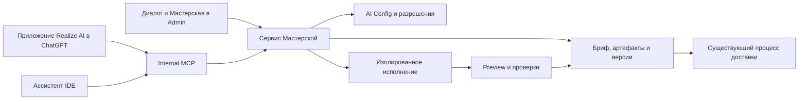

# Мастерская дизайна Realize — продукт и агентский процесс

Версия **0.1**, 2026-09-25. Статус: **Draft specification**.
Требования к общей Мастерской, трём каналам и предустановке заданы пользователем.
Ниже предложены устройство, контракты и порядок реализации. Они не означают,
что runtime Мастерской или запись через ChatGPT уже доступны.

## 1. Результат

Мастерская создаёт и развивает референсы, интерактивные макеты, компоненты,
интерфейсы модулей и темы Admin/frontend внутри существующего проекта Realize.
Пользователь описывает задачу в админке, ChatGPT или IDE, видит результат,
оставляет замечания и продолжает ту же работу в другом канале.

Единица работы — **дизайн-проект с версиями результата**, а не отдельная реплика
модели. В нём сохраняются бриф, источники, дизайн-решения, компоненты, состояния,
изменения, предпросмотр, проверки и обратная связь. Диалоги ссылаются на него;
смена чата не создаёт копию проекта автоматически.

Разделение в продукте:

- **Мастерская** — создание, эксперименты, сравнение и развитие результата.
- **Темы и шаблоны** — каталог совместимых выпусков, настройка и применение.
- **Task Manager** — постановка, назначения и контроль работ; он связывает
  дизайн-проект с задачей, но не заменяет хранилище версий и исполнитель.
- **Агентский слой** — профили, инструкции, доступные действия и процессы.

Документ уточняет DEV-01–03, DEV-05–08, DEV-12–16, DEV-18–23 и THEME-01–14
из [функционального каталога](../product-functional-catalog.md).
Разработка бизнес-логики модуля продолжает обычный backend/Code Lane процесс;
макет модуля сам по себе не создаёт production API, таблицы или интеграции.

## 2. Что есть в репозитории

Проверено 2026-09-25 по коду и [контексту проекта](../project-context.md).

| Возможность | Фактическое состояние | Как использовать |
| --- | --- | --- |
| Мастерская в навигации | `workshop` с `hiddenByDefault: true` в `src/components/admin/system-shell/systemAdmin.navigation.tsx`; готового редактора дизайна нет | Подключить будущий раздел к общей оболочке |
| Task Manager | Общий интерактивный референс в `src/components/admin/task-manager/reference/`; публичный и защищённый маршруты | Первый сценарий доработки; не выдавать fixtures за реальные задачи |
| Темы интерфейса | `packages/ui-kit/src/theme/` и общая системная оболочка; Payload использует отдельный адаптер; frontend имеет своих владельцев | Общие semantic tokens и явные адаптеры целей |
| Инструкции референсов | Есть [reference-to-frontend workflow](../../.ai/workflows/frontend/next-react/guardrail/WORKFLOW.md#reference-to-frontend) | Сохранить как процесс исследования и реализации UI |
| Конфигурация AI | Восемь типов артефактов, редактор workflow, validation, immutable AIConfigRelease, activation/rollback | Расширять существующую модель и UI |
| Исполнение workflow | `agent_turn`, `request_input`, `capability`, `check`, `branch`, `finish`; bounded graph без циклов; capability готовит DataOperation dry-run | Нужны новые зарегистрированные действия Мастерской, их исполнение и передача вложений |
| Admin chat | Текущий agent turn анализирует контекст; отдельный Code Lane запускает Codex в worktree из HEAD | Обычный чат пока не является исполнителем дизайн-правок |
| Internal MCP / ChatGPT | S1 и Repo/Git/Pages read; локальное облачное соединение проверено пользователем и tunnel-метриками | GPT может читать инструкции; patch/write/preview tools ещё не зарегистрированы |
| Code Lane / delivery | Изолированное исполнение, проверки, review, preview; отдельное продвижение в GitHub branch/draft PR | Переиспользовать владельцев, сохраняя отдельную авторизацию доставки |

Актуальные исходные контракты: [AI-layer](realize-ai-commerce/v1.0/01-architecture/10-ai-codex-layer-integration.md),
[MCP](internal-mcp.md), [Task Manager](task-management.md),
[системная оболочка](../architecture/system-admin-shell.md).

## 3. Сравнение подходов

Изучены официальные тексты на 2026-09-25. Продукты не запускались для этого
исследования; это сравнение документированных подходов, не оценка качества
генерации и не визуальный benchmark. Тарифы и полнота возможностей не сравниваются.

| Источник | Наблюдение | Проектное решение для Realize |
| --- | --- | --- |
| [Lovable: Plan mode](https://docs.lovable.dev/features/plan-mode) | Обсуждение, согласуемый план и выполнение представлены разными режимами; планы имеют историю | Отделить исследование, черновую реализацию и применение; объём планирования зависит от задачи |
| [Lovable: ChatGPT app](https://docs.lovable.dev/tips-tricks/chatgpt-app) | Документация текущей начальной интеграции описывает создание проекта из ChatGPT и дальнейшие правки в Lovable | Поддержать повторные правки одной версии через MCP; не ограничивать ChatGPT стартовым запросом |
| [v0: Design mode](https://v0.app/docs/design-mode) | Выбор элемента в preview, точные визуальные изменения и текстовое поручение приводят к новой версии кода | Связать замечание с элементом и ревизией; показывать diff и состояние сохранения |
| [v0: Design Systems 2.0](https://v0.app/docs/design-systems-2) | Повторное использование опирается на реальные пакеты, примеры потребителей, tokens и проверяемый starter | Давать агенту контракт установленной дизайн-системы и примеры, проверять переносимость результата |
| [Bolt: Project settings](https://support.bolt.new/settings/project-settings) | Контекст проекта сохраняется отдельно от короткой истории чата; восстановление backup может создавать fork | Хранить дизайн-контекст как данные проекта; восстанавливать старый результат новой версией |

Вывод для архитектуры: качество обеспечивается постоянным контекстом,
дизайн-системой, работающим preview и проверяемыми итерациями. Один длинный
system prompt не заменяет эти механизмы. Это наше проектное решение по итогам
сравнения, а не утверждение о внутренней архитектуре конкурентов.

## 4. Объекты и режимы

| Результат | Что получает пользователь | Граница готовности |
| --- | --- | --- |
| Референс | Проверенные источники, композиция, визуальное направление, пояснения | Исследование или изображение не называется работающим интерфейсом |
| Интерактивный макет | Реальные React-компоненты и сценарии на fixtures | Явно указаны демонстрационные данные и ограничения сохранения |
| Компонент | API/props, варианты, состояния, tokens, примеры использования | Проверен в реальных потребителях и изолированном примере |
| Интерфейс модуля | Связанные экраны, переходы, DTO-потребности и права пользователя | Backend отдельно отмечен как существующий, подготовленный или отсутствующий |
| Тема Admin / frontend | Версионный пакет оформления и адаптеры выбранных поверхностей | Подтверждены совместимость, состояния и способ применения/возврата |

Режимы действий в диалоге:

1. **Исследовать** — понять задачу, собрать образцы, сравнить направления.
2. **Создать / доработать** — менять разрешённый черновик с предпросмотром.
3. **Проверить** — оценить конкретную версию, воспроизвести сценарии, дать замечания.
4. **Подготовить к применению** — представить точный пакет изменений и проверки.

Тип результата, режим действия и модель-исполнитель — разные настройки.
Для простой правки в принятом стиле не нужны новый конкурентный анализ и
несколько новых направлений. Если пользователь дал точный референс, сначала
сравнивается он; вариативная генерация не подменяет соответствие.

## 5. Один процесс, три канала

Это целевая схема. Transport adapters вызывают один application service;
они не пишут в файловую систему или БД в обход него. MCP получает узкие DTO,
а не raw Payload documents. Установка и actor определяются сервером.

**Admin.** В диалоге можно начать дизайн-проект, приложить материалы и открыть
его в Мастерской. Карточка показывает текущую версию, стадию, preview, замечания
и следующий доступный шаг. В полноэкранном разделе: библиотека проектов,
чат/материалы, preview, инспектор компонентов/tokens, версии и проверки.
На узком экране области переключаются вкладками. Предлагаемый новый маршрут
`/system/workshop` использует system shell; сейчас он не реализован.

**ChatGPT.** Приложение находит или создаёт тот же дизайн-проект, читает его
контекст и готовит правки. MCP возвращает подтверждённые receipts, ссылки на
preview, версии и результаты проверок. Следующая реплика меняет выбранную
версию, а не генерирует новый несвязанный проект. Минимальный интерфейс — tools
и защищённая ссылка; встроенная карточка/preview внутри ChatGPT — отдельное
улучшение после проверки возможностей клиентского SDK и доставки ресурсов.

**IDE.** Ассистент использует те же инструкции и workspace binding. Локальные
несохранённые изменения не входят автоматически в Git HEAD. Импорт рабочей
копии требует явного manifest с hashes, исключения секретов и подтверждения
базы; прямые локальные правки нельзя объявлять сохранённой версией Мастерской
до регистрации и проверки. При отсутствии этого runtime IDE выполняет обычную
локальную задачу и передаёт честный отчёт о файлах/проверках.

Перенос контекста происходит через brief/revision/decision records, а не через
скрытое копирование всего чата. Два клиента, меняющие одну базу, получают
revision conflict; интерфейс предлагает обновить базу или создать вариант.
Отмена preview-правки и восстановление сохранённой версии имеют разные действия.

## 6. Исполнитель и расход лимитов

| Исполнение | Кто создаёт содержимое | Что делает Realize |
| --- | --- | --- |
| `client_authored` | GPT в текущем ChatGPT-диалоге или ассистент IDE | Принимает bounded patch/структурированные операции, проверяет scope, сохраняет, строит preview и выполняет проверки |
| `server_agent` | Явно выбранный доступный provider из Admin | Запускает задачу с выбранным профилем, моделью и бюджетом; сохраняет реальный job и результат |
| Детерминированная правка | Пользователь меняет поддержанный token/prop через UI | Выполняет типизированную операцию без обязательного нового модельного вызова |

Первый сценарий ChatGPT проектируется как `client_authored`. MCP не запускает
Codex автоматически для применения полученного patch. Запуск Code Lane/Codex
или другой серверной модели — отдельный явно выбранный способ исполнения.

Подписка ChatGPT и OpenAI API имеют отдельный billing; серверные API-вызовы
не покрываются подпиской автоматически. [OpenAI: billing](https://help.openai.com/en/articles/9039756-managing-billing-for-chatgpt-and-the-api-platform).
Нельзя обещать точный остаток ChatGPT/Codex allowance, если интеграция его
не сообщает. В Admin показываются исполнитель, источник оплаты, доступные
лимиты и измеренный расход; неизвестные значения остаются неизвестными.
Preview, storage, browser checks и генерация изображений также имеют свои
ресурсы. Credentials разных клиентов сохраняются через Admin/vault.

## 7. Предлагаемая модель и владельцы

Названия ниже — проект DTO/persistence, не уже существующие коллекции.

| Сущность | Существенный контракт |
| --- | --- |
| `DesignProject` | Установка, owner/access, target, тип результата, текущий brief, ссылки на диалоги и при наличии настоящую задачу |
| `DesignBrief` | Revision, цель/аудитория, экраны, сценарии/состояния, стиль, ограничения, критерии и предположения |
| `DesignSource` | Тип, источник, дата, наблюдение, статус визуального просмотра, права использования assets; содержимое недоверенное |
| `DesignRevision` | Immutable ID/hash, parent revision, база исходников, artifact manifest, patch receipt, автор и канал |
| `DesignFeedback` | Revision, экран/состояние/элемент, замечание, критерий и статус решения; привязка к устаревшему элементу видна |
| `DesignRun` | Ссылка на существующий execution/workflow run, выбранный executor, pinned configuration, status/progress и evidence; не второй scheduler |
| `DesignPackage` | Принятая revision, тип/версия пакета, targets, зависимости, compatibility manifest и лицензии assets |

Бинарные материалы и screenshots хранятся как артефакты с digest и ACL;
в DTO возвращаются метаданные и ограниченные ссылки. Нужны quotas, retention,
экспорт и очистка с учётом ссылок на принятые версии. Локальная `.ai-workspace`
остаётся рабочим каталогом IDE и не становится multi-user storage продукта.

`taskID` не является обязательной зависимостью первой поставки: реальная
модель Task Manager пока не реализована. Дизайн-проект можно связать с ней
позже через её owner; fixture ID нельзя выдавать за настоящую задачу.

| Слой | Ответственность |
| --- | --- |
| `packages/ai-contracts` | DTO, versioned commands, errors и manifests |
| `packages/change-engine` | Общая policy, capability validation, prepare/apply semantics; без Transport/React |
| `packages/payload-ai-plugin` | Installation persistence, API facade, actor/access, связи с Config/AIRun и chat UI |
| `services/internal-mcp` | Схемы tools и адаптация к тому же facade |
| Существующий execution worker | Workspace lease, выполнение разрешённых jobs/checks, preview lifecycle и receipts |
| `packages/ui-kit` | Переиспользуемые primitives, tokens и оболочка интерфейса |
| `.ai` / `.codex` | Канонические инструкции процесса / тонкий адаптер IDE |

Это распределение предполагает расширение существующих владельцев. Создание
отдельного универсального workflow engine, Git delivery или secrets store
для Мастерской не требуется. Новые domain-файлы выбираются при реализации
по принятому стандарту структуры; этот документ не предписывает монолитный service.

## 8. Настраиваемый процесс в Admin

Базовый маршрут: **бриф → исследование → направление → компоненты/tokens →
интерактивная версия → проверки → замечания → принятая версия**.
Неприменимые этапы пропускаются с причиной. Новая правка возвращает процесс
к затронутому этапу и создаёт новую версию; принятые evidence не переносятся
на изменившийся результат автоматически.

Используется существующий редактор «Настройки → Агентский слой → Рабочие
процессы», AIConfigRelease и runtime сегментов. В Мастерской нужен понятный
выбор шаблона, параметров и progress, с переходом к этому редактору для сложной
настройки. Не создавать второй независимый каталог ролей/skills/workflows.

Предлагаемые presets:

- `workshop.reference` — бриф, источники, направление и интерактивный референс.
- `workshop.component` — контракт, reuse, состояния, примеры и review.
- `workshop.theme` — foundations, tokens, adapters, галерея потребителей и review.
- `workshop.refine` — замечание к версии, локальная правка и затронутые проверки.

Администратор выбирает включённые этапы, роли/профиль исполнителя, источники,
доступные tool bindings, модель, бюджет/таймаут, целевые поверхности,
обязательные проверки и точки человеческого решения. Сохранение черновика,
выпуск и активация остаются разными существующими действиями.

Отображение на текущие типы шагов:

| Шаг | Использование | Недостающая реализация |
| --- | --- | --- |
| `agent_turn` | Анализ brief, направления, подготовка содержимого | Typed artifact inputs/outputs и executor selection для дизайн-задачи |
| `request_input` | Существенное уточнение или выбор направления | Привязка ответа/вложений к brief revision; не механизм выдачи серверных прав |
| `capability` | Подготовка draft change, preview/check job, package preparation | Зарегистрированные domain capabilities; текущий DataOperation dispatcher не умеет эти операции |
| `check` | Проверить receipt и evidence точной revision | Реестры проверок дизайна и owner для их исполнения |
| `branch` | Выбрать объявленный путь по typed результату | Никаких произвольных JS/команд из prompt |
| `finish` | Закончить bounded этап с typed outcome | Честное различение подготовлено, проверено, принято |

Текущий граф запрещает циклы. Итерация по замечаниям — новый запуск/сегмент
над выбранной revision, а не обход ограничения через бесконечный retry.
Асинхронный preview/check выдаёт job ID и durable checkpoint; отключение чата
не теряет работу. Timeout, `failed`, `cancel_requested`, `cancelled` и recovery
требуют явных переходов владельца runtime. Cancel не означает, что процесс
действительно завершён, пока это не подтверждено. Неизвестный результат apply
сначала восстанавливается по idempotency receipt.

Каждый run фиксирует release/profile/workflow hashes, версии инструкций,
design-system contract, brief/base revision, grants/policy snapshot и executor.
Текущие права перепроверяются при каждом действии: исторический snapshot
не позволяет продолжать запись после отзыва доступа.

## 9. Агентский слой и поставка по умолчанию

Канонический процесс находится в `.ai`. Подготовлены отдельная роль
[Workshop Director](../../.ai/roles/design/workshop-director/INDEX.md),
[маршрут Мастерской](../../.ai/workflows/frontend/design-workshop/WORKFLOW.md),
[бриф](../../.ai/templates/design/TEMPLATE-DESIGN-WORKSHOP-BRIEF.md) и
[проверка результата](../../.ai/checks/development/frontend/CHECK-DESIGN-WORKSHOP-REVIEW.md).
Они используют действующий frontend workflow и существующие роли разработки.

| Ответственность в процессе | Реализация в агентском слое |
| --- | --- |
| Бриф, направление, последовательность и целостность результата | Workshop Director |
| Поиск и оценка образцов | Режим исследования Director; отдельный агент не обязателен |
| Tokens, компоненты и реальный UI | Developer Frontend с reference workflow |
| DTO, сохранение, права и интеграции | Developer Backend по мере необходимости |
| Review версии и evidence | Режим проверки по общему rubric; независимый reviewer только когда он действительно назначен/нужен |

Роли — обязанности, а не автоматический запуск пяти моделей и не ACL.
Один исполнитель может пройти несколько этапов. Самопроверка маркируется как
самопроверка; независимый review нельзя имитировать сменой имени в prompt.

Три способа доставки инструкций:

- **IDE:** `.codex/skills/design-workshop` направляет к каноническим `.ai`.
- **ChatGPT сейчас:** S1 `ai_context_resolve` / `ai_instructions_get` доставляют
  выбранные инструкции по hashes. ChatGPT не читает AGENTS автоматически;
  правило bootstrap должно быть в подключённом приложении/профиле и вызываться
  агентом. S1 сообщает truncation и неоднозначные связи, их нельзя игнорировать.
  `.ai/templates` не входит в текущую S1 policy: workflow содержит необходимые
  поля брифа/передачи, отдельная локальная форма остаётся необязательной.
- **Admin, целевая поставка:** build/versioned preset преобразует разрешённые
  инструкции в typed skill/role/prompt/workflow artifacts существующего Config.
  Manifest фиксирует source hashes; compiler проверяет system ceiling. Нужны
  реализация publisher и parity tests, сейчас автосинхронизации файлов в БД нет.

Пакет платформы содержит базовые инструкции, manifests и совместимые шаблоны
Мастерской. **Предустановленность не означает автоматически выданные права**:
новая установка получает catalog entry/readiness; owner подключает клиента и
разрешает области работы через Admin. Установка приложения в личный аккаунт
ChatGPT всё равно требует подключения пользователем; платформа не делает это
за владельца аккаунта.

Обновление presets идемпотентно и версионно: изменённый клиентом профиль не
перезаписывается. Новый baseline предлагается как новая версия с diff;
локальные настройки остаются overlay. Upgrade проверяет совместимость,
missing capabilities и миграции; downgrade инструкций не откатывает данные.
Неподдержанный preset не активируется с фиктивными bindings. До готовности
write runtime доступен только явно обозначенный режим анализа.

## 10. Инструменты и управляемая запись

Следующие семейства **предлагаются**, в текущем MCP их нет. Стабильные имена
и строгие schemas уточняются в контрактной поставке до регистрации tools.

| Семейство | Назначение | Доступ / эффект |
| --- | --- | --- |
| `workshop_project_list/get`, `workshop_context_get` | Проект, brief, выбранная revision, доступные операции | Scoped read |
| `workshop_project_create`, `workshop_brief_update`, `workshop_feedback_add` | Сохранение проекта, brief и замечаний | Design metadata write, optimistic revision |
| `workshop_artifact_read`, `workshop_revision_get` | Артефакты и версии того же workspace binding | Scoped read, limits/ACL |
| `changes_prepare/get/apply` | Точный patch/структурированная операция в черновике | S4 draft write, server-derived scope, idempotency |
| `workshop_preview_start/get`, `workshop_checks_start/get` | Реальные jobs для конкретной revision | Execute grant, registered worker/check IDs |
| `workshop_package_prepare/get` | Совместимый пакет и diff для review | Package preparation; ещё не установка/публикация |

Существующие repository reads при работе в draft должны использовать тот же
server-owned `workspaceBindingID`, что patch/check/preview. Чтение из основной
копии при записи в другую копию недопустимо. MCP tool annotations отражают
реальный эффект; возвращать writes как `readOnly` нельзя.

Основной контракт изоляции и восстановления остаётся в
[internal MCP §4.6 и §16.5](internal-mcp.md). Для первой версии:

- Сервер создаёт/привязывает изолированную рабочую копию и immutable base;
  client не передаёт произвольный абсолютный repo path. По умолчанию — чтение.
- Prepare сохраняет hashes, точный diff, затронутые пути, policy и checks.
  Apply проверяет текущую базу, actor/grants, lease и idempotency receipt.
- Multi-file запись имеет durable journal/recovery; hash-check плюс rename
  в общем checkout не объявляется атомарной транзакцией или compare-and-swap.
- Каталоги secrets, generated outputs, системные инструкции, package lifecycle
  scripts и зависимости имеют отдельные ограничения. Даже разрешённый TSX
  исполняется в sandbox без production env, сетевых/DB credentials и admin cookies.
- Изменения инфраструктуры, permissions, `.ai`/`.codex` и AGENTS не следуют из
  разрешения создавать дизайн. Code execution также требует отдельной policy.
- Promotion, commit/push, установка темы, merge и deploy выполняются через
  существующих владельцев и свои разрешения. Принятие макета не равно release.

Preview работает на отдельном origin с ограниченным доступом и сроком жизни;
использует fixtures, sandboxed runtime, ограниченные network/CPU/time/storage.
URL не заменяет ACL. Screenshot/evidence связываются с content hash, viewport,
темой и сценарием. Подгруженный URL/HTML/asset проходит отдельный контролируемый
fetch с защитой от private-network redirects, лимитами и проверкой типа.

Identity пользователя ChatGPT нельзя вывести из текста запроса. Текущая
личная tunnel-интеграция использует выданного principal; многопользовательская
поставка требует проверяемого actor mapping/OAuth и isolation каждой установки.
Подтверждение от модели `approved: true` не заменяет авторизацию доверенного UI.
Обычные правки уже разрешённого draft не требуют повторного согласия на каждый
файл; изменение scope или применение к рабочей установке — отдельное действие.

## 11. Темы, компоненты и качество

Тема описывает foundations → semantic tokens → варианты компонентов →
шаблоны/композиции. Контракт включает typography, spacing, density, colors,
radii, elevation, focus, motion, состояния и target adapters. Для системного
Admin используются владельцы `@realize/ui-kit`; Payload bridge и storefront
проверяются отдельно. Единый бренд не означает один глобальный CSS для всех.

Theme manifest содержит ID/version, поддержанные platform/UI-kit versions,
targets, modes, token schema, fonts/assets с provenance, необходимые adapters
и примеры потребителей. Первая поставка может поддержать только tokens и
существующие component variants. Layout/component extensions вводятся позже
с явными slots/API; тема не получает произвольные hooks к БД или policy.

Visual inspector меняет только поддержанные tokens/props с обратным отображением
на исходники. Произвольный DOM selection не обещает надёжную AST-правку любого
компонента: неподдержанный элемент передаёт scoped замечание агенту. Реальная
запись всегда создаёт revision; временный DOM override не называется сохранением.

Готовность оценивается по [общему review rubric](../../.ai/checks/development/frontend/CHECK-DESIGN-WORKSHOP-REVIEW.md):
сценарий пользователя, композиция и иерархия, связная typography/spacing,
корректные данные и состояния, переиспользование, responsive, доступность,
browser evidence и совместимость. Указываются конкретные дефекты и evidence,
а не произвольная общая оценка «профессионально на 9/10».

Для темы Admin базовая галерея включает shell/sidebar, таблицу с фильтрами,
форму, modal/popover/portal, статусы/ошибки, empty/loading и длинный русский
текст; light/dark и 1440/768/390. Для frontend добавляются согласованные
публичные страницы; каталог/карточка/корзина обязательны только для магазина.
Accessibility проверяет keyboard/focus/labels/contrast/reduced motion по
затронутым компонентам; полная сертификация не выводится из одного автотеста.

Источник изображения может быть предоставлен, найден или сгенерирован при
наличии соответствующего инструмента. Сохраняются origin, условия использования,
alt и назначение. Сгенерированная картинка интерфейса служит направлением,
но не заменяет редактируемый React-макет и проверку работающих контролов.

## 12. Порядок реализации и приёмка

| Этап | Результат | Проверяемая граница |
| --- | --- | --- |
| W0 — проектирование и инструкции | Этот документ, роль, workflow, brief, rubric и IDE skill | Ссылки/metadata валидны; S1 может прочитать инструкции; runtime не объявлен готовым |
| W1 — версии и управляемые правки | Shared DTO/service, persistence, workspace binding, S2 artifacts/check receipts и S4 prepare/apply/recovery | GPT сам готовит patch; после перезапуска видны receipt и новая revision; основная копия не меняется |
| W2 — работа из диалогов | Admin chat/MCP adapters, передача материалов, preview jobs, ссылки и возобновление | Один проект продолжается в Admin, ChatGPT и IDE; проверены scope, конфликт версий и отзыв прав |
| W3 — продуктовый интерфейс | `/system/workshop`, library/preview/feedback/versions, простые presets, выбранные visual edits | Пользователь создаёт и дорабатывает референс без ручного переноса файлов |
| W4 — темы и компоненты | Packages, token/target adapters, gallery и compatibility checks, отдельное применение | Пакет проверен на двух совместимых установках; тема обратимо применяется через своего owner |
| W5 — предустановка и настройка | Versioned preset publisher, обновления/overlays, Admin pipeline и readiness | Новая установка получает рабочий анализ; запись включается по готовности и правам; custom config переживает upgrade |

W1–W3 делаются короткими сквозными поставками. Первый полезный сценарий:
**доработать текущий Task Manager через ChatGPT, открыть сохранённый preview
и продолжить ту же revision в Admin**. Не ждать реализации всех типов пакетов
и свободного визуального редактора. При этом preview/изоляция/версионирование
входят в этот сценарий, а не откладываются за необратимую запись в основной repo.

Пример приёмки первого сценария:

1. Admin создаёт доступ к draft scope Task Manager; GPT читает capability list,
   актуальные инструкции, brief и исходники конкретной базы.
2. GPT отправляет подготовленное изменение. Сервер возвращает change ID/diff,
   применяет в разрешённом workspace и выдаёт новую revision/receipt.
3. Preview/check jobs сохраняют реальные результаты этой revision. Пользователь
   видит состояние при ошибке сборки, а не старый preview с новой подписью.
4. В Admin открывается тот же проект; замечание к sidebar сохраняется с revision.
   Следующий запрос GPT исправляет её, не теряя прежние версии.
5. Одновременная IDE-правка даёт явный conflict; повтор network request не
   создаёт вторую правку; сбой посередине apply восстанавливается по journal.
6. Недопустимый path, чужой actor, отозванный grant и попытка получить secrets
   отклоняются. Принятый результат остаётся draft до разрешённой доставки.

До реализации каждой поставки уточняются schema/migrations, owner interfaces,
negative tests и эксплуатационные лимиты. Это обычная декомпозиция исполнения
данного проекта, а не автоматическая активация всех инструментов из документа.
