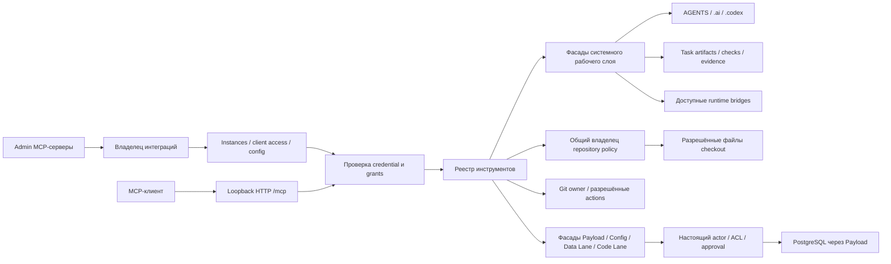

# Внутренний MCP Realize: спецификация и техническое задание

- Статус: **A+G+S1, предустановки и Workshop managed tools implemented; C настраивается в Admin, cloud acceptance pending; общие S2–S5/B/P target**, версия 0.9, 20 октября 2026 года.
- Предмет: внутренний MCP как функциональный интерфейс системного рабочего слоя, административных возможностей Realize и единое управление несколькими MCP-серверами в Admin.
- A+G реализованы: отдельный SDK listener, read tools и Admin manager. S1 добавляет context resolver, чтение инструкций по hash, capability discovery и подключение development Codex. Фактические команды, поддержанные adapters и ограничения описаны в [runbook](../architecture/mcp-tooling.md); приёмка — в плане. Последующие S2–S5/B/P/C инструменты остаются целевыми контрактами.
- Архитектура и эксплуатация: [MCP tooling](../architecture/mcp-tooling.md), [план работ](internal-mcp-implementation-plan.md).
- Референс: [временное задание](../temp/realize-internal-mcp-agent-task.md). Реализация A+G начата по отдельному запросу пользователя «Приступай».
- Уточнение 20 октября 2026 года: раздельная диагностика filesystem/Git и лёгкий context реализованы в MCP `1.3.1`, output contract `realize_get_context` `1.1`. Версия и успешное чтение HEAD/status подтверждены на локальном bootstrap и через Realize AI ChatGPT connector; diff, файлы и S1 instructions также проверены через connector. Это адресная проверка исправления, не полная приёмка всех consumers поиска или этапа C.

## 1. Результат и границы

Предметный потребитель следующих S2/S4 возможностей —
[Мастерская дизайна](design-workshop.md#tools): общий проект/версии/preview для
Admin, ChatGPT и IDE. Её спецификация не регистрирует новые инструменты;
workspace binding, управляемая запись и восстановление остаются в §4.6/§16.5
этого контракта. GPT применяет собственную правку сохранённого макета через
scoped Workshop facade без запуска Codex. Это не произвольная запись в checkout:
фактические 11 tools, grants, CAS/replay, image content и отзыв фоновых jobs
описаны в [Workshop §12.3](design-workshop.md#123-admin-preview-и-managed-mcp-правки).

**Целевой результат — через один внутренний MCP агент может пройти рабочий цикл проекта:** получить актуальные инструкции и контекст, определить область задачи, использовать существующих исполнителей, внести разрешённые изменения, выполнить проверки, собрать доказательства и передать результат на review или разрешённую доставку. Этот же транспорт предоставляет отдельные административные возможности установки через их действующих владельцев и права.

Максимальная функциональность означает покрытие полезных рабочих сценариев и существующих возможностей проекта. Чтение репозитория и Pages — первая техническая поставка, а не конечная граница MCP. Интеграция с `.ai/`, `.codex/` и `AGENTS.md` является обязательной частью задания, а подключение ChatGPT — отдельной клиентской возможностью.

**Управление MCP через админку входит в первую поставку.** Раздел «MCP-серверы» содержит экземпляры разных типов, их настройки, доступ, проверку подключения и фактическое состояние. Один тип допускает несколько экземпляров. Управление входящим Realize MCP и подключение внешнего MCP используют общую навигацию и существующего владельца интеграций, сохраняя разные контракты исполнения (§19, этап G).

### 1.1. Последовательность поставок

| Поставка                                 | Проверяемый результат                                                                                                                                                |
| ---------------------------------------- | -------------------------------------------------------------------------------------------------------------------------------------------------------------------- |
| **A — основание**                        | Транспорт, identity, строгие схемы, чтение repo/Git/Pages; подробные контракты §5–11 и приёмка §13                                                                   |
| **G — MCP-серверы в Admin**              | Multi-instance каталог, настройки/доступ/проверка и подтверждённое применение; обязательная часть первой поставки A+G, §19                                           |
| **S — системный рабочий цикл**           | Применимые инструкции, task artifacts, проверки и evidence, доступный agent runtime, разрешённые изменения и Git delivery; обязательное продолжение A, контракты §16 |
| **B — управляемый page draft**           | Подготовка page draft через настоящий DataOperation и человеческое применение; §12                                                                                   |
| **P — функциональность админского слоя** | Разрешённые Config, run/workflow, Data Lane и Code Lane операции через существующих владельцев; §17                                                                  |
| **C — дополнительные клиенты**           | Отдельно проверенные transport/auth/scopes для ChatGPT и других внешних клиентов; §14                                                                                |

Системный выпуск S завершается по критериям S01–S08 (§18), а не по количеству зарегистрированных tools. A не закрывает задачу интеграции рабочего слоя. B/P могут развиваться независимо от S после готовности общей авторизации и своих owner-контрактов; C не определяет последовательность внутренней разработки.

### 1.2. Техническая поставка A

A предоставляет совместимому локальному MCP-клиенту:

1. Контекст текущей установки и реально доступных инструментов.
2. Ограниченное чтение, перечисление и поиск файлов разрешённого checkout.
3. Безопасные status и diff Git без изменения индекса и рабочей копии.
4. Поиск CMS-страниц, чтение разрешённого текстового контекста и структуры Pages от имени проверенного пользователя.
5. Воспроизводимый запуск, остановку, протокольные проверки и документированное подключение клиента.

**MCP-инструменты A полностью read-only** для проектных и продуктовых данных. Отдельный management API/Admin этапа G сохраняет настройки, credentials и audit; это явные операции управления, не скрытые writes инструментов A.
Завершённым считается A с реальным сценарием Pages и работающим разделом управления G; transport/repository-only сервер является промежуточной технической поставкой.
В установке без настройки Pages сервер может работать в режиме repository-only и явно объявляет это ограничение.

Выпуск **B** подготавливает создание page draft через существующий DataOperation lifecycle. Он не входит в критерии готовности A. Это сохранённая операция, ожидающая человека; создание страницы подтверждается только после штатного применения.

За пределами A: CRUD задач и рабочих сред, изменение исходников и `.ai/.codex`, выполнение проверок, управление агентами, запись Config API, approve/apply/rollback/publish, Git commit/push, внешние сообщения, production deployment, OAuth-сервер, публичный endpoint, ChatGPT plugin/UI и туннель. Разрешённые расширения описаны в S/B/P; перечисление здесь не запрещает их развитие.

### 1.3. Постоянные границы

MCP не вводит собственные бизнес-правила, альтернативный task manager, произвольные shell/SQL/CRUD endpoints или доступ к секретам. Полномочия следуют от server-owned grants, действующей политики и владельца операции. Переданный моделью текст, роль или флаг `approved:true` их не создаёт. Существующее разрешение на задачу может покрывать много обратимых действий; подтверждение каждого вызова само по себе не требуется.

Продуктовый Task Manager пока является reference UI. Файловая рабочая область `.ai-workspace` и managed agent jobs не становятся его фиктивной реализацией. Development principal, runtime operator и административный actor — разные области прав даже при общем listener.

## 2. Обязательная связь с существующими контрактами

| Источник                                                                                                 | Что сохраняется                                                                                         |
| -------------------------------------------------------------------------------------------------------- | ------------------------------------------------------------------------------------------------------- |
| [AGENTS.md](../../AGENTS.md), `.ai/rules/**`                                                             | Порядок разработки, владельцы, проверки, разрешения Git и сохранение чужих правок                       |
| [ADR-0007](../architecture/decisions/ADR-0007-mcp-phase-0-policy.md)                                     | MCP не становится зависимостью внутреннего чата; отдельные contract, threat model, allowlist и проверки |
| [ADR-0015](../architecture/decisions/ADR-0015-protected-system-ai-layer-and-installation-overlay.md)     | Administrative overlay не меняет системные полномочия                                                   |
| [Глава 20](realize-ai-commerce/v1.0/03-runtime-delivery-and-security/20-payload-mcp-and-tool-gateway.md) | MCP — транспорт; продуктовые ACL, scope и audit принадлежат серверу                                     |
| [Архитектура MCP](../architecture/mcp-tooling.md)                                                        | `/api/realize-ai` и native Codex tools не объявляются MCP                                               |
| [Структура проекта](../architecture/project-structure.md)                                                | Код приложения, агентские tools, конфигурация и документы сохраняют своих владельцев                    |

Локальный developer access к checkout и будущий административный Tool Gateway — разные доверенные области. Разрешение владельцу читать отобранные системные Markdown-файлы не переносится на пользователей админки или продуктового execution worker.

Глава 20 описывает будущие вызовы, связанные с run/Change Request. Для простого локального чтения они не создаются фиктивно. Границы developer-read сценария и независимого Pages-read facade закреплены в [ADR-0017](../architecture/decisions/ADR-0017-internal-mcp-and-server-management.md). Остальные ограничения главы 20 и Git-правила сохраняются.

## 3. Фактическая основа

| Возможность                      | Состояние и следствие для MCP                                                                                                                  |
| -------------------------------- | ---------------------------------------------------------------------------------------------------------------------------------------------- |
| Next, React, Payload, PostgreSQL | Действующий стек сохраняется; root npm workspaces охватывают `packages/*`                                                                      |
| Task Manager                     | Reference UI с in-memory fixtures; production Tasks/Workspaces CRUD для MCP отсутствует                                                        |
| Pages                            | Реальные коллекция, access, mapper, draft и управляемые операции; первый продуктовый сценарий A/B                                              |
| AI Config                        | Draft → validation → immutable release → отдельная activation; не файловый редактор `.ai`                                                      |
| Workflow                         | Сегменты AIRun, persisted checkpoints, owned history; не универсальная очередь MCP                                                             |
| Repository Context Pack          | Общая repository policy обслуживает прежний каталог и MCP line ranges, literal search и pagination                                             |
| Git delivery                     | Детерминированный inspect и отдельный MCP machine read port; обычные Git-операции рабочего слоя остаются через отдельного worker               |
| Системные инструкции             | S1 читает `.ai` registry/rules/checks/workflows и `.codex` adapters: bounded resolver, hashes/coverage и явное prose review                    |
| Managed agent runtime            | SQLite writer, CLI и operator dispatcher существуют; native collaboration и реальное управление процессами требуют своих bridges               |
| Проверки и task artifacts        | Реальные scripts/tests и `.ai-workspace`; безопасного MCP check runner и task facade пока нет                                                  |
| Входящий MCP                     | Отдельный loopback SDK listener и Admin manager реализованы; project Codex config подключает developer bootstrap отдельно от managed instances |

Существующие `pages_search/pages_read/pages_structure` являются native Codex tools. Их grant привязан к действительному AIRun и actor. Callback этого потока не используется как скрытый MCP API.

## 4. Архитектура первой поставки

### 4.1. Транспорт и запуск

Выбирается отдельный локальный процесс в **предлагаемом** `services/internal-mcp/`.
Это composition root транспорта, а не новый владелец бизнес-логики. Основание выбора — независимые loopback bind, порт, запуск и остановка, которые требуются исходным сценарием. Next-приложение и его публичные маршруты не получают repository endpoint.

Альтернатива Next Node Route Handler `/mcp` проще для существующего Payload lifecycle, но разделяет порт и внешнюю доступность с приложением. Она допустима только при пересмотре требования независимого listener; оба варианта одновременно не реализуются.



Диаграмма показывает целевую композицию A/G/S/B/P, а не уже реализованные модули. Выпуск A не требует вызова модели, аккаунта Codex, control plane, execution worker или agent-monitor. Bootstrap repository-only продолжает работать без приложения; managed instance зависит от доступной config authorization G. При доступной конфигурации ошибка Pages не блокирует repo tools. В S/P зависимости проверяются для конкретной операции: недоступный agent runtime не блокирует чтение правил, а выключенный model provider не становится общим запретом developer tools.

### 4.2. Владельцы и повторное использование

| Задача                                      | Владелец и разрешённая доработка                                                                                                                                           |
| ------------------------------------------- | -------------------------------------------------------------------------------------------------------------------------------------------------------------------------- |
| Listener, MCP SDK, transport auth, registry | Новый узкий composition root `services/internal-mcp/` после принятия owner decision                                                                                        |
| DTO, strict parser, mapping наружу          | Типы MCP у feature-владельца; существующие Page DTO из `packages/ai-contracts`; обобщённые AI DTO только при реальном втором потребителе                                   |
| Правила файлов и безопасное чтение          | `services/ai-control-plane/src/projectContextCatalog.service.ts`; выделить из существующего модуля необходимые операции и сохранить каталог/Context Pack его потребителями |
| Git status/diff                             | `.ai/tools/git-delivery/src/` через новый ограниченный публичный read port; без вызова arbitrary handler action                                                            |
| Pages, actor, PayloadRequest                | Узкий server export в `packages/payload-ai-plugin`, по существующему pattern `./server/*`; host adapters остаются в `src/collections/Pages`                                |
| Конфигурация локального запуска             | Root `package.json`, проверяемый config parser, пример без секретов; самостоятельный script                                                                                |
| Схема и миграции                            | Read facades A не требуют предметной схемы; G добавляет inbound keys/service receipts и нужные audit constraints у plugin owner, migrations в `src/migrations`             |

Импорт repository owner не должен импортировать `server.ts`, запускать control plane или загружать provider credentials. Не копировать массивы allowlist/deny в MCP. Если независимый экспорт из существующего модуля технически невозможен, сначала принять конкретное размещение общего server-only модуля; новый универсальный package заранее не создавать.

Git port использует фиксированный рабочий root и серверную область чтения. Сейчас у Git package нет подходящего публичного exports и bounded diff. Их создание и контракт доверенного machine caller — часть M0/M3 плана. Нельзя просто вызвать `runDelivery` с модельными полями или обойти действующий worker-маршрут при разработке. Нельзя переносить в продукт весь агентский runtime ради inspect.

### 4.3. Инициализация Payload

Payload подключается только для включённых application tools и лениво, через существующий config и host adapters. Инициализация не применяет migrations/schema push, не запускает seed, jobs, CP или execution worker. До импорта host config процесс обязан отклонить `PAYLOAD_DB_PUSH=true`; одного обещания read-only недостаточно. Используется `getPayload({config, cron:false})` и образец загрузки окружения/динамического config из `scripts/runtime/runMediaJobs.controller.ts`, без запуска самого Media worker. Сервер не делает внутренний HTTP-вызов к собственному `/api/realize-ai`, если доступен тот же server service.

Composition root закрывает принадлежащий ему Payload/DB connection при остановке (`payload.destroy()`, по существующему Media runtime pattern). Bootstrap repository-only запуск должен проходить без DATABASE_URI, PAYLOAD_SECRET и Codex credential. Managed configuration использует отдельный узкий runtime reader у integration owner и собственный закрываемый DB pool; чтение настройки не запускает целиком Payload/CP. Конкретная команда загрузки Payload для Pages проверяется в M4; предположение о работоспособности обычного `tsx` вместо принятого Payload bootstrap не является доказательством. Если используется `payload run`, lifecycle остаётся awaited до shutdown listener; завершение импортированного entrypoint не должно преждевременно закрыть Payload. Тест interrupted startup также обязан подтвердить отсутствие оставленных соединений.

### 4.4. Модули и каталог возможностей

Уже в M1 registry проектируется для семейства инструментов, а не для навсегда фиксированных девяти handlers. Каждый descriptor содержит стабильный ID/version, input/output schema, owner reference, domain (`development`, `managed_runtime`, `installation`), необходимые grants, effect class, зависимости, timeout/result budget, правила отмены и повторного вызова. Для меняющего состояние инструмента дополнительно обязательны preconditions, idempotency и существующий approval contract. Наличие descriptor без работающего handler не публикует tool.

Это транспортный каталог. Он ссылается на `.ai` для процедур агента и на `systemCapabilityRegistry`/продуктовых владельцев для исполняемых административных полномочий, не копируя их в третий независимый registry. Markdown workflow сам по себе не становится исполняемым handler. Выбор tool из текста модели не может включить незарегистрированную функцию.

Каталог для principal строится после auth. Неавторизованные семейства не показывают приватные имена объектов или состояние зависимостей и остаются закрыты при прямом `tools/call`. Для разрешённого инструмента различаются `ready`, `dependency_unavailable` и `configuration_required`; запланированные возможности представлены только в документации. Изменение grants проверяется при каждом вызове, даже если клиент сохранил старый tools/list.

Environment mapping §6 служит operator bootstrap и локальной диагностике. Штатная настройка установки выполняется через Admin registry G (§19); уже до приёмки A существуют отдельные server instances и client grants. Перед S/B/P список grants и scope расширяется версионированными контрактами; старые `repositoryRead/pagesRead` никогда не означают право записи. Secrets остаются во внешнем env/хранилище владельца, реальные credentials не попадают в project config. Соответствие principal → installation actor и principal → разрешённая developer task проверяется независимо.

### 4.5. Изменения, долгие операции и подтверждения

Read calls A остаются stateless. Состояние task принадлежит рабочей области, runtime — существующему runtime owner, продуктовые операции — их repositories. Долгая операция возвращает реальный `operationID`, текущий state, способ получения status и явный признак поддержки cancellation, а не удерживает HTTP до окончания. Cancel публикуется только при реализованном owner-контракте. Повтор после разрыва соединения проверяет существующую операцию; cancellation request не выдаётся за фактическую остановку или rollback.

Каждая запись привязана к stable principal, task/object scope, canonical request hash, ожидаемой версии и policy snapshot. Авторизация и preconditions проверяются до эффекта и при получении результата. Владелец операции обеспечивает durable replay и различает conflict, pending, completed, failed, interrupted/unknown; одного in-memory cache или JSON-RPC request ID недостаточно. Новый общий datastore не вводится автоматически: недостающий persistent receipt размещается у владельца конкретного действия и получает собственный контракт восстановления до включения tool.

Человеческое подтверждение, если его требует Git/Data Lane/Config/Code Lane действие, поступает через доверенный owner flow или проверяемую capability, связанную с точными действием, scope, hash/version и сроком. MCP-модель не подтверждает собственное действие. Допустимое в рамках текущей задачи заранее данное разрешение используется без повторного вопроса; transport не расширяет его. Механизм проверки такого разрешения при внешнем machine call должен быть реализован и протестирован, а не выведен из свободного текста запроса.

### 4.6. Одна рабочая область для полного системного цикла

В A repository tools используют configured checkout. Для S вводится server-owned task/workspace binding: opaque `workspaceBindingID` ссылается на проверенные principal/task, реальную принадлежащую задаче рабочую область и её lifecycle. Repository/context/Git reads, patch, checks, worker assignments и delivery используют один binding; схемы S явно расширяют контракты A этим полем. Клиент выбирает только разрешённую ссылку, не root/cwd. Глобального mutable `activeTask` для всех клиентов нет.

Workspace identity и policy version входят в cursors, fingerprints, change/check receipts и evidence. Запрос для другого binding или удалённой/заменённой рабочей области отвергается; unbound read главного checkout не подтверждает precondition изменения в task worktree. Principal не получает соседние workspace за счёт знания их ID. Разрешённые physical roots создаёт/регистрирует trusted owner, включая отдельно разрешённый worktree lifecycle.

`ai_context_resolve` указывает и workspace исследуемого кода, и принятый источник активной policy. Черновые изменения `.ai` внутри task worktree видны как proposed content; они не заменяют policy, принятую для текущего исполнения, без соответствующего owner flow. Это не новая БД правил: canonical источниками остаются AGENTS/.ai, а snapshot и ссылки фиксируют использованную версию.

## 5. SDK и версии протокола

Внешние источники проверены 20 сентября 2026 года. Официальный TypeScript SDK объявляет v2 стабильной веткой для MCP `2026-07-28`; старый монолитный `@modelcontextprotocol/sdk` остаётся веткой v1. Поэтому его имя из временного ТЗ не фиксируется как обязательная зависимость. [Официальный SDK](https://github.com/modelcontextprotocol/typescript-sdk).

Проверенные кандидаты для M1:

| Package                        | npm version при проверке                   | Назначение                                                                          |
| ------------------------------ | ------------------------------------------ | ----------------------------------------------------------------------------------- |
| `@modelcontextprotocol/server` | `2.0.0`, Node `>=20`                       | Сервер                                                                              |
| `@modelcontextprotocol/node`   | `2.0.0`, Node `>=20`, server peer `^2.0.0` | Штатная адаптация Node HTTP                                                         |
| `@modelcontextprotocol/client` | `2.0.0`, Node `>=20`                       | Protocol tests                                                                      |
| `zod`                          | `4.6.5`                                    | Strict runtime schemas                                                              |
| `@modelcontextprotocol/sdk`    | `1.30.0`                                   | Только если выбран обоснованный v1 fallback; не в дополнение к v2 без необходимости |

Метаданные получены `npm view <package> version engines peerDependencies --json --registry=https://registry.npmjs.org`. Для Node adapter дополнительно проверены dependencies/peerDependenciesMeta: peer Hono необязателен; добавление отдельного Hono-приложения не требуется. Данные registry — [server](https://registry.npmjs.org/@modelcontextprotocol/server/latest), [node](https://registry.npmjs.org/@modelcontextprotocol/node/latest), [client](https://registry.npmjs.org/@modelcontextprotocol/client/latest), [Zod](https://registry.npmjs.org/zod/latest).

Перед установкой повторить version/engine/peer check, выбрать exact pins и обновить lock штатным npm. Совместимость Node engine подтверждена метаданными; реальная интеграция с проектом подтверждается только сборкой и тестом. Зависимости в рамках подготовки ТЗ не установлены.

Проектный baseline: Node `24.18.0`, npm `11.15.0`. Среда аудита `24.19.0`/`11.17.0` его не проходит. Это устраняется настройкой окружения до реализации, а не ослаблением version guard.

Протокол A должен обслуживать две проверенные группы клиентов через один набор handlers:

- MCP `2026-07-28`: штатная per-request модель SDK, discovery и проверка версии.
- MCP `2025-11-25`: SDK legacy stateless, включая настоящий `initialize` и последующие `tools/list`/`tools/call`.

Используется штатный `createMcpHandler` с явно выбранной stateless legacy policy. Stateful legacy sessions, старый отдельный SSE endpoint, sampling, roots и server-initiated действия для A не нужны. В stateless режиме GET/DELETE `/mcp` не создают сессию; поведение метода делегируется SDK и проверяется тестом. Не писать собственную эмуляцию JSON-RPC. [Legacy clients](https://ts.sdk.modelcontextprotocol.io/v2/serving/legacy-clients.html).

Новый протокол не требует старого connection-scoped initialize; поэтому тест одного initialize не доказывает обе версии. Тестовый v2 Client по умолчанию может использовать legacy handshake: modern suite должна явно включать negotiation/pin и проверять выбранную era. [Поддержка новой ревизии](https://ts.sdk.modelcontextprotocol.io/v2/migration/support-2026-07-28.html).

## 6. Bootstrap и конфигурация процесса A

Названия ниже предлагаются для новой реализации. Значения секретов в документацию не помещаются. Это operator bootstrap, а не единственный интерфейс эксплуатационных настроек.

`REALIZE_MCP_CONFIGURATION_MODE` явно выбирает `bootstrap` или `managed`, без неявного fallback. В managed требуется `REALIZE_MCP_SERVER_ID`: ID конкретного экземпляра из Admin registry, привязанного доверенным launcher к этой установке/host profile. Настройки и клиенты разрешаются по §19. По умолчанию bootstrap предоставляет чтение репозитория; владелец IDE может отдельно включить локальную очередь поручений только на чтение. Он использует следующую env-схему; installation/Pages grants, actor mapping и смешение managed credentials с bootstrap token отвергаются. Pages первого выпуска настраиваются через G в managed mode.

| Переменная                            | Контракт                                                                                                                |
| ------------------------------------- | ----------------------------------------------------------------------------------------------------------------------- |
| `REALIZE_MCP_TOKEN`                   | Обязательный отдельный случайный credential; минимум 32 случайных байта до кодирования; не CP token и не Payload secret |
| `REALIZE_MCP_PORT`                    | По умолчанию `4319`; integer 1024–65535; занятый порт даёт ошибку, без автоматического переезда                         |
| `REALIZE_MCP_REPOSITORY_ROOT`         | Обязательный абсолютный путь; canonical realpath, существующий корень Git checkout; нельзя передать из tool input       |
| `REALIZE_MCP_PRINCIPAL_ID`            | Стабильный локальный идентификатор оператора; не секрет и не произвольный Payload user                                  |
| `REALIZE_MCP_REPOSITORY_READ_ENABLED` | По умолчанию `false`; отдельное явное право этого credential на checkout                                                |
| `REALIZE_IDE_ASSIGNMENT_QUEUE` | Опциональный абсолютный путь к личному каталогу 0700 вне checkout. Включает `task_submit` и `task_get` для bootstrap principal. |

Для поручения из диалога `task_submit` принимает `task` и `idempotencyKey`. Оркестратор закрепляет явно названные файлы либо ищет источники через agent-search. Для широкой области он последовательно выдаёт несколько read-only Assignment с общим runId, проверяет версии файлов при чтении диапазонов и возвращает агрегированный отчёт через task_get. Лимит отдельного вызова поиска приводит к разбиению внутри профиля в том же запуске. В конце отчёта указываются число совпавших файлов, вызовы и разбиения по профилям и стадиям, завершённые Assignment и наличие пропусков. Для готового Assignment `task_submit` принимает относительный `lockPath`, SHA-256 закреплённой привязки и
`idempotencyKey`, хранит заявку и возвращает `runId`. Обработка этой заявки
принадлежит отдельному оркестратору. `task_get` читает состояние и финальный
текст своего principal в том же checkout. Выдача и публикация отчёта доступны
локальному оркестратору через [CLI Assignment](../../.ai/tools/worker-assignment/README.md#очередь-ide).
После записи входа в stdin исполнителя служба атомарно сохраняет в таблице `audit_deliveries` локальной очереди идентификаторы запуска, попытки и Assignment, путь, номера первой и последней строк включительно, число строк файла, размер диапазона в UTF-8 и SHA-256 файла и диапазона. Перед сводкой служба заново читает квитанции текущей попытки и сверяет их с планом закреплённого снимка. Каждый диапазон должен принадлежать своему Assignment, а последовательность по файлу должна покрывать от первой строки до EOF без повторов, перекрытий и пропусков. Для пустого файла границы равны 1 и 0. При расхождении `task_get` возвращает `blocked` с причиной `assignment_delivery_incomplete` и диагностикой. Квитанция подтверждает транспортную доставку. Глубина проверки и пропуски поиска отражаются отдельно в отчёте.
Для широкого статического аудита служба инвентаризирует пути в применимых профилях agent-search и разрешённые корневые файлы конфигурации. Совпадения в именах путей также образуют начальную выборку. Между итерациями служба сверяет квитанции и получает структурированную оценку доступных областей и открытых связей. Уточнения ищут буквальное имя файла, текст или употребления обозначения в рамках инвентаря. Для вывода о потребителях служба закрепляет исходное объявление, выполняет обратный поиск и выдаёт отдельные Assignment с окнами вокруг всех строк совпадений. Классификация принимает фактическое употребление и определение с привязкой к совпадающей строке; постороннее совпадение требует основания, неизвестное передаётся на полное чтение. Для широкого поиска по пути допустима предварительная проверка назначения по началу файла. Доставленные окна сверяются с их точным планом и SHA-256; намеренные промежутки между окнами не учитываются как полное чтение файла. В сводку входят подтверждённые связи, отрицательные поиски и ещё не разобранные пути. Вопросы по заявленным материалам сохраняются между итерациями и привязываются к проверенным строкам или к области выполненного отрицательного поиска. Новые файлы получают очередные Assignment с тем же runId; непроверенные области остаются в работе. В личной очереди `audit_search_steps` хранит свидетельства итераций и поисковых запросов текущей попытки. Итог показывает отдельно инвентарь, адресное чтение и внешние пробелы.

Оркестратор начинает широкую проверку с разбора всех имён файлов выбранных профилей. Для поручения о происхождении, архиве или устаревшей реализации он также подключает доступные исторические каталоги штатного профиля reference с явными путями и основанием. Служба выдаёт исполнителям ограниченные пакеты метаданных, хранит хеш каждого списка, основания отбора и назначает чтение отмеченных источников. При большой доле совпадений служба возвращает каталогам их счётчики и принимает следующий запрос по вложенному каталогу, точному пути или более специфичному обозначению. Адресное уточнение `passage` читает строки около указанной позиции. При запросе полного повторного чтения оно передаёт небольшие смежные части до EOF с отдельными отчётами и сверкой квитанций. Новое назначение по уже рассмотренному диапазону допускается для другого вопроса. При нехватке сведений об именованной реализации служба использует синтаксический поиск определений agent-search. Приёмка получает сохранённые предметные ответы и дополнительный закреплённый текст с отдельной квитанцией. При смене аренды служба того же runId сверяет SHA-256 файлов и всех диапазонов завершённых чтений до последней приёмки. Изменённые пакеты возвращаются на чтение, остальные отчёты учитываются как архив с указанием попытки-источника. Связи проверяются поиском по актуальному инвентарю. Во внешнем остатке по цели фиксируются недоступный источник, выполненная проба и проверенная строка.

Для текстового входа служба сначала выбирает профиль исполнения. Выданный владельцем очереди приватный Git-контекст связывает SHA-256 поручения и runId с действиями commit и push. Git-воркер выполняет проверки и возвращает подтверждённые OID. Порядок назначения и повторного открытия описан в [контракте очереди](../../.ai/tools/worker-assignment/README.md#назначение-git-доставки).

Приёмка сначала выдаёт найденные адресные запросы. Когда их нет, она может поручить отдельному исполнителю уточнить открытый вопрос. Если этот исполнитель прерван, оркестратор фиксирует событие в журнале и продолжает по основному решению раунда, сохраняя открытый вопрос для расширения поиска. Отмена всего запуска передаётся владельцу аренды.
Права на запись в репозиторий и managed/ChatGPT grants у этого режима отсутствуют.

Bind фиксирован на `127.0.0.1` в A. Настройки `0.0.0.0`, внешнего host, произвольного proxy target и `trust proxy` не добавляются. Порт `4319` — предлагаемый default, не заявление о свободном порте текущей машины.

В managed имя, enabled, разрешённые tools/clients, limits и допустимый порт профиля редактируются в Admin. Root выбирается через зарегистрированный workspace/host profile, а не произвольный filesystem path. Изменение listener port сохраняется с `restart_required` до подтверждённого применения. Master key vault, доступ к конфигурационной БД и bootstrap/control identity остаются operator-owned trust anchors; UI показывает их готовность и ограничение управления, не значения секретов.

В bootstrap нужен явный repository read grant. В managed disabled instance или ещё пустой client allowlist — допустимое подготовленное состояние, в котором data calls запрещены. Неполная, неизвестная или противоречивая конфигурация завершает процесс с ненулевым кодом до listener. Для managed Pages проверяется реальная запись actor; недоступность БД отражается отдельно от ошибки конфигурации. Credentials не печатаются даже при config error.

Предлагаемая команда из корня: `npm run mcp:serve`. После реализации ожидается URL `http://127.0.0.1:4319/mcp`. Автозапуск из `npm run dev`, Compose и production image в A не добавляется.

Bootstrap repository-only запуск сохраняет независимость от БД и явно отличается от управляемого экземпляра. Managed mode проверяет свежую разрешённую конфигурацию и credential state до tool dispatch: недоступная конфигурационная БД блокирует managed calls, без перехода на более широкие env grants. Ошибка Pages service при доступной конфигурации не блокирует независимые repo calls. Offline permission cache с отложенным отзывом в G не вводится; его возможное добавление требует отдельного срока lease/revocation и критериев приёмки.

GET `/health` сообщает только liveness и версию сервиса, без identity, путей, списка модулей или конфигурации. Readiness и доступность инструментов проверяются авторизованным `realize_get_context`. Запуск на свободном порте, повторный старт на занятом, SIGINT/SIGTERM, grace period 5 секунд и освобождение порта входят в приёмку. Останавливаются только принадлежащие процессу операции/соединения.

## 7. Идентичность, права и модель угроз

### 7.1. Server-owned principal

Каждый запрос `/mcp`, включая discovery и legacy initialization, проходит bearer authentication до SDK. Отсутствующий/неверный credential — HTTP 401 с безопасным challenge; допустимый credential без нужного grant — 403 или авторизованный tool error по границе вызова. Query string, cookie и присланные моделью actor/role/workspace не заменяют bearer.

Минимальный principal A: `{principalID, installationScope, repositoryRead, pagesRead, payloadUserID?}`. InstallationScope задаётся конфигурацией сервера для одной установки; это не новая tenant model. DTO не содержит произвольного workspaceID, email, credentials и абсолютного пути checkout. Расширенные grants и проверяемый workspace binding S определены в §4.4–4.6.

Для каждого Pages call перечитать Users и действующие права, создать настоящий PayloadRequest, выполнить существующие permission callbacks и Pages ACL. Удалённый actor или снятая роль блокируют следующий вызов. Запретить искусственный admin, `overrideAccess:true` вместо ACL и доверие переданному клиентом userId. Первый выпуск поддерживает текущий admin-only контракт установки; роли developer/viewer в БД ради MCP не вводятся.

Текущая проверка контекста Pages требует update ACL. A сохраняет её, явно описывая инструмент как чтение административного контекста черновика. Поддержка пользователей только с read ACL — отдельное изменение owner-контракта.

Pages facade не требует включённого provider connection, поскольку чтение не вызывает модель. Это явное отделение server service от chat-specific `options.enabled`, а не отключение ACL. Негативные тесты доказывают сохранение остальных ограничений.

### 7.2. Сетевой периметр

- Проверять Host на точный разрешённый hostname и configured port; не доверять `X-Forwarded-*`.
- Origin по умолчанию разрешён только для собственного локального адреса; отсутствующий Origin допустим для CLI. Иные browser origins запрещены. Inspector на другом origin требует отдельной точной настройки и проверки, без wildcard.
- CORS не является authentication. Не отражать произвольный Origin и не разрешать credential через query.
- Ограничить body до 64 KiB до полного накопления; oversized request → 413, неверный content type/протокол — штатные транспортные ошибки.
- Rotation credential выполняется заменой настройки и перезапуском; старый токен больше не принимается. Сессионный ID никогда не даёт права.

SDK fetch handler сам по себе не гарантирует Host/Origin validation; guards обязательны перед ним. [Web-standard handler](https://ts.sdk.modelcontextprotocol.io/v2/serving/web-standard.html).

### 7.3. Угрозы и обязательные меры

| Угроза                                          | Мера и проверяемый результат                                                                           |
| ----------------------------------------------- | ------------------------------------------------------------------------------------------------------ |
| Другой сайт обращается к loopback               | Exact Host/Origin, bearer, body limits                                                                 |
| Prompt injection в файле, странице, tool result | Содержимое считается данными; не меняет root, registry, grants или разрешённые действия                |
| Traversal, absolute path, symlink/hardlink      | Единая path policy, безопасный file descriptor, отказ до выдачи bytes                                  |
| Leakage через Git diff/rename/deleted file      | Отбор обоих имён и blob/content до формирования ответа; нет глобального diff с последующей фильтрацией |
| Local token получает весь Admin                 | Явный mapping одного credential на существующего actor и ограниченный набор операций                   |
| Выполнение команды из input                     | Строгие enum/paths; аргументы процесса формируются только сервером                                     |
| DoS поиском, большим JSON или зависшим Git      | Лимиты обхода/bytes/конкуренции/времени, фактическая отмена I/O/child process                          |
| Изменение прав после tools/list                 | Повторная авторизация tools/call; каталог не является разрешением                                      |
| Чтение private runtime                          | Запрет secret/runtime путей во всех файловых и Git handlers                                            |

Локальный credential даёт своему держателю заявленное чтение; сервер не защищает от самого владельца ОС, способного заменить executable или конфигурацию. Эта граница не отменяет проверки недоверенного tool input и конкурирующих изменений файлов.

## 8. Единая политика репозитория

В A root всегда серверный. Все пять repository tools и repository-часть context используют один policy resolver, применяемый **до** чтения содержимого.

Разрешены отобранные text sources внутри `src`, `packages`, `services`, `tests`, `scripts`, `documentation`, `.github`; для developer credential также статические инструкции `.ai`, `.codex`, `AGENTS.md`. Корневые README, манифесты и конфигурации разрешаются явно общей политикой. Добавление `README.md` устраняет текущий пробел каталога.

Не выдаются `.git/**`, `.env*`, credentials/auth/key/token files, provider profiles, `.ai-workspace/**`, private attachments, любые runtime/session/log/SQLite/projection/maintenance outputs агентских tools, `.runtime/**`, зависимости, сборки, coverage, dumps и бинарные файлы. Generated Payload/Next outputs не нужны для A и исключаются. `.env.example` допустим только как отдельное проверенное исключение с безопасными placeholder, не как разрешение `.env.*`.

Policy проверяется и для исторических Git bytes: запрещённый файл не становится доступным после удаления или rename. `.gitignore` — дополнительный сигнал, не единственное средство защиты. `.ai/**` нельзя разрешить одним рекурсивным glob без исключения вложенных runtime owners.

Пути UTF-8, относительные POSIX, без NUL, control characters, drive/UNC/absolute prefix и `..`-сегментов. Вход нормализуется один раз. Symlink и hardlink отвергаются, включая directory symlinks; special files не открываются. Hash считается от того же полного набора bytes, из которого получена возвращаемая часть. При замене пути/несовпадении inode/version чтение завершается CONFLICT, не подменяется новым содержимым.

Границы A: файл ≤2 MiB; текст UTF-8 без NUL; один response ≤128 KiB; один обход ≤10 000 entries и ≤50 MiB фактически прочитанного текста. При достижении traversal budget сервер не объявляет поиск полным. Совпадения известных secret signatures в разрешённом файле/диффе блокируют выдачу чувствительного содержимого; сообщение не содержит найденный секрет. Это дополнительная защита, не обещание распознавания всех возможных секретов.

Version identity: `{sha256, byteLength, source:"working_tree"}`. Ветка/HEAD описываются отдельно и никогда не подменяют hash незакоммиченного файла. Рабочая копия может содержать несохранённые в Git изменения; состояние редактора вне файловой системы MCP не видит.

Pagination: сортировка детерминированная; opaque cursor связан с principal, policy version, query и снимком результата. Выбирается stateless HMAC cursor с временным ключом процесса: retained snapshot cache отсутствует. Внутри — позиция, expiry и hashes, без raw content, секретов/absolute paths. Срок 10 минут; после restart — INVALID_CURSOR. При несовместимом изменении снимка — CONFLICT с предложением начать заново.

Для list snapshot покрывает отсортированные разрешённые entries и metadata; для search — paths и SHA-256 прочитанного содержимого всех candidate files, включая ещё не возвращённые matches; для Git — HEAD/index/разрешённые working bytes соответствующего scope. Поиск повторно проверяет content snapshot, даже когда имена файлов не изменились. При достижении scan budget полного snapshot нет: nextCursor=null, truncationReason=scan_budget и запрос более узкого path. Cursor не даёт дополнительного scope; подмена principal/query/policy/expiry отвергается. Отдельная БД или постоянный индекс поиска для A не нужны.

Лёгкий `realize_get_context` не строит этот content snapshot: он проверяет
доступность файлового корня отдельно от Git и читает только HEAD/branch.
`repo_git_status` сохраняет полный fingerprint разрешённых bytes, включая
файлы за пределами возвращённой страницы. `limit` ограничивает ответ, а не
область проверки снимка. Ускорение обхода и чтения не заменяет content hash
списком статусов, размером файла или временем изменения.

## 9. Контракты инструментов A

`repo_search intent=text` сохраняет literal контракт. Для TS/JS family добавлены
`definitions` (точное имя объявления), `references` (синтаксические usages без
symbol binding) и `imports` (binding/alias или literal часть module specifier;
`*` перечисляет module specifiers выбранного файла). По умолчанию import resolution
не выполняется. Pure TypeScript parser принимает только текст после того же
strict reader, без CompilerHost/Program и вычисления expressions.

Opt-in `resolveImports: true` допустим только с `intent=imports` и точным TS/JS
`path`. Optional `maxDepth` — 1–12, default 8, только при resolveImports.
Shared resolver читает bounded tsconfig/workspace metadata и targets через
прежний strict reader. Binding приоритетнее module substring во всём seed;
binding ведёт к исходному объявлению, namespace/module query — к файлу.
Match добавляет `resolution` со status, nullable reason/target и bounded chain;
target/steps содержат path,line,column,kind, optional name/fileSha256.
Top-level `resolution` сообщает precision=static_imports, maxDepth, maxFiles=128,
maxReadBytes=4194304, filesRead, bytesRead, probes, blockedCandidates,
unresolvedMatches и exhausted. Колонки сохраняют Unicode code points от 1.
Scope и secret/link checks не ослабляются; внешние зависимости не читаются.
Неподдерживаемая конфигурация, cycles/ambiguity и другие unresolved причины
явны; этот контракт не обещает полный TypeScript symbol binding.

Snapshot разрешения включает sources/config hashes, статусы отсутствующих и
закрытых кандидатов, workspace listings. ResolveImports/maxDepth входят в cursor
binding; новая страница повторно проверяет граф. При превышении scan budget
nextCursor/snapshotHash=null, truncated=true, truncationReason=scan_budget.
Маленький limit ограничивает страницу, не является лимитом чтения;
точный binding сокращает обход. Operation диагностики остаётся `imports`,
новые enum/migrations не требуются. Фактические bytes включают чтение до отказа
content validator или отмены; код, пути и query в события не добавляются.

Navigation-файл ограничен 512 KiB; parser не меняет allowlist, secret filtering
и descriptor checks. Optional `syntax` содержит enum kind и bounded
name/moduleSpecifier/importedName. Optional `navigation` сообщает precision=syntax,
languages=typescript_javascript, maxFileBytes и counters parsedFiles,
prefilteredFiles, unsupportedFiles, skippedFiles, syntaxErrorFiles. Prefilter
исключает AST только при отсутствии query и escapes; ошибки в других файлах
тем самым не объявляются проверенными. Ненулевые skippedFiles/syntaxErrorFiles
означают неполноту анализа отдельно от `truncated`, описывающего pagination/scan.
Snapshot включает hashes прочитанных кандидатов и fingerprints unsupported/
отклонённых entries; intent входит в cursor binding. Новые схемы принимают старые
text ответы и diagnostic events. Web/collectors обновляются вместе до доставки
событий с новыми operation values; миграция БД не нужна. Подробный алгоритм,
семантика координат, маршруты агентов и benchmark — в
[архитектуре поиска](../architecture/repository-search.md).

Все входные object schemas строгие, unknown keys запрещены. Общие необязательные поля не превращаются в произвольный request context. Все перечисленные инструменты имеют `readOnlyHint:true`, `destructiveHint:false`, `idempotentHint:true`, `openWorldHint:false`; чтение может вернуть новые данные при изменении источника.

Каждый успешный результат имеет `schemaVersion:"1.0"`, `ok:true`, `data`, `requestID`, `observedAt`. Ошибка имеет `ok:false`, `error:{code,message,retryable}`, `requestID`. Обе формы — явные output schemas. В MCP возвращаются structuredContent и краткий согласованный text content; результаты не содержат raw Payload documents. Текст не копирует большой JSON целиком.

Версия общего envelope остаётся `1.0`. Изменённый контракт context
объявляется отдельно как `outputSchemaVersion:"1.1"` в metadata инструмента
`realize_get_context`; это не повышение версий остальных инструментов.
После обновления и restart runtime потребители повторяют tool discovery
и обновляют сохранённые output schemas. Старое ожидание `dirty:boolean`
несовместимо с context `1.1`: преобразование `null` в `false` запрещено.

| Tool                  | Строгий input и defaults                                                                                                                                                                                                                  | Data result                                                                                                                                                                                                          |
| --------------------- | ----------------------------------------------------------------------------------------------------------------------------------------------------------------------------------------------------------------------------------------- | -------------------------------------------------------------------------------------------------------------------------------------------------------------------------------------------------------------------- |
| `realize_get_context` | `{}`                                                                                                                                                                                                                                      | Project/server versions; auth scopes; single-installation mode; отдельные repository/Git module statuses; разрешённый tool catalog; repository branch/HEAD при repo grant, `dirty:null`, `dirtyStatus:"not_checked"` |
| `repo_list_files`     | `path` default пустой root; `depth` 1–5 default 1; `limit` 1–100 default 50; `cursor?`                                                                                                                                                    | Разрешённые entries `{path,type,size?}`, `nextCursor`, `truncated`, `policyVersion`; directory names тоже проходят policy                                                                                            |
| `repo_read_file`      | `path`; `startLine` ≥1 default 1; `lineCount` 1–400 default 200; `expectedSha256?`                                                                                                                                                        | `path`, UTF-8 `text`, `startLine/endLine`, `nextLine`, `truncated`, полный version identity; границы строк явно включительные                                                                                        |
| `repo_search`         | `intent` text (default), definitions, references, imports; `query` 1–256 code points; `path` default root; `caseSensitive` default false; `limit` 1–100 default 50; `cursor?`; `resolveImports?`, `maxDepth?` только для адресных imports | Matches `{path,line,column,snippet,fileSha256,syntax?,resolution?}`, `navigation?`, `resolution?`, snapshot и page window; snippet ≤500 code points; regexp не принимается                                           |
| `repo_git_status`     | `limit` 1–100 default 50; `cursor?`                                                                                                                                                                                                       | `branch:null                                                                                                                                                                                                         | string`, `head:null                                                                                                                                    | string`, `detached`, `unborn`, разрешённые `{path,indexStatus,worktreeStatus}`, conflict status, `nextCursor`, `truncated`, snapshot fingerprint |
| `repo_git_diff`       | `scope:"index"                                                                                                                                                                                                                            | "working_tree"`; `paths`1–20 точных относительных файлов;`contextLines`0–5 default 3;`limitBytes`1024–65536 default 32768;`cursor?`                                                                                  | Bounded unified diff, scope, разрешённые paths, before/after identities, `nextCursor`, `truncated`; binary/untracked не превращаются в synthetic patch |
| `pages_list`          | `query` после trim 0–128 chars default пусто; safe integer `page` 1–999999 default 1                                                                                                                                                      | Существующий DTO поиска Pages, limit 20, страницы, ID/title/slug и разрешённая metadata; без произвольных collection/where/depth                                                                                     |
| `pages_get`           | `pageID` как валидируемый string ID                                                                                                                                                                                                       | Существующий PageDraftContextDTO: identity, updatedAt, fingerprint, adapterVersion, разрешённые text fields; до 128 полей/64 KiB текстовой проекции и optional knowledge до 48 KiB, с общим wire budget              |
| `pages_get_structure` | `pageID`; safe integer `offset` 0–10000 default 0, кратный 32; `fingerprint?`, `catalogHash?` как Hash256, оба обязательны при offset>0                                                                                                   | Штатный DTO порции структуры, до 32 placements, next offset, fingerprints; без произвольного дерева Payload                                                                                                          |

`pages_get_structure` переиспользует текущий strict parser; Page ID проверяется существующим parseIdentifier (не произвольная строка). Для list допускается пустой query по browser catalog contract; native pages_search с обязательным непустым query не подставляется вместо list parser. Альтернативная пагинация не вводится. Слишком большой text snapshot не выдаётся как полный; используется явная ошибка лимита и отдельное структурное чтение.

Line semantics: строки нумеруются с 1, завершающий newline сохраняется в возвращённом диапазоне, CRLF не переписывается незаметно. `expectedSha256` требует точного совпадения полного файла. Отсутствие следующего диапазона обозначается `nextLine:null`. При response-byte limit возвращается завершённая допустимая порция; одна слишком длинная строка даёт RESULT_LIMIT с рекомендацией сузить способ чтения, без разрыва UTF-8. Пустой файл: text="", totalLines=0, startLine=1, endLine=0, nextLine=null; startLine>EOF у непустого файла даёт INVALID_INPUT. Последний newline не создаёт дополнительную пустую строку.

### 9.1. Общие типы и точность сериализации

Это контракт wire DTO, а не добавляемые в этой задаче исходники. Все timestamps — ISO 8601 UTC strings; sizes/offsets/limits — конечные safe integers. Hash256 — 64 lowercase hex characters. Max path — 4096 UTF-8 bytes, cursor — 2048 ASCII characters; root path пустой допустим только в list/search. Все входные массивы ограничены и не содержат duplicate paths. `column` — позиция Unicode code point с 1; размер literal query/snippet считается в Unicode code points, без разрыва surrogate pair. Pages input сохраняет правила длины существующего parser, а не новую Unicode-семантику.

Общий response ceiling 128 KiB измеряется по окончательному UTF-8 JSON-RPC response, включая content, structuredContent и envelope, после сериализации. Если Page DTO с knowledge не помещается, возвращается RESULT_LIMIT; enrichment не исчезает молча. При сокращении списка возвращаются полные items. Max 64 KiB raw diff не гарантирует размещение после JSON escaping — действует меньший wire budget.

```ts
type TruncationReason = "page_limit" | "response_bytes" | "scan_budget";
type PageWindow = {
  nextCursor: string | null;
  truncated: boolean;
  truncationReason: TruncationReason | null;
};
type WorkingFileVersion = {
  source: "working_tree";
  sha256: string;
  byteLength: number;
};
type GitContentIdentity =
  | { source: "head" | "index"; blobOID: string; sha256: string }
  | WorkingFileVersion
  | { source: "absent" }
  | { source: "unavailable"; reason: "binary" | "untracked" | "unmerged" };
type ToolError = {
  code: string; // Закрытый enum из §11.
  message: string;
  retryable: boolean;
};
```

`truncated=false` означает nextCursor=null и truncationReason=null. Порция с nextCursor означает, что продолжение возможно при неизменном snapshot. truncated=true без cursor требует более узкого запроса, не выдуманного continuation. Read-file использует nextLine вместо cursor с теми же значениями truncated/reason; page_limit обозначает lineCount. Git identity unavailable означает намеренно не прочитанную сторону, а не отсутствие файла; для omitted binary/unmerged/untracked запрещено подставлять фиктивный hash.

Точные поля `data` repository tools:

- Context, output contract `1.1`: `project:{name,version}`, `server:{name,version,protocolVersions:string[]}`, `principal:{id,scopes:string[]}`, `installation:{mode:"single",id}`, `modules:{id:"repository"|"git"|"pages"|"workshop",status:"ready"|"not_configured"|"unavailable",reasonCode:string|null}[]`, `tools:{name,inputSchemaVersion,outputSchemaVersion}[]`, `repository:{branch:string|null,head:string|null,dirty:null,dirtyStatus:"not_checked",dirtyScope:"allowed_paths"}|null`. `repository` module описывает доступность файлового корня; `git` module — отдельную проверку Git metadata. Если разрешённый файловый корень доступен, Git timeout не меняет `modules.repository.status:"ready"`: Git summary становится `repository:null`, `modules.git.status:"unavailable"` сохраняет `reasonCode:"TIMEOUT"`. При отсутствии repo grant/configuration summary также равен null; доступность не выдумывается.
- List: `entries:{path,type:"file"|"directory",size:number|null}[]`, `policyVersion`, `snapshotHash` и PageWindow; size=null для directory, hash не включает закрытые paths.
- Read: `path,text,startLine,endLine,totalLines,nextLine:number|null,truncated,truncationReason,version:WorkingFileVersion`.
- Search: `matches:{path,line,column,snippet,fileSha256}[]`, `snapshotHash:string|null` и PageWindow; snapshotHash=null при неполном scan budget.
- Status: `branch:string|null,head:string|null,detached:boolean,unborn:boolean`, `entries:{path,indexStatus,worktreeStatus,conflicted:boolean}[]`, `snapshotHash` и PageWindow. Status codes — закрытый porcelain enum; unknown code является parsing error, не пропускается молча.
- Diff: `scope`, `snapshotHash`, `files:{path,before:GitContentIdentity,after:GitContentIdentity,patch:string,status:"modified"|"added"|"deleted"|"unmerged"|"binary"|"untracked",omittedReason:string|null}[]` и PageWindow. omittedReason — закрытый enum `binary/untracked/unmerged/null`; такие записи имеют пустой patch. `head/index` OID — непрозрачный lowercase hex идентификатор Git object format, не предположение о SHA-1.

Для Pages output source of truth — существующие exported `PageDraftContextDTO`, PageDiscovery/PageStructure DTO и parsers в `packages/ai-contracts`; facade не переименовывает поля и не добавляет raw document. Schema fixture tests обязаны сравнить MCP output с результатом этих parsers. При M1 фиксируются JSON schemas из указанных типов, включая все required и nullable поля; `additionalProperties:false` — часть приёмки.

`dirty:null` вместе с `dirtyStatus:"not_checked"` означает, что context не
проверял изменения файлов; это не clean status и не ошибка. Для определения
состояния разрешённых путей используется `repo_git_status`; при усечённом
ответе агент учитывает pagination. `dirtyScope:"allowed_paths"` не разрешает
выводы о скрытых изменениях. Для получения текущих HEAD/branch достаточно
`realize_get_context`, чтение `.git` и дополнительный публичный Git tool
не требуются. Context не читает Config drafts, private run checkpoints,
credentials и provider instructions. Temporary outage не удаляет настроенную
возможность из registry: ошибка относится к конкретной зависимости и сохраняет
доступный reason code. Ненастроенный или неразрешённый модуль не рекламирует
рабочие tools.

## 10. Git как ограниченный серверный read port

Сохраняется существующий Git handler как владелец subprocess safety. Публичная MCP-функция принимает только read operation, доверенные root/scope и валидированные read options. Types не допускают commit/push/произвольную command. Scope задаётся сервером до snapshot; текущий `inspect(scope:all)` нельзя запускать, а затем фильтровать вывод: он уже прочитает запрещённые changed files.

Обязательные свойства:

- Git запускается без shell, с фиксированными аргументами, literal pathspecs и `--` для путей.
- Унаследованные `GIT_*`, pager, external diff/textconv, hooks и interactive prompts не дают дополнительных действий; filesystem monitor отключён.
- Нельзя вызывать `captureWorktreeDiff` из execution worker: он делает `git add -N`.
- Индекс, ref и рабочие файлы не меняются; untracked видны в status. Разрешённые bytes могут читаться внутри content snapshot, но status не выдаёт содержимое; для его получения используется `repo_read_file`.
- Context читает HEAD/branch через внутренний helper того же Git owner без обхода рабочего дерева, чтения содержимого или полного index/tree manifest. Этот helper не является новым публичным инструментом и не заменяет development inspect.
- Status сохраняет точный content snapshot. Ограниченное параллельное чтение и повторное использование удерживаемых directory descriptors сохраняют policy, проверки descriptor identity, запрет ссылок/вложенных checkout, лимиты и отмену. Все принадлежащие вызову чтения завершаются и descriptors закрываются до освобождения операции.
- Для unborn repository staged diff сравнивается с пустым деревом; branch/HEAD nullability документирована. Detached HEAD, merge conflicts, deleted files и пробелы/Unicode проверяются отдельно. Вложенные Git repositories и submodules в A целиком исключены из traversal и Git file reads, содержимое другого checkout не открывается; административная настройка root не следует ссылке на произвольный Git dir из tool input.
- Rename не раскрывает запрещённое старое/новое имя. Простой baseline может отключить rename detection и безопасно показать отдельные разрешённые записи.
- В index diff before=head, after=index; в working_tree diff before=index, after=working_tree. Отсутствующая сторона обозначается source=absent. Content hash и blobOID вычисляются только для разрешённых sides.
- Пагинация diff идёт по полным hunks в детерминированном порядке paths/hunks. Каждый patch содержит собственные file headers и полные hunks; hunk не разрезается. Cursor хранит позицию следующего hunk и snapshot fingerprint. Если один hunk не помещается — RESULT_LIMIT с предложением уменьшить contextLines/сузить path; oversized line не обходится бесконечным cursor. Совокупность порций описывает ровно полный разрешённый diff данного snapshot; повтор file headers документирован, patch не предназначен для автоматического apply.
- Пагинация diff связана с fingerprint HEAD/индекса/рабочих bytes; смена snapshot даёт CONFLICT. При невозможности продолжить из-за общего budget `truncated:true` сопровождается требованием сузить paths.
- Git timeout 10 секунд и output cap применяются к процессу, а не только к ожиданию promise; при отмене child действительно завершается.

Текущий Git adapter рассчитан на Linux/flock. A принимает Linux как проверяемую среду проекта; переносимость на другие ОС не обещается до отдельной проверки. Git author, remote URL, credentials, `.git` paths и contents индекса наружу не выдаются.

## 11. Ошибки, лимиты и наблюдаемость

Tool errors: INVALID_INPUT, FORBIDDEN, NOT_FOUND, CONFLICT, INVALID_CURSOR, RESULT_LIMIT, RATE_LIMITED, DEPENDENCY_UNAVAILABLE, TIMEOUT, INTERNAL_ERROR. HTTP authentication и protocol errors обрабатываются на своих уровнях; runtime ошибки tool — CallToolResult с `isError:true`. Для объекта вне прав допустим единый NOT_FOUND, чтобы не раскрывать его существование. INTERNAL_ERROR отдаёт correlation ID без stack/env/SQL.

`TIMEOUT` отдельного чтения не означает потерю соединения с MCP или платформой.
`FORBIDDEN` для `.git` — отказ политики доступа; агент не обходит его прямым
чтением служебных файлов. Диагностика различает transport/auth failure,
доступность filesystem, Git и других модулей. Если клиентская обёртка сообщает
общий `INVALID_ARGUMENT`, сохраняется фактический код ответа сервера, когда он
доступен; неизвестную причину нельзя подменять утверждением о разрыве связи.

Default concurrency: 4 реально выполняющихся tool calls на principal, 8 на процесс; поиск — не более 1 на principal. Rate limit 60 calls/minute на principal с burst 10, timeout 10 секунд для repo/Git и 15 секунд для Pages. Настройки ограничены server-side ceiling. Отключение HTTP-клиента отменяет работу, если операция поддерживает отмену; слот не освобождается до фактического прекращения I/O. Promise.race без отмены недостаточен.

Pages read берёт PostgreSQL advisory transaction lock. Facade обязан ограничить ожидание lock/query/connection общим deadline, завершить/откатить принадлежащую запросу транзакцию и освободить connection. Нельзя объявлять 15-секундный предел по одному HTTP timeout, оставив pg_advisory_xact_lock в фоне. Нужен integration test с реально занятым другим connection lock.

Логи A: timestamp, requestID, tool, безопасный principalID, result code, duration, bytes/truncated. Не логируются bearer, raw headers/inputs/content/diff, prompts, страницы, user PII и absolute root. Логи процесса направляются в stderr; отдельный audit datastore A не создаёт. B использует существующий durable audit DataOperation.

MCP annotations и описание инструмента не являются enforcement. Runtime capabilities строятся из тех же registrations, которые обслуживают tools/call. Описание недоступных задач/документов из продуктового каталога не подменяет handlers.

## 12. Выпуск B: подготовка page draft с участием человека

Этап выполняется после A и отдельного согласования schema/source/UI изменений. Текущие DataOperation требуют настоящие conversation/sourceMessage и assistant/workflow provenance; внешнего MCP-origin сейчас нет.

Первый сценарий Data Lane через MCP — `pages_prepare_draft`. Вход: `idempotencyKey`, versioned page creation intent в существующих пределах и ожидаемая версия capability. Principal, installation и policy binding поступают только с сервера. Выход: реальный `dataOperationID`, state `awaiting_approval`, operationHash/version/expiry, безопасный preview и ссылка на штатный Admin review. `pageID` отсутствует до фактического создания. Developer task/check операции S имеют другой lifecycle и не требуют фиктивного DataOperation.

Необходимые изменения у существующих владельцев:

1. Discriminated provenance с новым MCP source, server request identity, actor и policy/capability binding. Не создавать фиктивные AIRun, conversation и сообщения.
2. Migration/validator/repository/discriminated DTO для нового source; прежние assistant/workflow операции сохраняют обязательные связи и читаются без reinterpretation. Source-aware ownership нужен во всех detail/decision/apply/rollback/replay путях: текущий getOwnedOperation всегда проверяет conversation owner, что не подходит MCP-source без conversation.
3. Доступная Admin карточка подготовленной операции вне chat-only navigation. Человек видит полный контент, hash-bound подтверждает и отдельно применяет существующим Data Lane. Базовое решение B сохраняет действующий Admin gate enabled Codex + tools.dataOperations для approve/apply; A от него не зависит. Возможное отделение этого gate для MCP-origin требует отдельного обоснованного изменения owner-контракта, а не скрытого удаления проверки.
4. Durable idempotency с unique key в области installation + stable principal + actor + operation kind + client key. Canonical request hash хранится до completion; другой payload на прежнем ключе → CONFLICT.
5. Конкурентный первый запрос и последующее replay связываются с созданием DataOperation одной транзакцией/штатной блокировкой. Crash до/после commit, рестарт и параллельные вызовы не создают второй объект. Истечение runtime HTTP запроса не выдаётся за rollback.
6. Повтор и получение результата заново проверяют текущие права. Rotation token не меняет identity области idem key; смена actor не наследует чужие результаты.
7. `pages_get_draft_operation` возвращает owned DTO. После штатного apply — реальный page ID и editor URL; отказ/expiry/error отражаются честно.

Tool annotations prepare: readOnlyHint false, destructiveHint false, idempotentHint true только после доказанной durable реализации. Idempotency HTTP JSON-RPC request ID не заменяется.

В B MCP не выдаёт пользовательское approval, не запускает apply или rollback. При apply сохраняются ACL/hooks/transaction/audit/outbox, draft-only status и исходные optimistic locks. Rollback остаётся отдельным действием человека. Publication, page update и workflows расширяются отдельными owner-контрактами P, а не добавляются попутно.

## 13. Проверки и приёмка A

| ID  | Обязательный сценарий                                                                              | Доказательство                                                                                                                                                                                      |
| --- | -------------------------------------------------------------------------------------------------- | --------------------------------------------------------------------------------------------------------------------------------------------------------------------------------------------------- |
| A01 | Valid/invalid config, занятый порт, SIGTERM и restart                                              | Реальный процесс; порт освобождён, нет собственных оставленных child/DB connections                                                                                                                 |
| A02 | Modern discovery + tools/list/call                                                                 | Реальный SDK client; проверена negotiated era/version; unsupported revision отклонена                                                                                                               |
| A03 | Legacy initialize + tools/list/call                                                                | Отдельный клиентский сценарий `2025-11-25`, stateless GET/DELETE behavior; malformed JSON-RPC, unknown method/tool и неверные media headers не рушат процесс                                        |
| A04 | Credential отсутствует/неверен/отозван; bad Host/Origin                                            | Запрет до чтения файлов/БД, без утечки setup; no-Origin CLI работает                                                                                                                                |
| A05 | Каждый из 9 tools, empty/not-found/invalid input                                                   | Input/output schemas, аннотации, безопасный text и structuredContent                                                                                                                                |
| A06 | Working tree отличается от HEAD                                                                    | Прочитаны реальные локальные bytes; hash и ranges согласованы                                                                                                                                       |
| A07 | Traversal/absolute/UNC, file и directory symlink, hardlink, binary, invalid UTF-8                  | Ни list/read/search/status/diff не раскрывает исключённое                                                                                                                                           |
| A08 | Secret в рабочем/индексированном/удалённом/переименованном файле                                   | Тестовые маркеры не попадают ни в content, ни в diff/логи                                                                                                                                           |
| A09 | Index vs worktree, detached/unborn, conflicts, untracked, вложенный repo                           | Правильные статусы; до/после неизменны index/ref/working-file hashes; вредоносные diff/textconv/fsmonitor настройки не выполняются; write action отклоняется до subprocess                          |
| A10 | File/list/search/diff меняются между порциями; cursor expiry/tamper/restart/другой principal/query | CONFLICT/INVALID_CURSOR; нет пропусков и молчаливой подмены; полные hunks восстанавливают весь разрешённый diff                                                                                     |
| A11 | Лимиты/timeout/cancellation/concurrency; Pages lock занят другим соединением                       | Реально ограничены CPU/I/O/children/DB waits, следующий запрос обслуживается; empty/EOF/Unicode/oversized-line cases                                                                                |
| A12 | Pages существующей одноразовой установки                                                           | List → ID → text → structure; данные совпадают с обычным Payload/UI чтением                                                                                                                         |
| A13 | Customer, удалённый actor, revoked admin, forged ID/role, недоступная связанная форма              | Соблюдены реальные Pages/Forms ACL; два admin могут законно читать общую страницу. Чужая owned DataOperation проверяется в B, а не выдумывается ownership Pages                                     |
| A14 | Pages/config DB недоступна в bootstrap и managed                                                   | Bootstrap repo работает без БД и не принимает Pages grants. Managed config DB unavailable закрывает calls без env fallback; сбой только Pages при доступной config DB не блокирует разрешённый repo |
| A15 | CLI client config и regression существующего Context Pack                                          | Подключение реально проверено, существующий CP не изменил безопасность                                                                                                                              |

Unit и временные repo fixtures дополняются настоящими MCP client integration и disposable PostgreSQL для A12–A13. Пользовательские страницы и рабочий индекс для mutation tests не используются. Для B дополнительно нужны реальные DB concurrency/restart/replay tests и browser evidence Admin confirmation, а не только mocks.

Проверки проекта: exact runtime, typecheck, lint изменённых owners, targeted integration suites, header check изменённых исходников; build — если затронута Next/package build boundary. Генераторы и migration checks — только при schema изменениях. Точная матрица команд и критерии этапов находятся в [плане](internal-mcp-implementation-plan.md).

## 14. Подключение клиента и следующий этап ChatGPT

Для обычного ChatGPT локальный этап C использует отдельный managed instance и
Secure MCP Tunnel: ChatGPT → OpenAI tunnel → локальный `tunnel-client` → loopback
MCP. Tunnel ID и runtime key OpenAI задаются владельцем установки в Admin
у конкретного MCP instance. Workspace permissions задаются в OpenAI Platform.
Доступные участники tunnel используют отдельный read principal с выбранными
в Admin grants и сроком; это не индивидуальный OAuth. MCP не вызывает модельный API или Codex. До реального
вызова tools из ChatGPT подключение не считается принятым. Для публичного
HTTPS endpoint по-прежнему требуется отдельное решение OAuth.

Контракт настройки ChatGPT (реализация 2026-09-25): `POST /mcp-servers/:serverID/chatgpt`
под plugin API prefix принимает expectedRevision, tunnelID, необязательный новый
apiKey, grants и expiresAt. Пустой ключ при повторном сохранении сохраняет
предыдущий; первое подключение требует ключ. Команда сохраняет и запрашивает
применение одной revision. `POST .../chatgpt/disconnect` принимает expectedRevision,
отзывает выделенный client, удаляет credential envelope и настройки tunnel.
Оба действия требуют integration manager, CAS, idempotency и atomic audit.

Safe configuration содержит только tunnelID/clientID. OpenAI key и исходящий
Bearer специализированного локального connector хранятся в существующем vault
с AAD `mcp`/`mcp:<serverID>`; в inbound client record остаётся только verifier.
Это единственная recoverable копия исходящего Authorization, не общий способ
чтения ранее выданных client keys. Права повторно проверяются через существующий
client owner, Pages привязываются к текущему actor. Обновление connector
перевыпускает его локальный key; обычная rotate-команда не обслуживает этот key.

Оператор разрешает конкретный установленный executable tunnel-client в host
profile. Managed process запускает его с фиксированными аргументами, loopback
endpoint и credentials только в child environment. Health читается через private
Unix socket; конфигурационная БД, актуальная revision/boot, grants и expiry
проверяются до запуска и при refresh. Disable, revoke, изменение binding и сбой
БД останавливают supervisor; data-plane ACL запрещает следующий вызов немедленно.
Старые env-файлы не служат fallback. Receipt содержит отдельное безопасное
наблюдение ChatGPT; статус connected требует успешной readiness, имеет TTL и
не означает приёмку приложения ChatGPT. Presets остаются без ключей и tunnel ID.

В S1 проектная запись Codex подключает локальный developer bootstrap:

```toml
[mcp_servers.realize-internal]
url = "http://127.0.0.1:4319/mcp"
http_headers_helper = "\"$HOME/.local/share/realize-ai-cms/node-24.18.0/bin/node\" scripts/runtime/readLocalMcpHeaders.controller.mjs"
startup_timeout_sec = 20
tool_timeout_sec = 30
```

Helper получает client credential из `REALIZE_MCP_CLIENT_TOKEN` либо private файла локальной установки без записи значения в TOML. Для managed используется выданный в Admin client key, для явного bootstrap — его ограниченный operator credential. Клиентский источник не служит источником server grants и отделён от server bootstrap `REALIZE_MCP_TOKEN`. Формат подтверждён [документацией Codex MCP](https://learn.chatgpt.com/docs/extend/mcp?surface=cli) и настоящими S1 calls установленного Codex 0.154.0 без model turn. Lifecycle и настройки — в [runbook](../architecture/mcp-tooling.md). Session-provided MCP servers не копируются в project config.

Для ChatGPT нужен отдельный этап: доступный HTTPS endpoint либо поддерживаемый private tunnel, выбранная пользовательская авторизация, mapping identities/scopes, verification фактических tool calls и отдельное решение о публикации repository tools. Локальный bearer не доказывает готовность OAuth. В текущей документации OpenAI для authenticated MCP описан OAuth 2.1; developer-mode private tunnel и публичная публикация имеют разные требования. [Авторизация](https://developers.openai.com/plugins/build/auth), [подключение и проверка](https://developers.openai.com/plugins/deploy/connect-chatgpt).

В A не обещаются ChatGPT connectivity, доступность developer mode для конкретного аккаунта или публичный plugin. Read tools проверяются SDK-клиентом; дополнительный Inspector допустим после отдельного version check. [Руководство OpenAI по MCP](https://developers.openai.com/plugins/build/mcp-server).

## 15. Решения, которые фиксируются перед кодом

Спецификация задаёт целевой функциональный MCP и поэтапное ТЗ. Перед кодом фиксируются:

1. Цель A → S с расширениями B/P: системный рабочий цикл обязателен; A — техническое основание. Standalone loopback process сохраняется общим composition root.
2. Отдельный developer repository grant и разрешённое чтение статических `.ai/.codex`; это не расширяет Admin/worker policy.
3. Повторное использование repository owner и новый server export Pages без provider readiness gate, с сохранением ACL.
4. Новый read-only machine-caller port Git и согласование связанного правила/ADR; существующие агентские Git-команды остаются через worker.
5. SDK v2 modern + legacy stateless, точные зависимости после повторной проверки.
6. Владельцы S1–S4 и P, отдельные effect/grant contracts, схема доверенного machine authorization и точные границы каждого выпуска. Техническая невозможность конкретного native bridge фиксируется до обещания его функций.
7. Обязательный G: отдельный Admin раздел MCP, multi-instance registry у существующего integration owner, раздельные inbound client keys/outbound credentials, managed/bootstrap режимы и реальное подтверждение применённой конфигурации.

Фактические token, actor ID, локальный root и свободный port относятся к конфигурации реализации, не к секретам этого документа. До принятия этих границ выполняется только подготовка документации; черновик не служит самостоятельным разрешением на запись в продуктовые данные или системные правила.

## 16. Обязательная интеграция системного рабочего слоя — S

### 16.1. Инструменты и владельцы

Первые два семейства таблицы (`ai_context_resolve`, `ai_instructions_get`, `ai_capabilities_list`) реализованы в S1. Остальные — предлагаемые контракты S2–S5, не утверждение их доступности. Перед реализацией каждого семейства фиксируются строгие schemas и необходимые exports. При совпадении с действующим CLI/сервисом сохраняется его смысл, а отсутствующая возможность явно реализуется у владельца до публикации MCP handler.

| Семейство / предлагаемые tools                                                                | Полезный результат                                                                                                             | Источник и обязательная граница                                                                                                                                            |
| --------------------------------------------------------------------------------------------- | ------------------------------------------------------------------------------------------------------------------------------ | -------------------------------------------------------------------------------------------------------------------------------------------------------------------------- |
| `ai_context_resolve`, `ai_instructions_get`                                                   | Bootstrap пакета инструкций для задачи: общие правила, профильные owners, roles/workflows/checks/skills, источники и конфликты | `AGENTS.md`, `.ai/registry`, `.ai/rules`, `.ai/checks`, `.ai/workflows`, `.codex/skills`; новый resolver читает существующие источники                                     |
| `ai_capabilities_list`                                                                        | Какие действия доступны этому principal сейчас, необходимые зависимости, ограничения и допустимый fallback                     | Реальные registrations §4.4; session-provided tools доступны только при подтверждённом bridge                                                                              |
| `task_context_open`, `task_artifacts_list/read/write`, `task_handoff_prepare`                 | Продолжить задачу по TASK.md, сохранить относящиеся материалы, собрать проверяемую передачу                                    | `.ai-workspace/README.md` и правило task artifacts; отдельный узкий task grant, без глобального чтения чужих задач                                                         |
| `checks_list`, `checks_run`, `checks_get`, `checks_cancel`                                    | Выбрать применимые проверки, выполнить разрешённый профиль и получить реальный outcome/evidence                                | `.ai/checks`, scripts из package.json и существующие check owners; новый ограниченный runner, не выполнение команд из Markdown                                             |
| `agents_list`, `agents_get`, `agents_request_status`, `agents_message`, `agents_request_stop` | Настоящие sessions/jobs/группы и управляемое взаимодействие с назначенными workers                                             | `.ai/tools/agent-runtime` через авторизованный facade; native backend только через отдельный доступный bridge                                                              |
| `agents_request_work`, `agents_launch`, `agents_get_result`                                   | Передать назначение coordinator, запустить worker поддержанным executor, получить настоящий результат и завершить lifecycle    | Runtime `request_worker` — запрос, не запуск; general executor пока отсутствует; external launch требует preflight, lease/ownership и завершения собственного процесса     |
| `runtime_health`, `runtime_service_start`, `runtime_maintenance_preview/apply`                | Состояние нужных runtime services, разрешённый запуск/reuse и контролируемое обслуживание                                      | Существующие monitor-service lifecycle и retention/projection команды; отдельные service/maintenance grants, фиксированные сервером paths/ports, без arbitrary output path |
| `changes_prepare`, `changes_apply`, `changes_get`                                             | Проверяемый scoped patch исходников/документов в разрешённой задаче, diff, preconditions и результат применения                | Владелец development file operations с политикой §16.5; A read policy сама по себе не даёт write authority                                                                 |
| `git_delivery_prepare`, `git_delivery_execute`, `git_delivery_get`                            | Точный scope commit/push и фактический результат разрешённой доставки                                                          | `.ai/tools/git-delivery`; действующий restricted worker route либо явно принятый новый machine-caller contract, без generic Git                                            |

### 16.2. S1 — инструкции и контекст задачи

Исполняемый контракт S1 фиксируется у существующего repository/context owner
`services/ai-control-plane/src`; MCP остаётся transport adapter. Добавляются
`ai_context_resolve`, `ai_instructions_get`, `ai_capabilities_list`. Первые два
требуют existing developer repository grant, `developerInstructions` policy и
явного разрешения имени tool; managed allowlist не расширяется автоматически.
Это read-only расширение, без task/write/runtime grants и изменения БД.

Resolver использует детерминированные entrypoints AGENTS/global/main-delivery
и профильные registry, выбранные по kind и target paths. Kind и описание задачи
считаются подсказками, не полномочиями. Обход ссылок ограничен числом источников,
глубиной и байтами; authority определяется допустимым путём, а не метаданными
Markdown. Policy, Codex procedures и справочная документация различаются.
Task notes, Pages, runtime state и произвольные документы не становятся
инструкциями. Из Markdown извлекаются literal ссылки и идентификаторы,
команды и YAML не исполняются. Неоднозначная применимость и семантические
противоречия prose всегда требуют review; дублирующиеся artifact IDs, неактивные
источники и отсутствующие ссылки выделяются отдельно.

Context возвращает metadata/хеши прочитанных resolver-ом источников, deferred
references и coverage; это не заявление о прочтении содержания клиентом.
`ai_instructions_get` возвращает точные порции исходника с expected hash и
продолжением. `policyHash` идентифицирует фактически просмотренный набор,
не удостоверяет permissions или полный согласованный snapshot. Каждый вызов
читает актуальные источники без policy cache; повторное чтение изменившегося
файла со старым hash отклоняется. Discovery строится из того же каталога,
который регистрирует handlers, и отдельно сообщает непроверенные/недоступные
зависимости. Контент и metadata MCP не меняют приоритет инструкций среды.

Resolver получает bounded task description, разрешённые target paths и kind работы. Возвращает обязательное ядро, дополнительные применимые документы, owner references, проверки, доступные tool families и нерешённые конфликты. Каждый источник имеет относительный путь, artifact ID при наличии, content hash, authority layer и provenance. Снимок содержит `policyHash`, `observedAt` и явный coverage/truncation status; ссылки на непрочитанные документы не считаются прочитанными.

Применимость начинается с `AGENTS.md` и registry, проверяется по области задачи и фактическому владельцу. Если метаданных недостаточно, ответ содержит `needs_review` с конкретными источниками; heuristic или модель не объявляет обязательное правило неприменимым. Отсутствующие ссылки и противоречивые native/managed требования видны агенту. Resolver не чинит их автоматически и не создаёт альтернативную версию правила внутри сервиса.

Source policy, `.codex` procedure, административный overlay и найденный контент возвращаются раздельно с их полномочиями. Вложения, страницы и task notes не повышаются до системных инструкций. Hash — идентификатор версии, а не доказательство правомерности изменения policy: её изменение разрешается только через §16.5. Перед эффектом проверяется актуальность relevant policy/approval snapshot; на конфликте действие переподготавливается.

MCP подключается в существующий main-delivery workflow: bootstrap → выбор owners/checks → работа → evidence → handoff. Соответствующие role/workflow/skill получают краткий маршрут и ссылку на контракт. В `.codex/config.toml` остаётся только adapter connection; AGENTS.md не превращается в каталог всех tool schemas. MCP resources/prompts могут позже дать дополнительные проекции того же resolver, если клиент их поддерживает; основной рабочий цикл доступен через tools и не требует отдельной копии инструкций.

Недоступность MCP не лишает агента возможности прочитать AGENTS.md и `.ai` напрямую. Fallback сохраняет ту же политику и отмечает фактические пропуски. Требуемые live runtime/DB evidence нельзя заменить чтением описания инструмента.

### 16.3. S2 — task artifacts и исполняемые проверки

Task facade работает только с разрешённым task ID внутри `.ai-workspace/tasks`, заданным trusted task binding. Непроверенный task ID не даёт доступа к соседней задаче. Создание/привязка новой developer task выполняется в разрешённой области; это локальное продолжение работы, не product Tasks CRUD. Подкаталоги создаются по необходимости. Секреты, provider profiles и посторонние runtime logs не становятся доступными через artifact tool.

Чтение и запись используют такую же проверку реальных путей/links, как repo owner, плюс отдельную task policy. Для изменения TASK.md/артефакта обязательны expected hash или отсутствие файла, проверяемое владение записью, atomic replacement, bounded bytes и idempotency receipt. Один ведущий владеет TASK.md, workers сохраняют материалы в своих разрешённых областях. TASK.md сохраняет цель, scope, статус, ограничения и следующий шаг; evidence хранится отдельно со ссылкой и hash. Handoff не утверждает, что review выполнен другим агентом, если такого результата нет. Общий обход всех tasks и автоматическое удаление по возрасту не добавляются.

`checks_list` различает текстовый check и реально зарегистрированный executable profile. `checks_run` принимает только check ID, task binding и валидированные параметры разрешённого профиля: paths/suite IDs, ожидаемую revision и limits. Shell string, произвольные argv/env/cwd, dependency install, миграции и сеть не предоставляются универсальным параметром. Профили используют существующие runtime/typecheck/header/test/lint команды; browser evidence остаётся отдельной проверкой фактически доступного browser bridge.

Проверка выполняет код проекта, поэтому отсутствие shell-интерполяции недостаточно. Профиль задаёт изоляцию, environment allowlist без provider/production secrets, разрешённые temporary outputs, ограничения сети/ресурсов и тип test fixture. Runtime guard не обходится. Если нужной изоляции для переданного кода нет, remote untrusted principal такой профиль не получает. Реальная БД допускается только специально подготовленным DB-test профилем, а не наследованием пользовательской `.env`.

Runner возвращает устойчивый run ID; status DTO включает check/version, проверенный набор файлов и hashes, `queued/running/passed/failed/cancelled/interrupted`, exit code, timings, truncation и ссылки на разрешённые evidence. `passed` возникает только после подтверждённого exit. Изменения входных файлов во время проверки делают evidence stale; hashes до/после не заменяют изолированный snapshot там, где нужна строгая воспроизводимость. При рестарте runner восстанавливает существующий job или помечает его interrupted; повтор не запускает второй процесс. В receipt не дублируется вся runtime БД.

### 16.4. S3 — агенты и runtime

Managed runtime store — существующий owner для sessions/jobs/events/messages/notifications. MCP получает scoped DTO через facade, а не прямой доступ к SQLite и не доверяет `actor_role` из input. Read port использует read-only open без schema initialization; существующий CLI по умолчанию может инициализировать store даже для status, поэтому простой запуск CLI нельзя объявить чистым чтением. Write идёт через действующий writer и проверенные transitions.

Результаты отражают текущую семантику: `request_worker` создаёт запрос, `request_status` доставляет запрос статуса, `stop` запрашивает остановку. Это не подтверждение запуска, ответа или завершения процесса. `accept_result` действительно меняет session/presence/notifications и получает отдельный write grant; acceptance worker результата не заменяет human approval продуктовой операции. Для настоящих launch/stop нужны owner executor, подтверждение состояния, bounded work assignment, runtime preflight, cleanup и recovery. Произвольные process ID, CODEX_HOME, команды, модели или пути из input не становятся trusted launch configuration. Operator role проверяется отдельно от принадлежности worker.

Native collaboration принадлежит среде, где живут handles. Отдельный HTTP-сервер не может получить `spawn_agent` только из наличия SQLite или Codex CLI. Без аутентифицированного session-provided bridge native backend обозначается unavailable и используется доступный клиенту native tool по workflow. Native результаты не превращаются в synthetic managed sessions. Поддержка managed mode не делает agent-monitor обязательной зависимостью direct/native mode.

S3 делится на существующие runtime reads/transitions и новый настоящий executor. В полном S требуется доказанный launch → result → review → exit/cleanup хотя бы одного поддержанного backend. Если native bridge недоступен, план предусматривает ограниченный внешний executor, а не фиктивное выполнение через dispatcher. До его готовности публикуются только уже проверенные coordination tools, и S3 обозначается частично выполненным. Запуск моделей требует соответствующей разрешённой конфигурации и не входит в стоимость/side effects обычного context call.

Service/maintenance tools используют реальный owner `.ai/tools/agent-runtime`, закрытый список services и server-owned runtime root. Запуск/reuse monitor выполняется только для выбранного managed режима. Retention сначала показывает disposition; apply сохраняет unresolved sessions и требует отдельного разрешённого scope. Полный snapshot SQLite, произвольный output path и cleanup чужих rows не предоставляются. Если штатного stop конкретного service нет, контракт не обещает его до реализации owner lifecycle.

Передача сообщений ограничена разрешёнными участниками текущей работы. Она не даёт инструменты Slack/email или право отправлять сообщения сторонним адресатам. Приёмка проверяет отсутствие брошенных собственных процессов и ложных статусов, а не только успешный ответ dispatcher.

### 16.5. S4 — изменения и доставка

Read grant не предоставляет write. `changes_prepare` получает явный ограниченный набор relative paths, ожидаемые hashes/отсутствие файлов и точный patch; возвращает validated diff, impacted owners/checks, policy hash и change ID. Размер, число файлов и допустимые операции задаются профилем. Generated files, secrets, runtime state, product DB и чужие task directories закрыты. Rename/delete требуют отдельного scope, массовая очистка и рекурсивное удаление не выводятся из разрешения обычной правки.

`changes_apply` применяет тот же подготовленный change при сохранении полномочий, preconditions и принятого задания. Для нескольких файлов нужны recovery journal/receipt и честный partial/interrupted state; atomic rename одного файла не обещает атомарность всего patch. Простая пара hash-check + rename не является CAS при произвольном конкурентном writer. По умолчанию используется принадлежащая задаче изолированная рабочая область; запись в общий checkout требует принятого механизма исключительного владения записью либо отклоняется. Создание Git worktree также проходит разрешённого Git owner. Конкурирующая правка вызывает conflict, восстановление не откатывает чужие bytes. Существующий product Code Lane не переиспользуется как произвольный редактор рабочего checkout.

Repository/context/Git reads, task/check/change, worker assignments и delivery получают один server-owned workspace binding по §4.6; клиент не подставляет абсолютный root. Если выбран Git worktree, его create/remove lifecycle требует отдельного узкого owner-контракта: имеющиеся inspect/commit/push этого не реализуют. Завершение task не разрешает удалить незабранный diff или worktree с чужой работой.

`.ai`, `.codex` и AGENTS.md изменяются только в явно разрешённой задаче рабочего слоя с точным file scope, canonical owner, связанными checks и documentation sync. Обычный development patch не меняет собственные разрешения. Administrative overlay не получает такой grant. Для protected-layer change действуют права и policy, принятые до применения; новый файл правила не может авторизовать своё собственное изменение. Генераторы запускаются отдельным известным профилем из источника, generated output вручную не правится.

Git delivery связывается с подготовленными paths, snapshot, разрешённым action и review/evidence; сохраняет чужие staged/unstaged изменения. Commit, push и promotion не следуют автоматически из успешных тестов. Текущий worker route сохраняется, пока отдельным решением не принят ограниченный machine caller с эквивалентной проверкой authorization. Push привязывается к точным commit/remote/ref; force/reset/clean и произвольные Git flags не предоставляются. Receipt отражает фактический commit/push и неопределённость при обрыве связи; повтор сначала сверяет состоявшийся результат.

## 17. Расширение административных возможностей — P

Общий MCP предоставляет продуктовые операции только authenticated actor соответствующей установки. Успешный developer bootstrap не даёт Config/Data Lane/Code Lane доступа. Включение входящего MCP не отменяет действующий запрет outbound `mcpToolCall` в Codex adapter и не подключает внутреннему чату новые tools автоматически.

| Этап / семейство              | Целевые операции                                                                                                                                                 | Существующий владелец и недостающий контракт                                                                                                                                                                                                                                                  |
| ----------------------------- | ---------------------------------------------------------------------------------------------------------------------------------------------------------------- | --------------------------------------------------------------------------------------------------------------------------------------------------------------------------------------------------------------------------------------------------------------------------------------------- |
| **P0 — чтение и диагностика** | Config bootstrap/runtime/draft/release, owned run/workflow/checkpoints, DataOperation и Code Lane status, доступные capabilities                                 | Payload plugin endpoints/repositories, `ai-contracts`, CP/worker owners; нужны безопасные facade exports и DTO redaction, текущий actor/ownership, честная граница persisted history и volatile CP state; существующий GET run events имеет side effects и не является готовым read port      |
| **P1 — Config**               | Создать/заменить draft, validate, получить immutable release; отдельные activate и rollback                                                                      | `aiConfigEndpoints`, replay/activation services; validate меняет draft/revision/events; сохранить CAS, pointer version, release/system manifest hashes, actor-scoped replay и различие release/activation                                                                                     |
| **P2 — Data Lane и workflow** | После B: подготовка разрешённых Pages update/structure/category операций, dry-run/check, owned workflow start/continue/status, получение review/apply результата | `systemCapabilityRegistry`, DataOperation owner и workflow segment owner; для каждого intent отдельный source/authorization/check contract, лимиты и checkpoint/replay; устранить ADM-02 до включения затронутых Pages workflow capabilities                                                  |
| **P3 — Code Lane и доставка** | Разрешённый job, status, diff/check/review/preview artifacts; отдельная разрешённая promotion/release; cancel только после нового owner-контракта                | `services/ai-control-plane`, `services/ai-execution-worker`, Payload repositories; новый MCP source вместо обязательного сейчас assistant sourceMessage требует полной provenance/ownership доработки; signed capability, queue/claim, worktree isolation и review/delivery gates сохраняются |

Реестр возможностей и facade должны отражать фактически реализованную операцию. Наличие Pages update сервиса не доказывает корректность его workflow check; наличие Config artifact типа workflow не разрешает произвольный исполняемый workflow. Любой новый input/source требует полной проверки downstream detail/decision/apply/rollback/replay путей, как в B.

Текущие Config activate/rollback проверяют `canManageAIConfiguration`, hashes/CAS и idempotency, но не имеют отдельного человеческого approval aggregate. P1 должен явно выбрать machine authorization поверх этого owner-контракта: разрешённое task action либо новый trusted confirmation flow. Нельзя описывать несуществующий approval как готовый и нельзя считать admin роль доказательством намерения активировать конкретный release. `validate` получает write-аннотации и replay, даже если по названию напоминает проверку.

Для P0 stored-events read отделяется от существующего `endpoints/stream.ts`, который сохраняет provider events и меняет run state. Для P3 до открытия execution обязателен полный protected-layer deny: текущий `packages/change-engine/src/executionPolicy.ts` содержит `.ai/.codex`, но не корневой AGENTS.md. Это выявленный статический пробел, не доказанный runtime exploit; нужен failing regression и исправление у execution policy owner. Development system-write §16.5 не передаётся product Code Lane.

Публичной owner-команды отмены Code Lane execution/preview/release/source-promotion job сейчас нет; AIRun cancel и внутренний timeout worker её не заменяют. До отдельной реализации request/acknowledgement, cleanup и recovery соответствующий cancel tool отсутствует, status явно сообщает это ограничение.

Автоматизируется всё, что уже разрешает существующий контракт. Действие человека, если оно требуется владельцем, остаётся в trusted Admin/client flow: агент может подготовить материал, запросить статус и после проверенного подтверждения продолжить разрешённое исполнение. Возможный machine execution после такого подтверждения проектируется отдельным scoped facade; `approve` и `execute` не сливаются. Publication и promotion допускаются только через реальные специализированные owners и их разрешения. Наличие API endpoint само по себе не обосновывает право внешнего агента его вызывать.

Для каждого P tool нужны: bounded input/output, реальная owner availability, текущий actor/ACL, provenance, лимиты, idempotency, recovery, audit и негативные tests. Универсальный `execute_capability(name,args)` без конкретной схемы и фиксированного server-owned allowlist не используется. Набор public DTO не раскрывает vault, provider secrets, raw runtime logs или полные Payload documents.

## 18. Приёмка системной интеграции и функционального расширения

| ID  | Сквозной сценарий                                                          | Критерий                                                                                                                                                                                                         |
| --- | -------------------------------------------------------------------------- | ---------------------------------------------------------------------------------------------------------------------------------------------------------------------------------------------------------------- |
| S01 | Новая задача через MCP получает правила, owner, проверки и доступные tools | Источники совпадают с AGENTS/.ai/.codex, есть hashes/coverage; устаревшая ссылка и противоречие видны, ложного полного bootstrap нет                                                                             |
| S02 | Возобновление разрешённой task, запись результата и handoff                | TASK/evidence сохраняются после restart; чужая task и secret недоступны, provenance и чужие изменения сохранены                                                                                                  |
| S03 | Реальный check с успешным/ошибочным/отменённым/прерванным процессом        | Exit/evidence/status согласованы; stale input не получает актуальный pass, replay не создаёт второй job; profile не наследует секреты и arbitrary command                                                        |
| S04 | Runtime reads/transitions и полный lifecycle поддержанного executor        | Настоящие DTO/ACL; read не создаёт БД; request/stop не выданы за launch/kill; хотя бы один backend реально запускает worker, получает результат и закрывает процесс; native unavailable и fallback честны        |
| S05 | Подготовка patch, конкурентная правка, применение и восстановление         | Patch в изолированном workspace виден через тот же MCP read/diff/check; главный checkout неизменён, соседний task закрыт; conflict/recovery не перезаписывают чужое и не обещают ложную атомарность              |
| S06 | Разрешённые commit/push и запрет без grant/approval                        | Точные scope/revision/action, текущий Git route, сохранение чужого staging, реальные IDs; retry не доставляет другой результат                                                                                   |
| S07 | Изменение правила, отзыв grant, отключение зависимости                     | Повторная авторизация блокирует старый write; cache/policy refresh не позволяет самоэскалацию; доступные независимые reads продолжаются                                                                          |
| S08 | MCP отключён или нужный tool отсутствует                                   | AGENTS/main-delivery допускают честный fallback; обязательное runtime/browser/DB evidence не выдумывается и пропуск назван                                                                                       |
| P01 | Один actor пользуется admin API и MCP                                      | Совпадают ACL, DTO и business effects; developer token не превращается в admin, Config release не означает activation                                                                                            |
| P02 | Prepare → trusted review → разрешённое исполнение → повтор после restart   | Exact hash/source/ownership/expiry; реальные объекты и audit, отсутствуют дубликаты и модельное self-approval                                                                                                    |
| P03 | Workflow/Code Lane capability, unavailable provider, interrupted execution | Поддержанный intent/check и owned checkpoint/job; Config activation/rollback между сегментами не меняет snapshot продолжения; статус отражает настоящий backend, неподдержанный cancel явен, скрытого deploy нет |

Для принятия S обязательны S01–S08 на реализованных backend paths. Unsupported native bridge остаётся допустимым явно проверенным ограничением S04, но готовность implemented managed actions, checks, patch и Git нельзя подменить этим исключением. Для каждого расширения P применяются относящиеся P01–P03 и owner-specific tests. Результаты A не засчитывают эти сценарии автоматически.

<a id="mcp-server-management"></a>

## 19. Раздел Admin «MCP-серверы» — G

### 19.1. Назначение, типы и экземпляры

Платформа поставляет расширяемый каталог предустановок. Начальная предустановка
`realize-internal` имеет стабильный serverID и создаётся в существующем registry
при входе пользователя с `canManageIntegrations` либо явной authenticated
командой установки. Повторная установка под transaction lock только добавляет
отсутствующие записи: не переименовывает, не включает и не сбрасывает настройки.
Создание отражается в audit от реального manager; чтение каталога не пишет БД.
Предустановка изначально disabled, без клиентов/credentials/grants и без запуска
процесса. Отсутствие operator profile показано как необходимость настройки.
Next.js/Payload пока остаются metadata-only типами, а не работающими серверами.

Раздел является общим местом управления поддержанными MCP: добавить экземпляр, настроить подключение или собственный endpoint, определить доступ, проверить соединение и увидеть применённое состояние. Конфигурация не ограничивается одним Realize server или одной записью на тип. Два Next.js проекта, две установки Payload и development/staging instances имеют разные IDs, credentials, permissions и историю.

Различаются `serverType` (adapter descriptor), экземпляр и направление:

- `hosted_endpoint`: Realize предоставляет MCP-клиентам endpoint; есть собственные клиенты/ключи и, при наличии executor, управление принадлежащим процессом.
- `external_connection`: разрешённый consumer Realize/агента подключается к другому MCP; есть destination, outbound auth и выбранные remote capabilities. Disconnect закрывает собственное подключение, а не останавливает чужой сервер.

Независимо указывается источник управления: `admin_managed`, `operator_managed` или `client_managed`. Один remote MCP может иметь локальный stdio adapter, поэтому hosted/external нельзя выводить только из транспорта. Фактический executor/host задаётся отдельным trusted profile; localhost относится к машине этого исполнителя, а не к браузеру администратора.

| Тип              | Фактическая основа / целевое подключение                                                                                                                                                                                                                        |
| ---------------- | --------------------------------------------------------------------------------------------------------------------------------------------------------------------------------------------------------------------------------------------------------------- |
| Realize Internal | Новый hosted adapter A/S/B/P, локальный `/mcp`; первый обязательный управляемый экземпляр G                                                                                                                                                                     |
| Payload CMS      | Отдельный adapter для выбранного Payload MCP endpoint. Официальный plugin существует, но в этом проекте не установлен и endpoint пока отсутствует. Встроенные Pages tools Realize уже имеют отдельного владельца и не требуют скрытого включения generic CRUD   |
| Next.js          | В `.codex/config.toml` уже объявлен development adapter `recommerce-next-devtools`; его наличие не доказывает availability. Он может быть отражён как client-managed connection; управляемая конфигурация требует привязки к фактическому executor/dev instance |
| Ant и другие     | Название Ant требует уточнения конкретного проекта. Новые типы добавляются через versioned descriptors и проверенные adapters; в runnable catalog нет фиктивного провайдера или установки пакета по произвольному имени                                         |

Первичные источники проверены 20 сентября 2026 года: [Payload MCP Plugin](https://payloadcms.com/docs/plugins/mcp) описывает collection/global operations, собственные tools и API-key access; его подключение требует отдельной проверки соответствия Realize ACL/Data Lane. [Next.js MCP](https://nextjs.org/docs/app/guides/mcp) описывает `next-devtools-mcp` и `/_next/mcp` работающего development server. Next.js adapter не объявляется production listener. Проверка документации не является установкой или runtime proof этих adapters.

### 19.2. Навигация и экраны

Действующий Payload Admin получает пункт **«MCP-серверы» в группе «Настройки»**, рядом с интеграциями. Предлагаемые routes: `/admin/mcp-servers` и `/admin/mcp-servers/:serverID`; действительный Admin prefix берётся из конфигурации и собирается route helper. В системном shell reference целевое место — **AI → Конфигурация → MCP-серверы** со ссылкой на тот же действующий view; это не объявляет reference новой production оболочкой.

Каталог содержит поиск, фильтры по типу/окружению/состоянию, пагинацию и добавление поддержанного экземпляра. Строка показывает имя, тип, назначение, место исполнения, enabled, observed availability, состояние последней проверки и необходимость применения/перезапуска. Отсутствие подтверждения означает «Состояние неизвестно», а не «Работает». Список не запускает процессы, сетевые проверки или discovery автоматически.

Страница экземпляра:

| Область UI              | Настройки и действия                                                                                                                                                                     |
| ----------------------- | ---------------------------------------------------------------------------------------------------------------------------------------------------------------------------------------- |
| Обзор                   | Имя, окружение, назначение, enabled; сохранённое и применённое состояние, понятная причина недоступности                                                                                 |
| Подключение             | Для external — разрешённый URL/transport profile и auth; для hosted — выбранный host/workspace profile, доступный port, адрес подключения и параметры запуска, которые разрешает профиль |
| Инструменты и доступ    | Найденные/реализованные tools, выбранный allowlist и ограничения; новые найденные tools по умолчанию выключены                                                                           |
| Клиенты / использование | Для hosted — входящие клиенты, доступ, срок действия и отзыв ключей; для external — разрешённые consumers и причина, почему конкретный агент ещё не подключён                            |
| Проверка                | Явные «Проверить подключение» и «Обновить список инструментов», результат с датой и проверенной конфигурацией; дополнительные smoke calls только по разрешённому профилю                 |
| История                 | Redacted настройки/изменения доступа/проверки/применения и сообщения об ошибках без credential, raw env и секретных логов                                                                |

Для новых записей enabled=false. Сохранение, включение, применение и тест имеют разные значения; тест не включает сервер и не вызывает произвольный discovered tool. Locked setting отображается с причиной и владельцем настройки. Primary UI использует понятные названия; технические revision/hash остаются деталями диагностики. Dirty form, ошибки validation, CAS conflict и потеря соединения не уничтожают введённые несекретные значения. Secret input очищается после завершения операции и не восстанавливается из read DTO.

### 19.3. Владельцы и модель данных

Основой служит [ADR-0012](../architecture/decisions/ADR-0012-admin-integration-registry.md). Новая конкурирующая таблица каталога серверов не нужна: `packages/payload-ai-plugin/src/collections/integrations.ts` уже хранит text provider, unique connectionKey, JSON configuration и revision. Предлагается provider `mcp`, immutable server-generated `connectionKey=mcp:<instance-id>`, отдельный typed configuration union. Изменение display name не меняет identity/AAD binding.

Текущий transport/UI ещё не поддерживает эту модель: `IntegrationProviderID` ограничен GitHub/Codex, каталог загружает только primary connections, клиентский update заменяет записи по provider. G добавляет instance list/detail/mappers и строгие parsers, сохраняя старые primary consumers. JSONB не означает разрешение arbitrary configuration; parser выбранного adapter/config version проверяет все поля.

Configuration содержит `schemaVersion`, `serverType`, `adapterVersion`, `direction`, `managementSource`, environment label, server-approved transport/host profile references, endpoint при external HTTP, capability/consumer policy и bounded limits. Имя/enabled/revision остаются общими полями existing record. Public DTO дополнительно имеет safe credential status, desired/applied revision, observed status/time и причины ограничений; raw document, executable commands и process handles наружу не выдаются.

Management contract включает отдельные list/get/create/update/test/discover, enabled, clients issue/rotate/revoke и runtime status/apply команды под настроенным plugin API prefix. Это новые authenticated Admin endpoints, не универсальный CRUD и не инструменты data-plane MCP, управляющие своими правами. Один инстанс адресуется по server ID; произвольный connectionKey/provider/actor из input не выбирает другого владельца. Точные paths/schemas и limits фиксируются в G1/G2 до UI.

| Ответственность                                                             | Владелец реализации                                                                                                                            |
| --------------------------------------------------------------------------- | ---------------------------------------------------------------------------------------------------------------------------------------------- |
| Строгие input/output и discriminated DTO                                    | `packages/ai-contracts`, новые exports по фактическим consumers                                                                                |
| Instance registry, persistence, management API, adapter-specific validation | `packages/payload-ai-plugin/src/integrations`, существующие repository/transaction/audit owners и узкие MCP handlers                           |
| Admin RSC views и client forms                                              | Предлагаемый feature `packages/payload-ai-plugin/src/admin/mcp-servers/`; `DefaultTemplate`, navigation/route helpers, общий `@realize/ui-kit` |
| Разрешённая runtime projection/config apply/status                          | `services/internal-mcp` и authenticated host controller; отдельный narrow integration-runtime export, без повторной бизнес-логики в listener   |
| Схема/ограничения/генерация                                                 | Canonical plugin collections и `src/migrations`; Payload generators, без ручных правок generated types/import map                              |

Добавление provider к text/JSON registry само по себе не требует отдельной таблицы. Inbound client keys и service receipts имеют новый lifecycle и требуют явного schema/retention решения и migrations. Audit сейчас допускает только saved/tested/disconnected и требует человеческий actor; новые действия требуют owner/schema доработки. Runtime acknowledgement получает проверенную service identity и собственный receipt; фиктивный Users actor запрещён. Полный registry runtime не переносится в `.ai` или `.codex`.

### 19.4. Права и credentials

RSC и каждый management endpoint проверяют реальный `canManageIntegrations`; скрытый пункт меню не заменяет authorization. Управление подключением установки не предоставляет developer/system-write permissions. Effective capabilities — пересечение host policy, реализованного adapter, разрешений management actor, client grants и текущих data ACL. Для выдачи developer grants необходим отдельный operator/instance binding, который Admin форма не может создать из произвольного текста.

Outbound credentials хранятся через существующий AES-GCM vault с AAD provider/connectionKey. UI передаёт новое значение только на запись; read возвращает hasCredential/вид/дату. Master key остаётся вне БД и UI. Замена endpoint/credential инвалидирует прежний успешный test; test сохраняется только для фактически проверенной revision/credential identity.

Inbound clients собственного MCP имеют отдельные records: instance, stable principal, разрешённый actor binding, scopes, expiry/revocation и high-entropy token verifier. При ручной выдаче plain token показывается только в ответе выдачи, не сохраняется в восстанавливаемом виде и не попадает в logs/audit/list/detail. Выделенный исходящий connector ChatGPT использует отдельный vault contract §14; он не позволяет читать ранее выданные ручные ключи. Потерянный one-time token перевыпускается отдельным действием; idempotent retry выдачи не создаёт второй клиент и не раскрывает прежний secret заново. Rotate/revoke точно определяют судьбу старого ключа. Удаление/блокировка actor и отзыв key проверяются до следующего managed call.

Management UI использует штатную Admin identity/API. Он не хранит data-plane MCP bearer в localStorage и не обращается им к tools/call. Control channel процесса аутентифицируется отдельно от UI user и входящего MCP client. Application grants не подменяются выбранной в форме строкой role/user ID.

### 19.5. Сохранение, применение и состояние процесса

Save/update выполняются с expectedRevision и idempotency scope installation + actor + instance + action + client key, обязательным canonical request hash и транзакционным audit. Текущий `requireMatchingIntegrationReplay` не сравнивает connectionKey; перед multi-instance reuse это исправляется у owner. Network test выполняется вне долгой DB transaction, с timeout/cancel/size limits; запись результата повторно проверяет exact revision. HTTP success не подтверждает protocol compatibility или фактический доступ к tool.

Изменения instance settings, client bindings/grants и credential lifecycle, влияющие на runtime projection, транзакционно обновляют общую desired revision экземпляра. Snapshot связывает версии подчинённых client/credential записей; их нельзя изменить в обход этой привязки. Test observations, heartbeat и apply receipts не увеличивают desired revision и не создают бесконечный цикл повторного применения.

`desiredRevision` обозначает сохранённое намерение, `appliedRevision/configHash` — подтверждение конкретного runtime instance. `pending`, `applying`, `applied`, `restart_required`, `failed` и stale/offline observation не смешиваются с enabled. Dispatch использует пересечение актуальной desired authorization, подтверждённого applied snapshot, host ceiling и текущих actor ACL. Disable/revoke и сужение scope действуют до следующего call сразу; новые clients/scopes и расширение limits не предоставляются до применения соответствующей конфигурации. Для численных limits действует более строгое ограничение из desired/applied.

Transport/destination/credential/profile binding используется только согласованным versioned tuple. Если изменение оставляет старую runtime-конфигурацию несовместимой с новой авторизацией или credential, затронутый call возвращает pending/configuration error; новый token со старым URL не смешиваются. Ограничения bootstrap/managed и текущие ACL не берутся из applied cache. Hot-reload меняет только поддержанные settings; port/launch changes остаются pending/restart_required до реального применения. Отзыв запрещает новые вызовы, но сам по себе не обещает rollback уже начатого эффекта.

Acknowledgement проверяет instance/host, runtime boot identity, config hash и revision; запоздавший receipt сохраняет факт старого применения, но не помечает текущую desired revision применённой и не возвращает отозванный доступ. Receipt от старого process incarnation или другого host отвергается. UI показывает pending до совпадения подтверждённой версии с актуальным намерением.

Контроллер получает конкретный instance binding и версию, проверяет host ceilings и подтверждает результат. Он не принимает произвольные shell/argv/cwd/PID/env. При отсутствии поддержанного process controller кнопки start/stop/restart не имитируются: UI сообщает требуемое operator action. Минимум G должен реально применять разрешённые hot settings первого Realize instance и показывать фактическую смену applied revision. Runtime status имеет TTL; устаревший heartbeat не доказывает работоспособность.

Bootstrap/offline и managed режимы §6 разделены. В managed отсутствующая конфигурационная БД приводит к безопасному отказу; stale local file не восстанавливает отозванный доступ. Независимый bootstrap credential не создаётся автоматически и не активируется после сбоя managed. Неизменяемые host roots/launch profiles и master keys настраивает оператор; эксплуатационные настройки поддержанных adapters доступны в Admin в пределах этих профилей.

### 19.6. Внешние соединения и привязка потребителей

HTTP test/discovery/calls применяют одну destination policy: разрешённая схема/host/port, отсутствие credential в URL, проверка resolved address, запрет неожиданных redirects и переноса auth на другой origin, ограничения ответа/времени. Private/loopback endpoints разрешаются только конкретным profile на выбранном executor; общий обход network policy не включается. Для stdio применяется проверенный version-pinned launch profile с фиксированным binary/args/env allowlist. В браузере нет редактора arbitrary command, install-package или secret env dump.

Discovery возвращает bounded catalog с server identity, protocol/adapter/config revision и schema hashes. Описание внешнего tool — недоверенные данные; аннотация read-only не доказывает отсутствие side effects. Новые/изменившиеся schemas требуют review и отдельного разрешения до использования. Ключ capability включает instance ID и remote tool name; одинаковые имена tools разных серверов не конфликтуют. Discovered resources/prompts также не становятся `.ai` instructions.

После сохранения connection отдельно привязывается к фактическому consumer: development client, конкретный server executor или поддержанный admin run profile. Текущий административный Codex запрещает outbound MCP (`mcp_servers={}`, reject `mcpToolCall`). G не снимает этот запрет: полноценный consumer bridge с actor/run/config binding, scope/budgets/audit выполняется отдельным этапом P4. UI может проверить connection, но показывает «Не подключён к этому агенту», пока bridge не реализован.

Client-managed `.codex/config.toml` не перезаписывается через Admin API. Возможны безопасный preview/export без secret и отдельно разрешённый apply через developer owner. Session-provided/plugin servers не импортируются в постоянный реестр без явного выбора и проверки источника. Для Payload adapter generic CRUD не открывается поверх защищённых AI collections или Data Lane; выбор официального plugin и его capabilities проходит отдельный adapter gate.

### 19.7. Приёмка управления серверами

| ID  | Обязательный сценарий                                                                                                                                                                                                                                  |
| --- | ------------------------------------------------------------------------------------------------------------------------------------------------------------------------------------------------------------------------------------------------------ |
| G01 | Создать два экземпляра одного типа; независимо настроить/list/detail/reload и получить разные IDs, credentials и историю без замены соседней записи                                                                                                    |
| G02 | Проверить Admin/API ACL, server/principal isolation, запрет self-issued developer grants, redaction и one-time token issue/rotate/revoke                                                                                                               |
| G03 | CAS/race/retry/crash и одинаковые client keys у разных instances; никакого replay чужой операции, secret или test результата                                                                                                                           |
| G04 | Save → pending → реальное apply; вызов до acknowledgement не получает новые scopes/повышенные limits, revoke действует сразу; late revision/boot receipt не активирует конфигурацию; port требует restart, offline/stale/failed не выдаются за running |
| G05 | Реальный MCP handshake/discovery; неверные auth/URL/redirect/DNS/oversized schema; тест не включает connection и не выполняет произвольный tool                                                                                                        |
| G06 | Отозвать managed key/disable instance; следующий call закрыт; БД недоступна — managed отказ без bootstrap fallback; отдельно явный bootstrap repository-only работает без БД                                                                           |
| G07 | Новый remote tool/schema по умолчанию закрыт; одинаковые tool names разных instances различаются; connection не меняет outbound Codex policy автоматически                                                                                             |
| G08 | Browser: нестандартный Admin prefix, deep link/back, empty/error/no-access, dirty/CAS, клавиатура/focus, узкий viewport, обе темы; соседние integrations/AI settings остаются рабочими                                                                 |

Для первой поставки A+G обязательны G01–G08, действующий managed Realize endpoint, UI-проверка и fixtures нескольких instances. Доступный внешний adapter проверяется отдельно из фактического executor; отсутствие Next dev instance не маскируется fake status. Каждый новый тип проходит свой integration gate перед появлением в подключаемом каталоге. Реализация всех внешних провайдеров не требуется для подтверждения multi-instance архитектуры, но возможность расширения и отсутствие primary-only допущений проверяются в G01.
