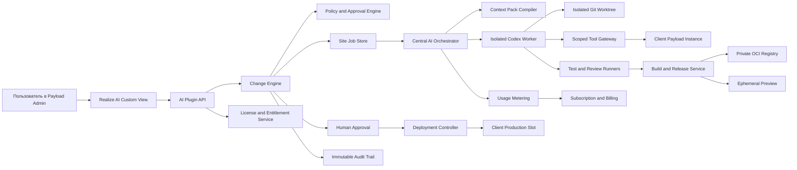

# 6. Целевая архитектура верхнего уровня

## 6.1. Плоскости системы

### A. Site Runtime Plane

Отдельный для каждого клиента:

- Next.js/Payload app;
- PostgreSQL;
- media storage;
- plugin collections;
- site-local audit references;
- client-facing admin;
- безопасный tool endpoint;
- deployment slot metadata.

### B. AI Control Plane

Общий сервис агентства:

- job routing;
- Context Pack compilation;
- Codex thread management;
- streaming event normalization;
- budgets;
- run cancellation;
- retry policy;
- worker isolation;
- model usage collection.

### C. Build and Release Plane

- repository checkout;
- worktree creation;
- dependency cache;
- test runners;
- DB clone/migration validation;
- image build;
- SBOM;
- image signing;
- private registry;
- preview deployment;
- production rollout.

### D. Commercial Control Plane

- customers;
- installations;
- licenses;
- subscriptions;
- plans;
- entitlements;
- usage ledger;
- invoices/credits;
- release channels;
- agency operator access.

## 6.2. Граница доверия

Модель является недоверенным планировщиком и генератором предложений.

Доверенными являются:

- authenticated user identity;
- server-side installation context;
- policy engine;
- state machine;
- tool executors;
- approval verifier;
- artifact digest verifier;
- deployment controller;
- license signature verifier.

---

